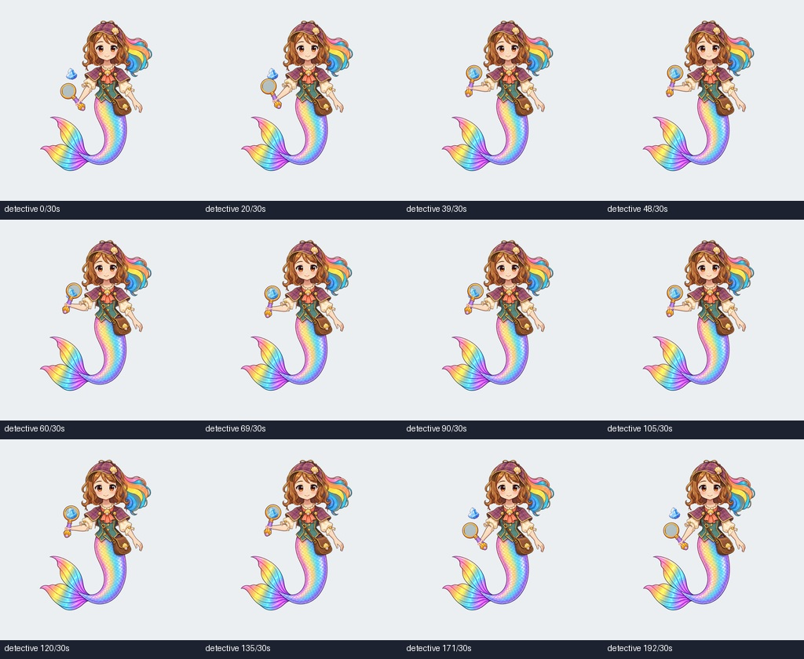
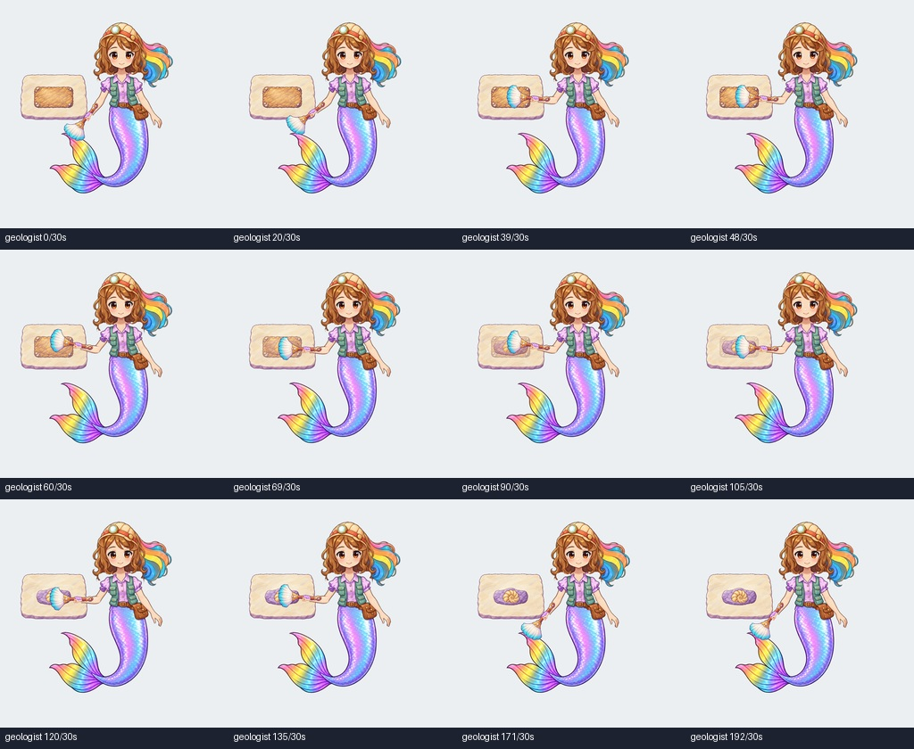

# Detective and geologist native outfit prototypes

Source-only investigation workstream commissioned October 31, 2026. The demo
freeze remains in force. These files do not replace the production character,
change a game, close a master finding, or authorize integration into dev/master.

Current status: **SOURCE-ONLY REVIEW DRAFT / CANDIDATE v6**. v6 fixes a
legacy-fin regression in v4:270 native samples over all27 legacy outfits now
match the immutable v8 seed exactly. All968 complete detective/geologist action
and regression frames remain pixel-identical to v4. v5's bounded paint repair
was rejected for worsening mixed fit65to80. Current strict contour checks still
fail, and65/250 mixed snapshots fail (47 include a new job part). The
shared contract remains unpublished. All82 trusted probes have passing evidence
after isolated reruns, with original failures retained. Publication state is in
`evidence/publication_receipt.json`. Compatible wardrobe and delivery acceptance
remain blocked; no dev/master integration.

Diagnostic boards (source study, including unresolved poses):

## Open and inspect

Run the isolated `demo/project.godot` with exactly Godot 4.7.2-stable and the
Mobile renderer. The project contains its own source textures and scripts; it
does not load the game or a save. D selects detective and G selects geologist.
4 plays the work phrase; 1–3 select the original arm, blink and tail regressions.
Space pauses. The source bindings expose independent head/body/tail slots through set_parts and equip_catalog_ids; H/J/K retain the seed legacy-slot cycle.

The detective sweeps the existing painted magnifier across an existing blue
specimen as a provisional crown-jewel examination target. The current detective
script names a crown jewel, but this is not a replacement for its live room
glints or case-board tokens. Its glass has a declared local alpha derivative so the clue remains visible.
The geologist uses the actual geology game's painted brush on its fixed painted
fossil/slab, with soil clearing during the measured contact interval. Objects
remain in the work hand; neither phrase depicts a pickup or a release.

These are front-view planar actions. Wrist/arm rotation stays in the picture
plane. They do not provide a body-facing turn or accept a frontal tool stretched
into profile. A generated alternate grip source is retained but unbound; its
rightmost wrist is clipped and it is not accepted perspective authority.

## Source and binding authority

`source_inventory.json` records the approved job sheets, Fashion Designer seed,
actual live object paths, hashes and the named reuse gaps. Geologist cells 0/1
are excluded as full-tail authority because they omit the complete fin. The
complete job-sheet pose and the complete approved seed tail supply that reference.

The frozen render_v8 seed is copied provisionally from the parent workstream.
Commit 26bd6d1f is the owner-rejected overlay predecessor and is not the baseline
for these garments. The corrected seed at b700b846d1d2f4b1843279f268e2bb12e4b1f4ec now has all29
frozen payload files anonymously hash-verified in `evidence/dependency_publication.json`.

The sole shared-skeleton owner supplies `contract/rig_v1.json`, version 1.0.0.
Its semantic bone IDs, rest, units and grip socket are pinned by SHA-256 in the
packet. The original fourteen bones, common vertices, original weights and
`arm_bend`, `blink`, `tail_bend` curves are preserved. New garments have their own
mesh bindings to those same bones. Their silhouettes are not constrained by old
clothes alpha. No independent skeleton, 3D asset or production fallback is added.

Old clothing is absent from the replacement anatomy. Each new outfit supplies
complete RGBA head/body/tail parts and a sleeve attachment. The original tail's
complete fin is restored only when the original tail slot is explicitly selected.
The cap and sleeve use stable Head/LeftUpper rest transforms. The original open
hand remains in regression actions; a derived wrist and painted closed grip are
used during object work. Tool body is behind the fingers, and the actual surface
is behind the tool. Binding JSONs declare exact grips, contact points, scale,
view, support and retained ownership.

## Inspect the evidence by lane

- **Implementation:** runnable native demo, source JSON bindings, editable
  `masters/*_binding.aseprite`, untouched generated natives and executable
  Aseprite derivation scripts. `seed_preservation.json` checks the shared seed.
- **Machine evidence:** actual Mobile RGBA frames, per-frame bone/contact
  telemetry, strict geometry/motion reports, all 125 slot choices at rest and
  arm extreme, fresh/live comparisons, 19,500 swaps, original restoration and
  retained grip/fixture/identity/old-underlay/source-poison controls.
- **Review:** silent landscape movies and light-background contact boards are
  diagnostic. Exact native frame archives and their index are the pixel authority.
  Full-speed and frame-step model observations belong in `visual_review.json`.
- **Acceptance:** natural hand shape/contact, cloth seams and changing outlines
  require exact human/owner review. Device, child and production acceptance are
  pending. A numerical pass grants none of those claims.

The first binding candidate is retained as rejected evidence. Its old mesh weights
distorted newly visible garment areas; its work acceleration exceeded 650°/s²;
some mixed outfits failed continuity despite perfect state equality. New garment
weights and a gentler work envelope address those specific causes. All previous
floors remain 0.80–1.20 visible strain, zero flips, 140°/s speed, 650°/s²
acceleration, three native pixels of grip error and the existing eight-pixel
raster-hole allowance. Reports preserve failures rather than averaging them away.

APNG export was tested and rejected when decoded alpha differed from source PNGs.
Native-frame ZIP archives preserve literal PNG bytes, hashes and chronological
indices instead. Review MP4s are uniformly scaled diagnostic derivatives.

## Compatibility and remaining dependencies

The shared contract's first freeze defines a waist socket, but complete
interchangeable wardrobe signoff additionally needs its common join ownership
and exact per-mix outline/component/contact checks. The inherited ballet/magician
waist gaps remain relevant. Local deterministic equality never accepts them.
Do not restore original clothing underneath a replacement to cover a gap.

`ARCHIVE_COMPLETE`, `GENERATION_READY` and `DELIVERY_ACCEPTED` are separate claims.
This local prototype does not authorize a generator job or accept delivery.
Publication status and remote byte/access receipts are explicit JSON evidence.

## Master-audit guidance

Read the master planning/task index, current design ledger and animation protocol
before reuse. This work relates to MA-ROSHAN-005/006 as source evidence only;
their production defects and lifecycle are unchanged. The impact record is
`design/audit_impacts/roshan-job-rig-investigation-20261101.json` at repository
root. Keep the source-only rig permission separate from DL-MED-02's accepted
runtime representation and the existing whole-sprite owner rules.

To reproduce sources, run the Aseprite scripts in this order: register_garments,
grip_parts, repair_parts, repair_seam, legacy_fin_layers, final_masters. Build garment weights with
`tools/build_bindings.py`. Native capture scripts are `demo/capture.gd`,
`demo/fresh_capture.gd` and `demo/source_controls.gd`. Analysis and packaging
preserve their exact inputs, floors and failed controls. Do not overwrite prior
candidate frames or their audit reports when iterating.

`tools/legacy_reference.py` compares all27 legacy outfits at ten authored arm,
blink and tail times with a disposable immutable-v8 actor. Only resource URLs
are relocated; the reference shader/rest/weights/curves are unchanged. The270
reference images are in the legacy_seed_preservation ZIPs. New job-only outputs
are independently compared against v4. These sampled equalities preserve
behavior; they do not prove continuous fit or artistic acceptance. CHG-126
records benefits, risks, exact publication binding and rollback scope.

Extract each ZIP into its own folder. Clip chunks use numeric filenames and
each archive has its own frame_index.json; unpacking different clips into one
folder would overwrite filenames. Keep the archives intact as byte authority.
