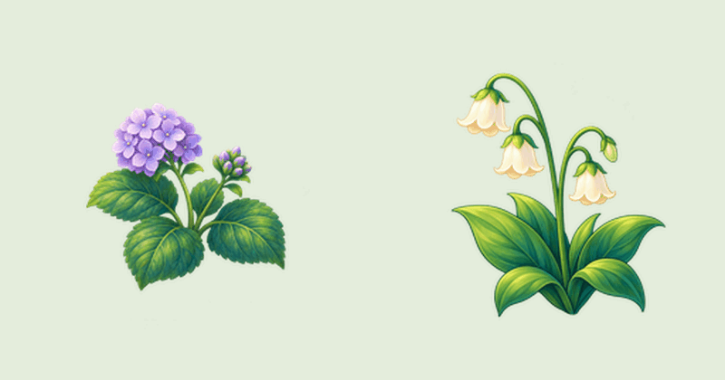
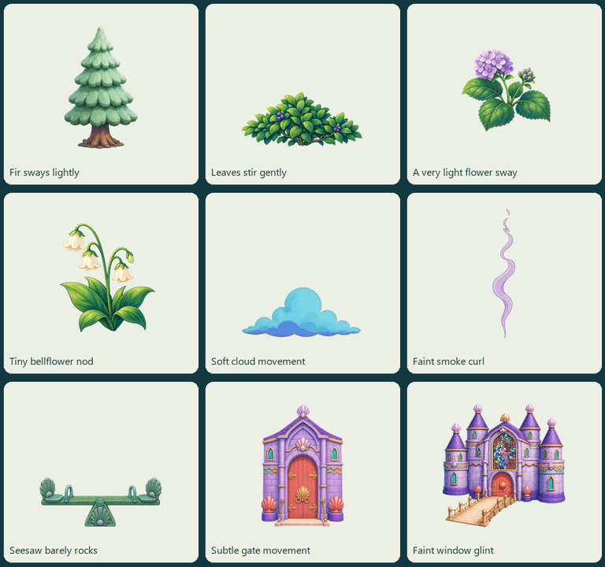
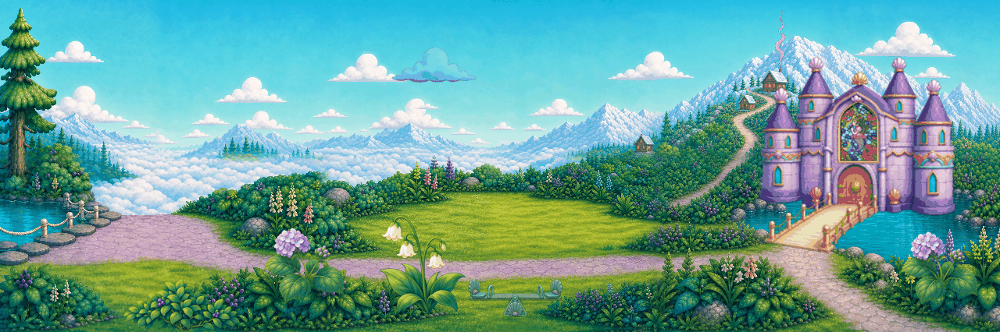

# Sky Lagoon moving-item correction

Owner correction, November 5, 2026. The earlier scrolling preview failed to demonstrate the requested item animation. It remains rejected evidence in its original packet and commit. This revision has a fixed camera throughout. Revision2 fixes an agent-found window-glint seam reset with a cyclic fade; the flower motion is unchanged. The original published manifest is preserved as `prior_manifest_v1.json` and the original pixels/masters remain at immutable source revision `76eb6da3`.

Open `flowers-closeup.gif` to see the original hydrangea and bellflower bend from fixed bases. `individual-items.gif` shows nine new source-still loops. `fixed-camera-items.gif` is an illustrative stationary lagoon composition. The actual Mobile-renderer captures are `fixed-camera-engine.gif` and `sky-lagoon-fixed.mp4`.

The isolated Godot 4.7.2 project is `demo_project/project.godot`. It opens with no automatic scrolling. **Show still / Show breeze** compares the same items in place. **See each item / See the lagoon** switches between the object board and fixed world view. A tap restarts the breeze. No production-game route, save or character atlas changes.

## Reused art and method

Every item starts from an existing identity still listed, hashed and copied in `derivation.json` and `sources/`. No new item design, new generated artwork or old rejected animation frame was used. Existing garden separations remain review-only sources, not accepted runtime art. New loops are declared local 2D source-pixel deformation and layer articulation, with premultiplied-alpha sampling. Plants bend at fixed support bands; the seesaw beam moves behind a fixed pedestal; the two door leaves hinge independently; smoke/cloud shapes vary locally and the castle window catches a moving light band. Native source paint is not regenerated.

Each action has a job card under `jobs/`. Nine Aseprite 1.3.18.4 masters preserve forty complete RGBA cels at 100 ms each. Runtime samples the same cels from legal power-of-two 2048-square lossless atlases. GIFs are preview conveniences only; palette limits and binary transparency make them unsuitable as the painted runtime asset format. Backgrounds remain twelve byte-identical 1024-square source tiles. Fixed foreground staging is illustrative, with overlap and production socket acceptance still open.

Rebuild source loops using `python -B build_items.py` from this packet. Import editable masters with Aseprite batch `--script-param packet=<absolute-packet-path> --script build_masters.lua`; use `verify_masters.lua` for full-canvas exports, then compare them to the per-frame hashes. The explicitly disabled Godot alpha-border recoloring preserves authored edge colors. Verify actual engine frames using `-- --verify`; capture the fixed view using `-- --capture-fixed`.

## Named gaps

- The swing is **not animated**. Its existing still cannot supply the accepted changing front/back seat surfaces required for a truthful fore-and-aft swing. No lateral wobble is substituted. It is retained only as a bound source and gap card.
- The door trial exposes a flat dark interior. A painted interior is a source gap; no invented room art is claimed.
- The fir loop is shown only on the object board. The existing mountain-path exclusion remains in force.
- Character acting, Roshan waving, foreground actor occlusion, production lifecycle, phone performance, child and owner acceptance are not established by this demo.

## Evidence and status

`evidence/mobile-verification.json` records actual Godot 4.7.2 Mobile playback, all 360 imported cels checked, exact periodic endpoint and zero camera movement. `evidence/aseprite-verification.json` records all 360 master-export RGBA comparisons. Original failed import diagnostics are retained separately. Per-frame source/derivative hashes and task limits are in the derivation and job cards. `python -B verify_items.py --production-base 80975b0051f6a5be29b0680e8b84e15f30d3c316` also checks all forty actual engine frames and 626,104 background pixels per frame, with zero changed background pixels. Revision2 adds a <=2-code rest-adjacent window-glint seam gate; endpoint equality alone had missed the earlier hard reset. The nine atlases use 144 MiB base RGBA plus 48 MiB native background RGBA; actual GPU/device memory, overdraw and frame-time acceptance remain unmeasured. This desktop trial is not a phone-ready asset budget. Human full-speed/frame-step identity and motion review, target-device playback and owner acceptance remain pending. No master finding changes lifecycle.

The prior topic head `5003d421b0de8771a59eafdcb2aadffd818a7246` passed the complete project GitHub Probe gate in run `41998350733`. This correction changes only the ignored isolated source demo and its audit/docs/license records, leaving that production runtime and its existing verification evidence unchanged. Fresh topic CI is tracked in PR 45. The temporary integration hold is released. Reconciliation preserves tested shared dev80975b00; exact combined-head checks are required before integration. One combined push run failed the existing two-position aquarium/turtle assertion while the parallel run passed the trusted checks. The failure log is preserved as `evidence/ci-42066798727-attempt1.log`; no aquarium behavior, test, classifier or threshold is changed here.

`ARCHIVE_COMPLETE` requires the exact published manifest and all payload hashes to verify. `GENERATION_READY` is not applicable: no external generation is requested. `DELIVERY_ACCEPTED`, main-game integration, owner, device and child acceptance remain false/pending. Publication is a review delivery, not creative approval.
