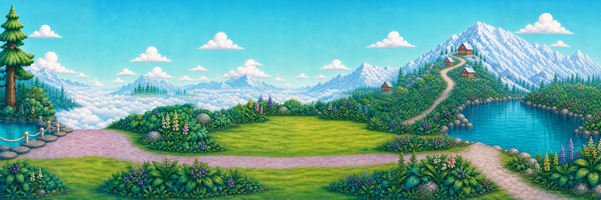
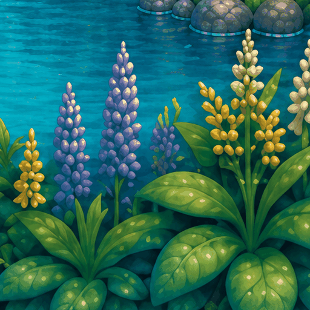
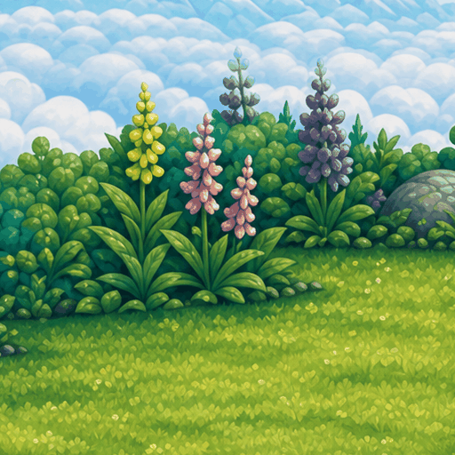
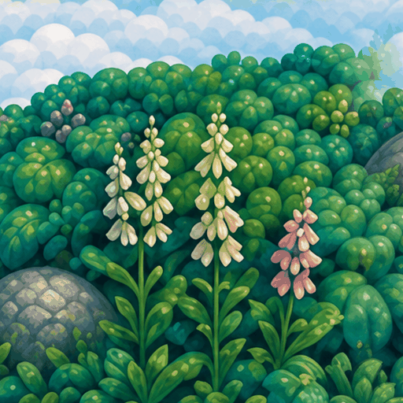

# Sky Lagoon original painting breeze review

This replacement animates flowers already painted into the approved Sky Lagoon v5 panorama. The owner rejected the previous added-object round: separate hydrangea, bellflower, huckleberry and other props were placed over the scene. Those objects are absent here. Their historical packet remains rejection evidence; PR 46 is closed.

The camera stays fixed. Three original flower groups receive a small rooted bend over a two-second loop: lakeside purple spikes, meadow-border pink/yellow/purple spikes, and the cream/pink arrival flowers. The measured tip excursion is about 1.3–1.9 native pixels, with zero vertical translation, rigid rotation or scaling. The overview renders that excursion below one display pixel.

[All three flower close-ups](original-flowers-closeup.gif) · [Fixed panorama animation](original-lagoon-fixed.gif) · [Frame-step sheet](evidence/frame-step.png)

## Source and construction

The only appearance input is `assets_src/sky_lagoon/masters/sky_lagoon_panorama_master_v5_hd_3x1.png`,6144×2048, SHA 256 `017532ae864e534d9b356472e2e29150855ede6583a7f63f02f0401d28c7be41`. The master and existing runtime tiles remain untouched.

This is an **in-place painting deformation**, not a true depth split or an extracted foreground alpha layer. Three complete 512-square windows retain their original coordinates and context. Hand-bounded flower selections and authored stems produce rooted displacement fields. A narrow collar around the existing contour is resampled with it. All pixels outside that field stay fixed. No background is invented or independently redrawn.

A derivative background clears each window interior; the complete animated context replaces it once. A one-native-pixel boundary underlap prevents bilinear-filter seams and contains no moving flower. No frozen duplicate flower remains exposed. Source crops, field-review images, complete-frame Aseprite masters and per-action job cards retain the derivation.

Read the [painted layer survey](SOURCE_LAYER_SURVEY.md), [GIF limits and output specifications](GIF_OUTPUT_SPEC.md), [manifest](manifest.json), and [machine evidence](evidence/machine-verification.json).

## Playback and editable files

Open `demo_project/project.godot` with the approved Godot 4.7.2-stable Mobile renderer. It reconstructs the native 6144×2048 painting from twelve 1024-square derivative tiles. A compact Canvas shader samples the same authored fields at 30 steps per second, avoiding 60 full GPU textures per flower. Space pauses, A compares the original pose with the breeze, C opens the flower close-up, and Escape closes this standalone review.

Each GIF contains 60 timed frames totaling 2000 ms. GIF delays alternate 30, 30, 40 ms; the mean cadence is 30 fps. The editable Aseprite masters use 33, 33, 34 ms durations. Each action has 59 distinct RGB images because the same source pose occurs at both crossings of the breeze cycle; no extra holds were added. The GIF palette reduces distinct decoded images to 58/57/58, as recorded in the independent verifier. PNG frames are reproducible with `build_original.py` and masters/round-trip exports with `build_masters.lua`.

The GIF is a review export. Native source sampling, rather than palette-limited GIF pixels, supplies engine playback. The approximate additional source/field image storage is 3.75 MiB before engine format expansion; actual target-device GPU memory and timing remain unmeasured.

## Evidence and acceptance

CPU checks prove exact native rest reconstruction, unchanged source SHA, fixed roots/scenery and analytic loop endpoints. Native desktop Mobile captures and import comparisons are separate evidence. The first render's 133-pixel edge seam is retained in `evidence/rejected-render-seam.json`; it was repaired before this candidate.

This is a source-only standalone review. The owner's 2026-11-03 correction permits normal completed, probes-green integration into dev; source archive integration does not adopt the animation in main-game routes. It changes no main-game routes, save data, controls or protected originals. `ARCHIVE_COMPLETE` requires exact remote verification; `GENERATION_READY` is not applicable to this local workflow; `DELIVERY_ACCEPTED`, production adoption, human normal-speed/frame-step, device, child and owner acceptance remain pending. No master-audit finding is closed.
