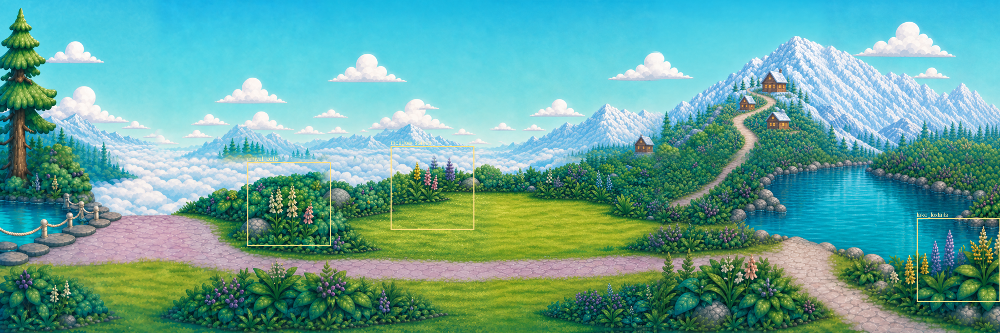

# Sky Lagoon painted layers and animation targets

The approved v5 source is a flattened 6144×2048 painting. Its twelve runtime tiles are a spatial grid, not twelve independent depth layers. The current game additionally stages eight Canvas groups, so its node hierarchy must not be mistaken for painted-source separation.

## Features already in the painting

Coordinates below use the unchanged native master, with the origin at its upper left. These are visual regions, not pre-existing separated alpha files.

| Painted region | Native area | Motion suitability and treatment |
|---|---|---|
| Sky and discrete white clouds | Upper sky, mostly y<780 | Slow cloud deformation/drift is a later candidate. It needs separate exact cloud ownership and background repair for larger movement. Held fixed here. |
| Distant mountains and cloud sea | Roughly x 480–3450,y 780–1300 | Cloud motion could be very slow; mountain contours must stay locked. Held fixed. |
| Left fir and shrubs | Fir x 0–360,y 50–1100 | Outer bough tips could respond to wind while trunk stays fixed. Dense overlapping branches need a dedicated authored mask. Held fixed. |
| Cabins and mountain path | x 3700–6144,y 150–950 | Buildings, roofs and rock contacts stay fixed. Added chimney smoke is excluded because it would introduce new pixels rather than animate a visible painted wisp. |
| Left pond and right lake | Left x 0–420,y 1150–1430; right x 4560–6144,y 1000–1580 | A later water study can resample existing highlights inside the water, with a locked shoreline. No fish or invented ripples added. Held fixed. |
| Lawn, paths, rocks and rope rail | Across the lower half | Fixed structural layer. No global scene warp, camera pan or grass sliding. |
| Lakeside purple foxtail-like spikes | Review window x 5632–6144,y 1344–1856 | Implemented. The existing purple spikes and stems bend about 1.91 px maximum; nearby yellow plants remain fixed. Species naming is descriptive, not a botanical identification. |
| Meadow border flower cluster | Review window x 2400–2912,y 900–1412 | Implemented. Existing yellow, pink and purple spikes bend about 1.32 px maximum with lower roots fixed. |
| Cream and pink arrival flowers | Review window x 1520–2032,y 1000–1512 | Implemented. Existing spikes bend about 1.40 px maximum. Path, rocks and surrounding shrub composition stay fixed. |
| Foreground leaf and flower beds | Bottom-left, lower centre and right edge | Existing candidates for later individual rooted leaf studies. No separate hydrangea or replacement plant from another design is included. |

The implemented 512-square windows are complete context replacements at their original positions. Only the small authored field and its contour collar move. They do not become genuine depth layers, so this study does not claim the earlier handoff's G 2 parallax split is complete.

## Existing game layers and characters

`scripts/arena/sky_lagoon_promenade.gd` already groups the scene into base, rear geography, rear atmosphere, landmarks, interactive objects, actors, foreground geography and foreground lighting. That hierarchy includes runtime cards beyond the original painting. This review uses the original painting alone; it does not import those extra cards as decoration.

No Roshan, family member or clearly identifiable animal character is visible in the approved panorama. Existing game actors are separate source families: Roshan's approved RGBA atlas, plus the otter, frog, hare, squirrel and raccoon idle/startle atlases declared in the promenade. They are valid subjects for later authored acting studies with their own movement, contact and identity contracts. They are not painted flowers and are not added to this demonstration. The original painting provides no mermaid-wave frames; a wave cannot be established by wobbling a still.

## Source selection rule

Every appearance input in this candidate must resolve to an exact crop of the approved v5 master. `verify_original.py` checks that requirement and the reconstructed rest image. The visual review must also check individual stalk continuity and the quietness of the complete loop; hashes and pixel checks alone cannot accept the performance.

## Production integration sequence

Review the three quiet loops at normal scene scale and close-up before choosing any runtime candidate. Preserve the selected original coordinates, root masks and fixed fixtures; keep the added-object round excluded. Bind selected fields to the existing Canvas stage and cull them with their source tiles. Do not animate Roshan or animals through these foliage fields.

Measure the Mobile/Speedy result on the target device: sustained 30 fps, load/hitch time, decoded and GPU memory, and transparent overdraw. Test pause, departure, re-entry and repeated scene visits against the existing state owners. Run the exact-engine, atlas/import and shared regression gates. Record human, device, child and owner outcomes separately. A larger foreground/parallax separation still needs a genuine same-source layer extraction and repaired background, as specified by the earlier G2 handoff; this in-place study does not supply it.
