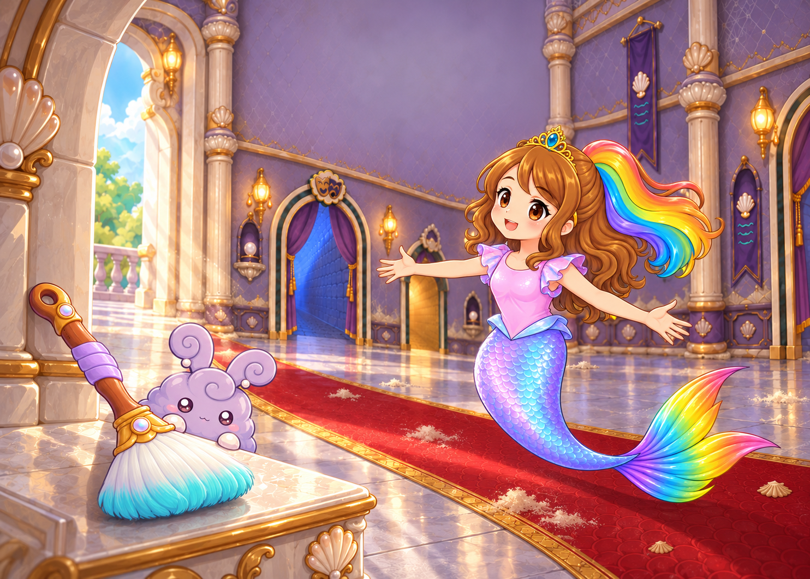

# New Pearl Castle back-cover composition

Status: `SUPPORTING_CURRENT`; owner-requested review candidate, 2026-10-21.

The owner rejected reusing an interior page for the back cover and explicitly requested a new scene using existing Day One castle materials. This scoped direction supersedes the old rear-A staging for this proposal. The pearl arch, lavender-and-gold hall, red runner, cleaning brush, Roshan and little lavender bunny come from four recorded project references, newly arranged in a diagonal composition. This is a reference-led new rendering, not a claim of exact source-pixel reuse.

[Exact request and prompt](request.json) · [Reference hashes, generation and visual review](generation_evidence.json) · [Manifest](manifest.json) · [Remote receipt](remote_verification.json).

One native take,1484x1060. No added text or raster upscale. Roshan is larger and her ponytail brighter than the prompt target; owner review and print-resolution work remain open. The previous V36 PDF and all32 interiors remain preserved. This file is the proposed replacement back-cover artwork, not an already-updated full-book PDF.
