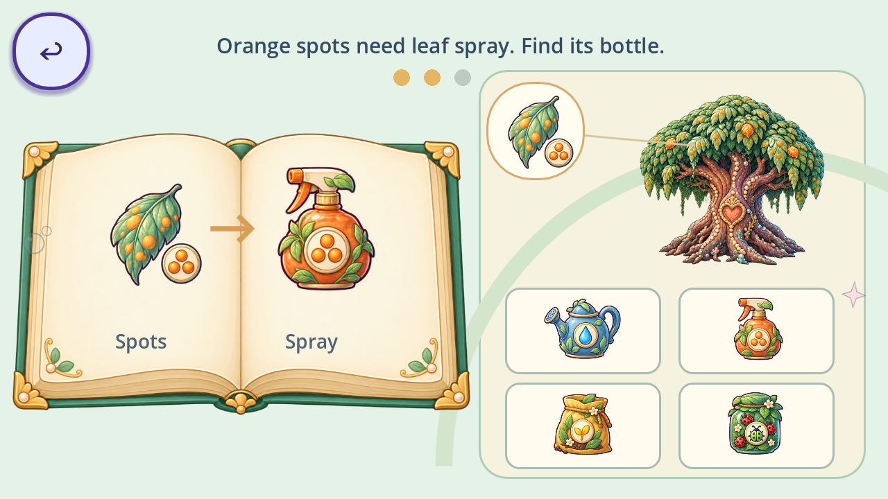
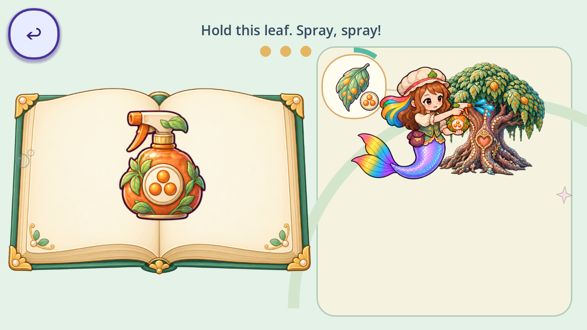
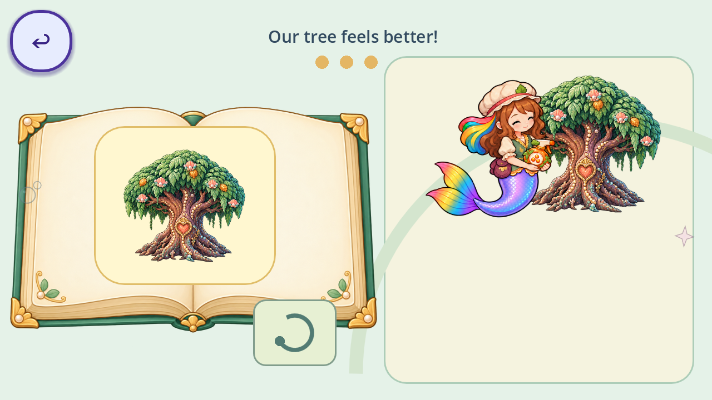

# Opera House Tree Book test level

Status: implemented test activity; owner, child and Android acceptance pending.
This is one orange-spotted pearl-heart patient, outside the stable career/star namespace.
It does not integrate the Arborist into Day Two or place Candy Maker in the Kitchen.

## Enter and play

In the Opera House, tap the illustrated tree book on the lower-right foyer floor.
For a focused desktop review, run Godot 4.7.2 with
`--path . scenes/arborist_tree_book_test.tscn`.
The standalone scene quits on Back; the in-game entrance returns to the Opera House.

1. Match the patient tree to one of four pictures in the left book.
2. Match its diseased leaf to one of four leaf pictures.
3. Read the picture equation: orange spots → orange-spotted spray bottle.
   Select one of four medicines on the right.
4. Roshan carries the bottle toward the patient. The book gives way to a large treatment view. Hold the spotted leaves on the tree to spray; the nozzle and droplets meet that canopy. Releasing or leaving the canopy stops both spraying and healing, keeping the earned dose.
5. The visible 1.6-second dose fills only while spraying. At completion, the same patient changes from orange spots to healthy leaves and flowers. Roshan settles with the bottle; the circular arrow repeats practice.

Exact generated Roshan cues accompany each page, plus two gentle wrong-choice cues.
Five idle seconds highlight the answer; ten show a moving hand. Neither makes a choice.
A second finger, canceled tap, focus loss, pause or an old held press cannot answer.
The additive `arborist_tree_book_test` save contains schema, patient, step and partial treatment.
It leaves career stars and chapter masks alone.

## Artwork and motion

Book, patient pair, leaves, medicines and reading pose reuse the [published packet](ARBORIST_TREE_BOOK_HANDOFF_2026-09-29.md).
Only the missing carry/aim/spray/finish action was generated for this test.
Native images, rejected candidates, prompts, hashes, measured atlas regions and logical
padding are in `assets_src/imagegen/arborist_test_20260930/PROVENANCE.json`.
Runtime PNGs use lossless imports and at most 1024 pixels on the longest side.
The action remains a Canvas game interaction, not cinematic delivery.

The test deliberately has four choices throughout. It follows Teacher's intentional
press/release and kind-help behavior but owns its separate book geometry and case state;
it does not claim to use the adaptive maths lesson generator.

## Evidence and remaining acceptance

[Audit impact](audit_impacts/opera-tree-book-test-20260930.json) records the exact baseline and gates.
`probe_tree_book_test.gd` exercises the state/input contract.
The trusted `probe_opera_2d.gd` also runs the shared checks with a real ReefMain and Opera House venue,
including enter, saved exit, reentry, teardown and unchanged stars.
Desktop Mobile-renderer captures cover the six states and foyer entrance.

Still required: phone/tablet touch feel, child comprehension, owner artwork and voice review.
The legacy project font authority remains unresolved; the test uses the existing StorybookUI role.
Tree-card distractors include two recovered low-resolution reference drawings; their background treatment
still needs art direction before this becomes a shipping career. Three patient cases, species-specific
diseased leaf variants, and Day Two integration remain future work.
No MA finding is closed by this prototype.

## Review images

Reproduce controlled composition captures with `--rendering-method mobile --script tools/capture_tree_book_test.gd`; use isolated APPDATA/LOCALAPPDATA for review.

Final focused validation: 49 standalone and 56 integrated checks pass. The full local run passed its static/import gates and 76 of 77 trusted probe executions; `probe_load` exited 127 without an assertion failure and passed an isolated rerun (exit 0). See [verification receipt](../assets_src/review/tree_book_test_20260930/VERIFICATION.json). A clean remote CI run is still required before integration.

## Spraying comprehension repair — 2026-10-15

The treatment view now shares one canopy region for touch, a moving hand, spray contact
and progress. A press begun elsewhere cannot start spraying by dragging into the tree.
The enlarged actor keeps the original measured atlas/padding and carry/aim/spray/finish
poses, with measured lower-fin registration to prevent a vertical jump. The patient uses
its authored sick/healthy endpoints; an initial alpha-blend trial was rejected for trunk ghosting. The original PNG and OGG bytes are reused unchanged. The existing spoken instruction
("Hold this leaf. Spray, spray!") accompanies the canopy cue; the adult caption names the leaves.
Version-1 stage and partial-dose checkpoints keep their existing meanings.

[Scoped impact](audit_impacts/arborist-spray-20261015.json) separates implementation,
focused/full regression evidence and remaining device/child/owner acceptance.
Reproduce the new treatment and wide-touch captures with
`--rendering-method mobile --script tools/capture_arborist_spray.gd` and disposable user data.
The older review images and counts above describe the September 30 build only.

October 15 machine verification:57 focused and64 integrated Tree Book checks pass;
the full unchanged local suite completes82/82 ordered trusted probes with zero exits
and no trusted failure markers. [Exact source/log/capture receipt](../assets_src/review/arborist_spray_20261015/VERIFICATION.json).
Published-head CI is tracked separately from these local results.
