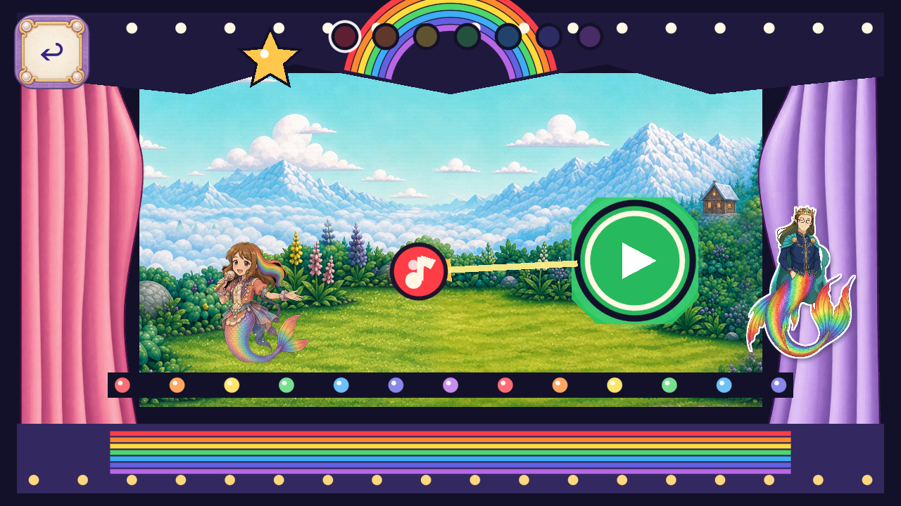

# R120 painted Melody theatre curtains

The owner resumed **art candidates and kept Dev frozen**. Two painted curtain assets replace the pink and lavender polygon curtains on their own work branch. The stage opening, actors, note interaction, saves and original texture-memory limits remain unchanged. This is one bounded implementation for two existing named art roles.

[Source packet and before/after images](https://github.com/Ebonyks/mermaid-roshan-reef/blob/0e8095e656aaae795076b98b202cc453c3234e06/docs/handoffs/codex_flat_vector_art_2026-10-07/r120_melody_curtains_runtime/README.md) · [Immutable source tree](https://github.com/Ebonyks/mermaid-roshan-reef/tree/0e8095e656aaae795076b98b202cc453c3234e06) · [Source manifest](https://github.com/Ebonyks/mermaid-roshan-reef/blob/0e8095e656aaae795076b98b202cc453c3234e06/docs/handoffs/codex_flat_vector_art_2026-10-07/r120_melody_curtains_runtime/MANIFEST.json) · [Anonymous source verification](SOURCE_REMOTE_VERIFICATION.json).

All 82 current trusted probes, the complete static prefix, real Godot analyzer and 2D regression guard pass with exact Godot 4.7.2. Native Mobile/Speedy checks cover 1280×720, 1600×720 and 1280×800: 69 source and 96 candidate executed checks. All 12 effective before/after stills were inspected. Six initial title-occluded captures and 54 fixture checks remain excluded. [Local result](LOCAL_82_RESULT.json), [ten-axis qualified role comparison](FRAME_REVIEW.json), [production/evidence lanes](PRODUCTION.json), [owner scope](OWNER_RESUME.json).

Two built-in ImageGen calls produced preserved native RGBA originals, editable Aseprite masters and two whole 384×768 runtime images. Four technical exports include the two earlier 512×1024 intermediates. No model version was exposed. Animation calls: 0. The two invisible stage clips supply no artwork pixels. Other flat stage props and natural current-route coverage remain open.

The canonical registry now records 23 published source artifacts and 20 partial Dev artifacts: 6,955 bounded, 4,183 excluded and 11,138 retained native PNG events. Accepted removals and whole-role closures remain 0. Unknown game-wide denominators, formal QA11, physical device/performance, child and owner acceptance remain open. **No Dev integration or release occurred.**

R119’s already-running exact-source CI completed successfully at 634c8e4a06aae91e30e71e5a5e314c59c29570ce; [new observation](R119_EXACT_CI_SUCCESS.json). Historical pending snapshots are preserved, and no old engine suite was restarted. R120’s automatic exact-source CI is tracked separately in [SOURCE_CI_HANDLES.json](SOURCE_CI_HANDLES.json).

The original full-game check required the retired curtain polygons. Its [failure](ORIGINAL_FULL_VALIDATION_FAILURE.json) is preserved; [bounded art-contract correction](FULL_GAME_ART_CONTRACT_CORRECTION.json) and [healthy-evidence reuse](FULL_VALIDATION_RECOVERY_BASIS.json) keep every other gameplay assertion and122 audit methods unchanged. No healthy engine suite, native frame or generation was repeated.

[Delivery manifest](MANIFEST.json) · [Anonymous immutable verification receipt](REMOTE_VERIFICATION.json) · [Payload revision](PAYLOAD_PIN.json).
