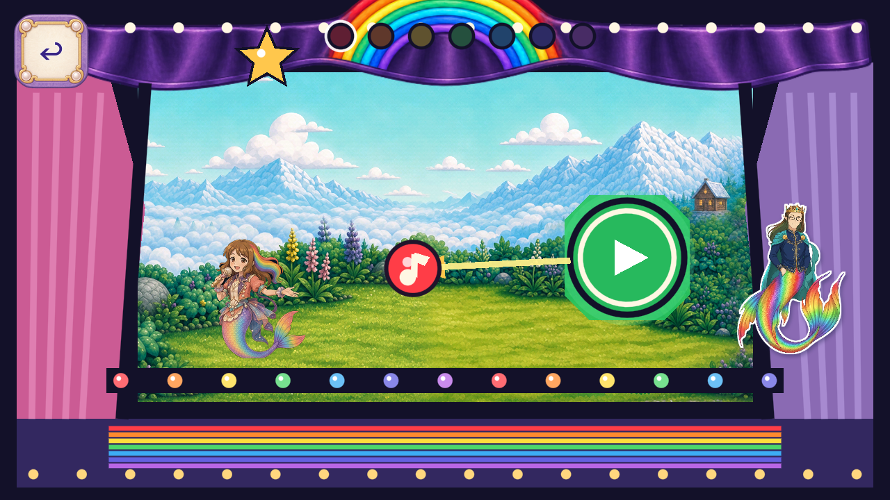

# R121 painted theatre crown header

One painted plum cloth header with its attached seven-color rainbow replaces the old header polygon and code-drawn arch on its source branch. Stable piece `FV-0671240CDB11`. Other curtain/apron/bulb/star/note/actor roles remain open. **Owner resumed art candidates; Dev remains frozen.**

[Source packet and exact before/after frames](https://github.com/Ebonyks/mermaid-roshan-reef/blob/621a098f6795d8aa2e0bd0838c2ff5e65aeb142c/docs/handoffs/codex_flat_vector_art_2026-10-07/r121_melody_header_runtime/README.md) · [Immutable source tree](https://github.com/Ebonyks/mermaid-roshan-reef/tree/621a098f6795d8aa2e0bd0838c2ff5e65aeb142c) · [Source manifest](https://github.com/Ebonyks/mermaid-roshan-reef/blob/621a098f6795d8aa2e0bd0838c2ff5e65aeb142c/docs/handoffs/codex_flat_vector_art_2026-10-07/r121_melody_header_runtime/MANIFEST.json) · [Anonymous source verification](SOURCE_REMOTE_VERIFICATION.json).

All82 current trusted probes, complete static prefix, Godot analyzer and2D no-regression guard pass at exact4.7.2. Current native Mobile/Speedy evidence is87 executed checks over1280×720,1600×720,1280×800; exact source reuse retains69 earlier executed checks. All12 source/candidate entry and deliberate-score stills were directly inspected. Six new native events are credited; six source reference frames are reused without new-event credit. The wider arch is more cropped at1600px; keep that device/owner review point explicit.

Two static built-in ImageGen calls, zero animation calls. Native RGBA originals, exact prompts/references and three editable Aseprite masters are preserved on the source branch; runtime consumes one whole bilinear1024×148 PNG. The first taller native take remains nonselected, not approved. No model version, seed or cost was exposed; no2.5 version is claimed.

Canonical totals:24 bounded published source artifacts,20 partialDev artifacts;6,961 bounded +4,183 excluded =11,144 retained native PNG events. Lower263 known roles/35 families and unknown whole-game denominators remain. Accepted removals and complete named-role closures:0. FormalQA11, physical device/performance, child, owner, natural routes and global inventory/coverage remain open. **No Dev integration, master promotion, release or automation resume occurred.**

R120's exact-source run41383041660 succeeded; [new observation](R120_EXACT_CI_SUCCESS.json) preserves its earlier pending snapshots and grants no new artwork credit. R121 exact-source CI remains separately tracked in [SOURCE_CI_HANDLES.json](SOURCE_CI_HANDLES.json).

[Current delivery manifest](MANIFEST.json) · [Anonymous immutable receipt](REMOTE_VERIFICATION.json) · [Payload revision](PAYLOAD_PIN.json). Resolve null manifest revisions against that payload revision, not a later receipt-only commit.
