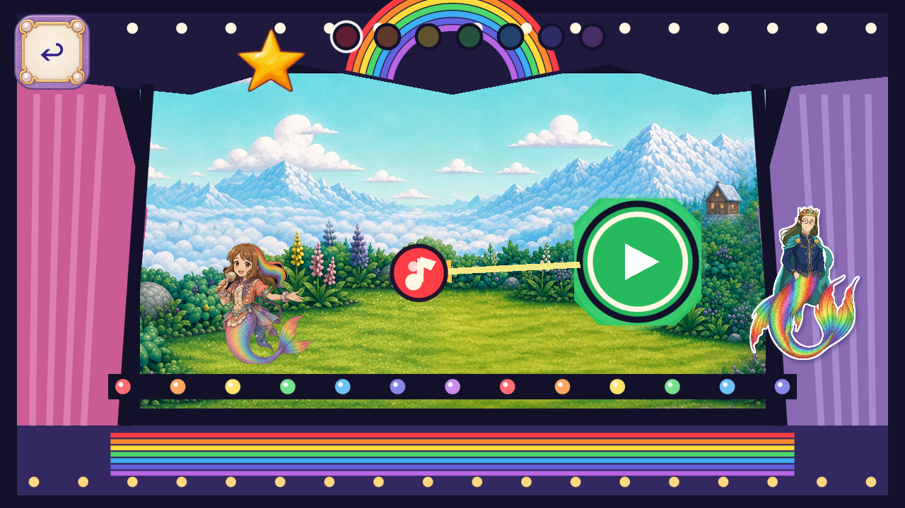

# R122 painted Melody stage star

One whole painted gold five-point star replaces the old polygon/custom-draw stage-star role on its source branch. Stable piece `FV-8E1550C50601`. Original center,104px diameter formula, z18 and noninteraction remain. Other curtain/header/apron/bulb/note/actor roles remain open. **Owner resumed art candidates; Dev remains frozen.**

[Source packet and exact before/after frames](https://github.com/Ebonyks/mermaid-roshan-reef/blob/877fb264778f59b6f1d1602fd8af4f73970351be/docs/handoffs/codex_flat_vector_art_2026-10-07/r122_melody_star_runtime/README.md) · [Immutable source tree](https://github.com/Ebonyks/mermaid-roshan-reef/tree/877fb264778f59b6f1d1602fd8af4f73970351be) · [Source manifest](https://github.com/Ebonyks/mermaid-roshan-reef/blob/877fb264778f59b6f1d1602fd8af4f73970351be/docs/handoffs/codex_flat_vector_art_2026-10-07/r122_melody_star_runtime/MANIFEST.json) · [Anonymous source verification](SOURCE_REMOTE_VERIFICATION.json).

All82 current trusted probes, complete static set, exact4.7.2 analyzer and2D no-regression guard pass. Current native Mobile/Speedy evidence has90 effective checks across1280×720,1600×720,1280×800 plus69 reused exact-source checks. Six candidate stills are directly inspected against the same six previously inspected source stills; source context is verified raw-exact. A0.000023px tall-screen arithmetic mismatch failed an exact-float fixture check; its original failure and two images remain excluded. Only that assertion was corrected to0.0001px arithmetic tolerance, and only the failed tall case was recaptured. Artwork, game/probe source, uniform scaling and all quality/resource floors were unchanged.

One built-in static ImageGen take, zero animation calls. The original1254-square RGBA, exact prompt/role bindings, pixel-exact editable Aseprite master/roundtrip and runtime master are preserved on the source branch. Runtime consumes one whole bilinear256-square PNG. No model version, seed or cost was exposed; no2.5 claim is made. One take remains unused in this item's cap2.

Canonical totals:25 bounded published source artifacts,20 partialDev artifacts;6,967 bounded +4,185 excluded =11,152 retained native PNG events. Lower263 known roles/35 families and unknown whole-game denominators remain. Accepted removals and complete named-role closures:0. FormalQA11, physical device/performance, child, owner, natural routes and global inventory/coverage remain open. **No Dev integration, master promotion, release or automation resume occurred.**

R121's exact-source run41404127761 succeeded; [new verified observation](R121_EXACT_CI_SUCCESS.json) preserves its earlier pending snapshots and grants no new artwork credit. R122 exact-source CI remains separately tracked in [SOURCE_CI_HANDLES.json](SOURCE_CI_HANDLES.json).

[Current delivery manifest](MANIFEST.json) · [Anonymous immutable receipt](REMOTE_VERIFICATION.json) · [Payload revision](PAYLOAD_PIN.json). Resolve null manifest revisions against the payload revision, not the later receipt-only commit.
