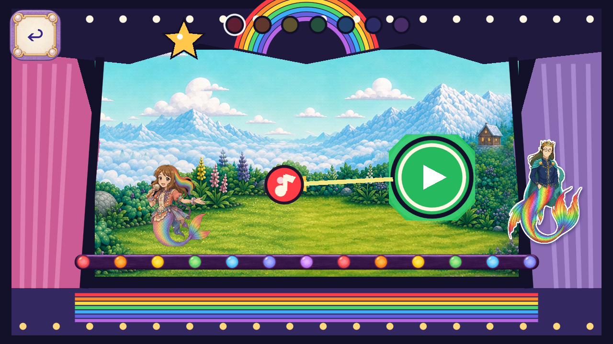

# R123 — Painted Melody rainbow light rail

Owner scope: **Resume art candidates; keep Dev frozen**. Existing piece `FV-864287E0D0F3` (Rainbow note rail), runtime `StageFootlights / FootlightsCanvas`, baseline `27c88288bf6e39582072811443df79919e7bbb89`, branch `codex/flat-vector-melody-footlights-20261102`.

The flat navy line and13 nested code-drawn circle/glint groups become one painted plum support and thirteen whole painted globes, reusing seven authored color sources in the original order. Original parent position/size/z16, all thirteen centers,30px globe diameter and36px rail height remain. The support retains the original visible segment from x18 to width-minus18. Bounded nine-slice display preserves18px painted end contours while only the straight middle changes length. Globes have no frame crop, tint, flip, relight or deformation. Controllers, targets, actors, voices, saves and every other theatre role are unchanged.

Two built-in ImageGen calls produce a seven-color globe atlas and one rail native. Original PNGs, exact prompts/role bindings, pixel-exact editable native/crop masters and uniform bilinear exports are retained under `assets_src/imagegen/melody_footlights_20261102/`. Runtime uses seven128-square globes and one674×36 support. Four initial127px numerical-rounding exports remain nonselected technical history; only those four were corrected to explicit128px dimensions. No native artwork was changed. No model/version, seed or cost was exposed; no2.5 claim is made. Static item cap2 is exhausted; zero animation calls.

Current import and99 configured native checks pass at exact Godot4.7.2 Mobile/Speedy across1280×720,1600×720,1280×800. Six current stills are directly reviewed against six reused exact source stills/69 earlier checks. `SOURCE_CONTEXT_REUSE.json` proves all5,062 pre-edit baseline files raw-exact; reference copies create no new frame credit. Local ten-axis comparison is separate from formalQA11, physical device/performance, child, owner and natural-route/global acceptance. Complete current static/analyzer/2D/all82 verification remains pending.

`R122_EXACT_CI_SUCCESS.json` retains the newly verified exact-source star CI success without rerunning its healthy suite or changing historical pending snapshots. All source and canonical material must be GitHub-published and anonymously byte-verified before delivery is claimed. Accepted removals0; whole-role closures0; unknown whole-game inventory/coverage remains open. No Dev/master action or automation resume is authorized.

[1280×720 before](source/1280x720/01_stage_entry.png) · [after](candidate/1280x720/01_stage_entry.png) · [1600×720 before](source/1600x720/01_stage_entry.png) · [after](candidate/1600x720/01_stage_entry.png) · [1280×800 before](source/1280x800/01_stage_entry.png) · [after](candidate/1280x800/01_stage_entry.png).

[Ten-axis comparison](FRAME_REVIEW.json) · [Frame/source index](FRAME_INDEX.json) · [Machine and external evidence lanes](VALIDATION_STATUS.json) · [Delivery manifest](MANIFEST.json).
