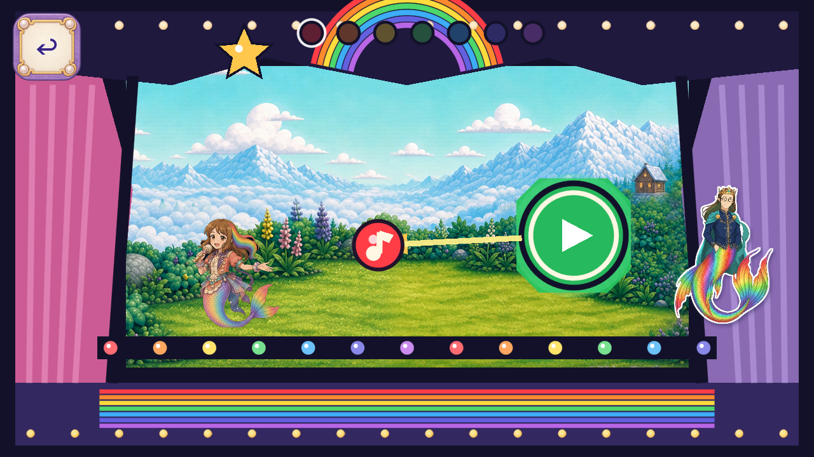

# R125 painted Melody theatre bulbs

Owner scope: **Resume art candidates; keep Dev frozen**. Existing role `FV-3C4F040EA786`; source baseline `27c88288bf6e39582072811443df79919e7bbb89`; branch `codex/flat-vector-melody-bulbs-20261102`.

Two whole painted cream/gold128-square bulb textures replace only the upper/lower flat-circle rows. Original count `maxi(12,int(width/66))`, horizontal centers24..width−24, upper center22/diameter15, lower centerheight−19/diameter14, parentz10 and foreground order remain. Whole untinted Sprite2D cards keep authored light and contours. Original curtains, crown, apron, footlights, star, actors, controls, audio, saves and progression remain at the fresh source baseline. No previous art branches are merged. No functional invisible geometry changes.

Two built-in ImageGen calls preserve two native1254-square RGBA outputs, exact prompts, scene/material bindings and exact native/crop Aseprite masters. Two128-square runtime exports add131072baseRGBA8bytes and remain inside unchanged texture ceilings. Aseprite bilinear alpha peaks at254; the initial255-only technical expectation failure is retained in `ALPHA_RESAMPLE_NOTE.json`, with actual pixels/exports unchanged and no retry. Model/version/seed/cost are NOT_EXPOSED; static cap2 exhausted; animation0.

Exact4.7.2 Mobile/Speedy import and99configured native checks pass at1280×720,1600×720,1280×800. All6candidate stills and6raw-exact reused source stills were directly reviewed. Reuse proves5062baseline files exact,69earlier configured checks and0new baseline frame credit; combined configured168checks are not independent acceptance requirements. Only2of71original game methods and3of88original probe methods change; all controller/state and original alpha-aware Sprite handling remain exact. All82 current trusted probes, complete current static set, exact4.7.2 analyzer and2D no-regression guard pass at the unchanged native candidate. Normal11save artifacts remain unchanged. FormalQA11 and external/global gates remain open.

R124 exact-source CI41461637778 succeeded atf1fe4a15eda241001e42eb0aa9629bbff5d69dec; its observation is included without rewriting historical pending snapshots or artwork credit. FormalQA11, natural-route/state coverage, physical device/performance, child, owner and whole-game inventory/zero-flat closure remain open. Accepted removals0. Publication and anonymous exact-byte every-required-file verification remain required before delivery is claimed. No Dev/master action, release or automation resume.

[Native checks](NATIVE_RESULT.json) · [Ten-axis comparison](FRAME_REVIEW.json) · [Frame/source bindings](FRAME_INDEX.json) · [Implementation scope](IMPLEMENTATION_SCOPE.json) · [Plan](PLAN.json).

[1280×720 before](source/1280x720/01_stage_entry.png) · [after](candidate/1280x720/01_stage_entry.png) · [1600×720 before](source/1600x720/01_stage_entry.png) · [after](candidate/1600x720/01_stage_entry.png) · [1280×800 before](source/1280x800/01_stage_entry.png) · [after](candidate/1280x800/01_stage_entry.png).

[Separate evidence lanes](VALIDATION_STATUS.json) · [Actual delivery manifest](MANIFEST.json).
