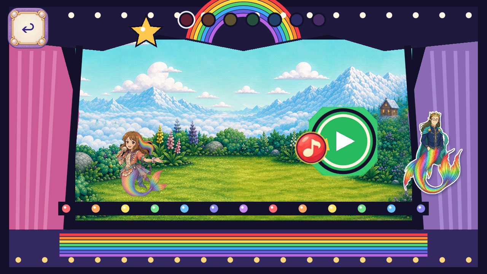

# R126: painted Melody note token

Stable role `FV-A914479B2992`; fresh baseline `27c88288bf6e39582072811443df79919e7bbb89`, branch `codex/flat-vector-melody-note-20261102`. Owner: **Resume art candidates; keep Dev frozen**. No Dev/master integration or promotion.

One preserved1774x887 RGBA atlas supplies seven complete painted discs in original red/orange/yellow/green/blue/indigo/violet order. Aseprite preserves native/crop masters and exact414-square crop roundtrips, then uniformly exports seven256-square textures. One built-in ImageGen call of static cap2; model/version/seed/cost are not exposed. [Prompt and native/master provenance](../../../../assets_src/imagegen/melody_note_20261102/README.md).

Only `RainbowNoteCanvas.setup` changes and primitive `_draw` is removed. Other69controller methods are LF-exact: original84px container,120px hit target,35z,42px pivot, movement/rotation, timing, seven deliberate notes, input/save/audio and teardown. Each note is one whole untinted Sprite2D. Other theatre art stays original; earlier art branches remain separately preserved. Probe79othermethods are LF-exact; representation checks bind actual seven texture hashes/hues and whole-sprite geometry, retaining original behavior gates. Original texture ceilings unchanged; new baseRGBA8 cost1,835,008bytes;13unique textures total.

Exact4.7.2 Mobile/Speedy import and171candidate checks pass at1280x720,1600x720,1280x800. All21candidate and21same-source seven-color frames were directly inspected; source171checks pass too. Local ten-axis comparison is provisional. The warmer leaf-green remains a readable green state; physical color/readability acceptance is open.

Two display fixtures expected the transient empty completion phase after3frames, while actual original return was already `level2`, Daddywon=true, one trophy and tokenlayernull. Only the capture expectation changed to this measured later return; production behavior and trusted completion assertions unchanged. Both failures and14excluded frame events remain preserved. New frame events42bounded+14excluded=56retained; no artwork-piece credit.

All82 current trusted probes, complete current static set, exact4.7.2 analyzer and2D no-regression guard pass; normal11save artifacts remain unchanged. Actual delivery files are bound by `MANIFEST.json`; exact-head CI is separately pending. FormalQA11/device/child/owner, natural-route/state/global coverage and whole-role closure remain open. Accepted removals0. R125 exact-source CI success at `e4166d1b74e5f04ce3b7388b517d8127686dedaa`, run41484922684, is newly observed with0new artwork/Dev credit.

[All source/candidate frame hashes](FRAME_INDEX.json) · [Separate evidence lanes](VALIDATION_STATUS.json) · [Actual delivery manifest](MANIFEST.json).
