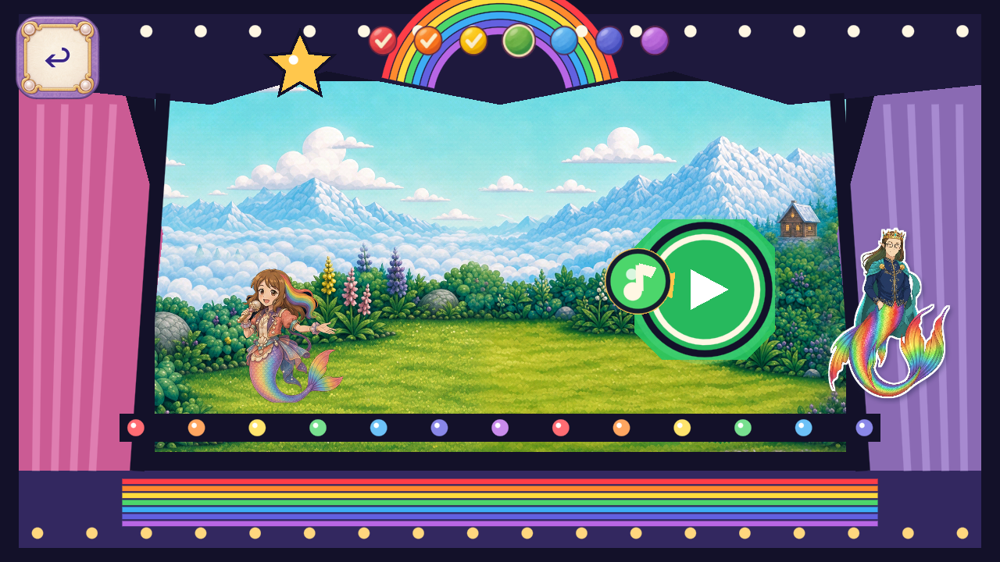

# R127 — painted Melody progress pips

Stable ID `FV-E6549378F626`. Owner scope: “Resume art candidates; keep Dev frozen.” Source branch `codex/flat-vector-melody-progress-pips-20261102`, baseline `27c88288bf6e39582072811443df79919e7bbb89`; public delivery destination `Ebonyks/mermaid-roshan-reef`, established canonical branch `codex/flat-vector-r6-20261012`. Anonymous immutable delivery verification is required before calling this delivered.

One native painted atlas supplies21 complete128px images: seven colors in idle/current/filled states. A single whole untinted Sprite2D replaces each visible pip polygon/draw path. Original48px controls, centered pivots,38px ordinary bodies,46px current cues, z40, state transitions, one-finger input, note action, voice, save and synchronous teardown are preserved. The other68 controller methods and83 original probe methods are LF-exact; the full-game probe remains LF-exact. All27 resident textures, including unbound pip states and mip overhead, stay subject to the original23MiB decoded/12MiB declared-upload ceilings.

The exact original source stage already has21 retained captures across three aspects. [Source-context reuse](SOURCE_CONTEXT_REUSE.json) binds the pre-edit5062-input proof and immutable R126 source evidence without new source-frame credit. New native candidate checks and all82 current trusted probes are pending. [Implementation scope](IMPLEMENTATION_SCOPE.json) separates component checks of all21 authored states from the19 state/color pictures naturally held during progression: red idle is not an ordinary entry state; violet filled is set only before synchronous retirement.

[Generation accounting](GENERATION_ACCOUNTING.json) records one built-in ImageGen call, one preserved native atlas and21 Aseprite technical exports; one item call remains. No exposed model/version selector, seed or provider cost is claimed. The appearance reference is the R126 source candidate, not owner-approved art. [Reference roles](REFERENCE_BINDING.json) keep actual scene captures as context, not delivery pixels. No protected original or functional invisible geometry changes.

All82 current trusted probes, complete current static set, exact4.7.2 analyzer and2D no-regression guard pass; normal11save artifacts remain unchanged. Actual delivery files are bound by `MANIFEST.json`; exact-head CI is separately pending. Formal QA11, all natural routes/states/action coverage, physical device/performance, child and owner acceptance remain open. MA-VIS-006 and MA-VIS-008 stay CONFIRMED_OPEN. Accepted artwork removal and complete named-role closure remain zero; whole-game denominators remain unknown. No Dev/master integration or release.

Verification history: initial focused check passed200 assertions and failed only a new color-category boundary that also rejected the original yellow. Two verifier literals now use disjoint orange/yellow bins at0.11; exact artwork hashes, seven distinct ordered colors and all other requirements remain. The complete healthy static set is source-bound and reused with fresh current changed-script/governance/analyzer/2D checks. All82 current probes must pass after correction. The failed result is retained separately; no new generation, re-export or native-frame credit.

[All source/candidate frame hashes](FRAME_INDEX.json) · [Separate evidence lanes](VALIDATION_STATUS.json) · [Actual delivery manifest](MANIFEST.json).
