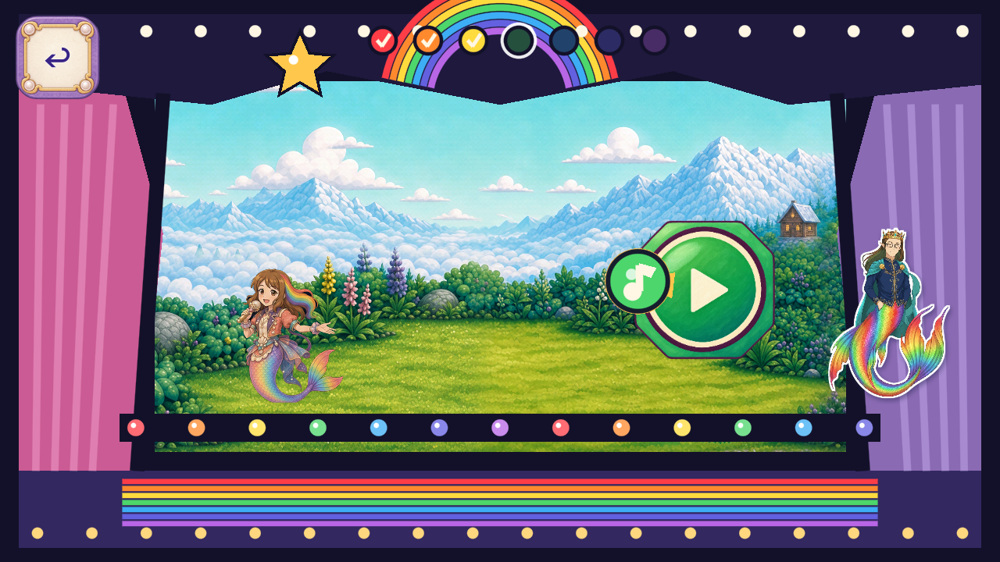

# R128 — Painted Melody timing-window candidate

Stable role FV-B276AD0A51E5 retains its historical registry name, “Melody start button.” The current implementation is the large green timing window, an input-transparent visual cue: it adds no start-button action. Two whole painted256px pictures replace its flat octagonal/circular/play-symbol drawing and mint aura. The fixed medallion keeps the original scoring box and center; only the quiet aura follows the existing5rad/s0..6px pulse at original0.24uniform opacity. The cream ring and play glyph remain part of the whole authored medallion.

The source branch starts at frozen Dev27c88288bf6e39582072811443df79919e7bbb89. The owner's current instruction is “Resume art candidates; keep Dev frozen.” All original input/scoring/save/voice/lifecycle/controller methods are preserved; only the role renderer and runtime-art inventory change. Representation-specific probe checks bind exact files, original boxes/pulse/order/opacity and all8resident texture budgets within unchanged23/12MiBceilings. The other stage art remains original Dev context; earlier candidates remain on their own published branches.

Both built-in ImageGen native outputs and their exact prompts/references survive, with editable Aseprite native/crop/runtime masters, exact RGBA crop roundtrips and uniform resampling records. Two static calls exhaust this item's cap2; zero animation calls, zero rejected native takes, no claimed model/version/seed/cost/backend2.5. Preserve original/source-reference licenses and hashes. No protected originals changed; no rasterized primitive/code-drawn substitute enters delivery.

Original5062runtime bytes match the historical R126 source capture closure exactly; its21native scene captures/171configured checks are reused at their immutable source revision with zero new sourceframe credit. The new changed candidate receives three-aspect configured Mobile/Speedy scene/touch captures and a whole-HUD phone-size review. All82 current trusted programs, exact4.7.2 analyzer and2D no-regression guard pass after the new verifier-only alpha-API correction. The complete healthy global static set is preserved with33905other tested index entries unchanged and fresh current changed-source gates; normal11save artifacts remain unchanged. Actual delivery files are bound by `MANIFEST.json`; exact-head CI is separately pending.

Formal QA11, physical phone performance, child and owner acceptance, all natural entry/alternate route/action/reward/settle coverage, full inventory and global removal remain open. Local same-scene ten-axis review and machine passes grant no accepted removal or complete-role closure. Dev/master stay frozen.

[Provenance](https://github.com/Ebonyks/mermaid-roshan-reef/blob/7b931bd88506890ab042e8c3abaef5536acf8fee/docs/handoffs/codex_flat_vector_art_2026-10-07/r128_melody_timing_window_runtime/GENERATION_ACCOUNTING.json) · [Implementation scope](https://github.com/Ebonyks/mermaid-roshan-reef/blob/7b931bd88506890ab042e8c3abaef5536acf8fee/docs/handoffs/codex_flat_vector_art_2026-10-07/r128_melody_timing_window_runtime/IMPLEMENTATION_SCOPE.json) · [Ten-axis review](https://github.com/Ebonyks/mermaid-roshan-reef/blob/7b931bd88506890ab042e8c3abaef5536acf8fee/docs/handoffs/codex_flat_vector_art_2026-10-07/r128_melody_timing_window_runtime/FRAME_REVIEW.json) · [Frame index](https://github.com/Ebonyks/mermaid-roshan-reef/blob/7b931bd88506890ab042e8c3abaef5536acf8fee/docs/handoffs/codex_flat_vector_art_2026-10-07/r128_melody_timing_window_runtime/FRAME_INDEX.json) · [Validation lanes](https://github.com/Ebonyks/mermaid-roshan-reef/blob/7b931bd88506890ab042e8c3abaef5536acf8fee/docs/handoffs/codex_flat_vector_art_2026-10-07/r128_melody_timing_window_runtime/VALIDATION_STATUS.json) · [Delivery manifest](https://github.com/Ebonyks/mermaid-roshan-reef/blob/7b931bd88506890ab042e8c3abaef5536acf8fee/docs/handoffs/codex_flat_vector_art_2026-10-07/r128_melody_timing_window_runtime/MANIFEST.json).

The initial full-suite pass attempt caught an unsupported API call in the new image verifier: Image.has_alpha does not exist. The exact approved engine confirms Image.detect_alpha reports blended alpha for both unchanged PNGs. Only that one verifier call was corrected; the completed full static set and192native checks/21frames remain source-bound. All82current trusted programs and fresh changed-source gates must pass after this correction; the initial failure stays preserved in initial_alpha_verifier_failure. No art, original assertions, geometry, budgets or quality floors changed.

[All source/candidate frame hashes](https://github.com/Ebonyks/mermaid-roshan-reef/blob/7b931bd88506890ab042e8c3abaef5536acf8fee/docs/handoffs/codex_flat_vector_art_2026-10-07/r128_melody_timing_window_runtime/FRAME_INDEX.json) · [Separate evidence lanes](https://github.com/Ebonyks/mermaid-roshan-reef/blob/7b931bd88506890ab042e8c3abaef5536acf8fee/docs/handoffs/codex_flat_vector_art_2026-10-07/r128_melody_timing_window_runtime/VALIDATION_STATUS.json) · [Actual delivery manifest](https://github.com/Ebonyks/mermaid-roshan-reef/blob/7b931bd88506890ab042e8c3abaef5536acf8fee/docs/handoffs/codex_flat_vector_art_2026-10-07/r128_melody_timing_window_runtime/MANIFEST.json).

Canonical envelope:31published bounded source artifacts /20partialDev;7,069bounded +4,206excluded =11,275retained native PNG events. No accepted-removal or complete-role closure credit. Lower263known roles/35families and unknown whole-game denominators remain.

[Immutable source tree](https://github.com/Ebonyks/mermaid-roshan-reef/tree/7b931bd88506890ab042e8c3abaef5536acf8fee) · [Anonymous source verification](SOURCE_REMOTE_VERIFICATION.json) · [Canonical delivery manifest](MANIFEST.json) · [Canonical anonymous immutable receipt](REMOTE_VERIFICATION.json) · [Payload revision](PAYLOAD_PIN.json). Null manifest revisions resolve against that payload revision, not the later receipt-only commit.
