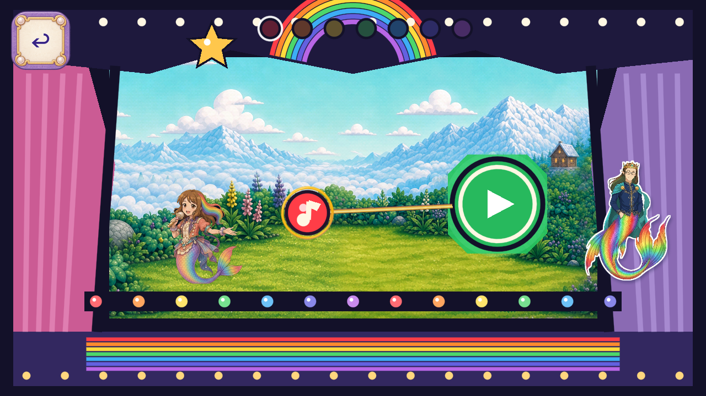

# R129 — painted Melody guide arrow and rings

Stable ID **FV-0091F4E1BC9C**. This source candidate replaces the plain guidance connector/triangle and double-ring drawing with authored painted raster artwork. Its original target, direction, connector endpoints/width/short-distance suppression, note occlusion and pulse remain intact. Dev remains frozen.

Two built-in ImageGen calls supplied one complete gold/cream arrow and one complete hollow double ring. Exact Aseprite RGBA crops, uniform exports and editable native/crop/runtime masters are preserved. Three runtime images derive from those two designs. The static UI head uses declared aspect registration to the original46x34envelope; the ring scales as a whole, including band thickness. Generated alpha is preserved, with no painted mask or procedural artwork substitute.

[Generation/provenance and budgets](https://github.com/Ebonyks/mermaid-roshan-reef/blob/75ea903d5d5679e90273fbb8faa80acba5ec5a65/docs/handoffs/codex_flat_vector_art_2026-10-07/r129_melody_guide_runtime/GENERATION_ACCOUNTING.json) · [Actual source binding](https://github.com/Ebonyks/mermaid-roshan-reef/blob/75ea903d5d5679e90273fbb8faa80acba5ec5a65/docs/handoffs/codex_flat_vector_art_2026-10-07/r129_melody_guide_runtime/DELIVERY_SOURCE_BINDING.json) · [Implementation scope](https://github.com/Ebonyks/mermaid-roshan-reef/blob/75ea903d5d5679e90273fbb8faa80acba5ec5a65/docs/handoffs/codex_flat_vector_art_2026-10-07/r129_melody_guide_runtime/IMPLEMENTATION_SCOPE.json) · [Method preservation](https://github.com/Ebonyks/mermaid-roshan-reef/blob/75ea903d5d5679e90273fbb8faa80acba5ec5a65/docs/handoffs/codex_flat_vector_art_2026-10-07/r129_melody_guide_runtime/METHOD_PRESERVATION.json) · [Ten-axis same-scene review](https://github.com/Ebonyks/mermaid-roshan-reef/blob/75ea903d5d5679e90273fbb8faa80acba5ec5a65/docs/handoffs/codex_flat_vector_art_2026-10-07/r129_melody_guide_runtime/FRAME_REVIEW.json) · [All frame hashes](https://github.com/Ebonyks/mermaid-roshan-reef/blob/75ea903d5d5679e90273fbb8faa80acba5ec5a65/docs/handoffs/codex_flat_vector_art_2026-10-07/r129_melody_guide_runtime/FRAME_INDEX.json) · [Phone-size review](https://github.com/Ebonyks/mermaid-roshan-reef/blob/75ea903d5d5679e90273fbb8faa80acba5ec5a65/docs/handoffs/codex_flat_vector_art_2026-10-07/r129_melody_guide_runtime/PHONE_SQUINT_REVIEW.json).

Original source context:126configured checks and15new full-travel native captures. Current candidate:213configured checks and33new native captures, with three actual Mobile/Speedy aspects and all seven note contexts. The original5062input baseline and all5068candidate runtime inputs are pinned; normal11save artifacts remain unchanged. The separately reused171checks/21historical original frames earn zero new frame credit. All33candidate native frames and48whole-HUD phone previews were visually inspected. These checks are not unique requirements or formalQA11.

All82existing local programs, fresh complete static gates, exact4.7.2analyzer and2Dno-regression checks pass. The headless display diagnostic skips rather than establishing formal visual acceptance. The2Dmission remains unsatisfied. [Actual local results](https://github.com/Ebonyks/mermaid-roshan-reef/blob/75ea903d5d5679e90273fbb8faa80acba5ec5a65/docs/handoffs/codex_flat_vector_art_2026-10-07/r129_melody_guide_runtime/LOCAL_82_RESULT.json), [static gates](https://github.com/Ebonyks/mermaid-roshan-reef/blob/75ea903d5d5679e90273fbb8faa80acba5ec5a65/docs/handoffs/codex_flat_vector_art_2026-10-07/r129_melody_guide_runtime/STATIC_RESULT.json), [native results](https://github.com/Ebonyks/mermaid-roshan-reef/blob/75ea903d5d5679e90273fbb8faa80acba5ec5a65/docs/handoffs/codex_flat_vector_art_2026-10-07/r129_melody_guide_runtime/RUNTIME_RESULT.json), [separate evidence lanes](https://github.com/Ebonyks/mermaid-roshan-reef/blob/75ea903d5d5679e90273fbb8faa80acba5ec5a65/docs/handoffs/codex_flat_vector_art_2026-10-07/r129_melody_guide_runtime/VALIDATION_STATUS.json). Exact published-head CI is separately pending.

The first native launcher referenced a stale fixture path and produced zero frames. Both successful imports were reused, and only the launcher path was corrected; no generation/export or healthy engine suite repeated. [Preserved failure](https://github.com/Ebonyks/mermaid-roshan-reef/blob/75ea903d5d5679e90273fbb8faa80acba5ec5a65/docs/handoffs/codex_flat_vector_art_2026-10-07/r129_melody_guide_runtime/initial_capture_launch_failure/STOP.json) · [Exact recovery](https://github.com/Ebonyks/mermaid-roshan-reef/blob/75ea903d5d5679e90273fbb8faa80acba5ec5a65/docs/handoffs/codex_flat_vector_art_2026-10-07/r129_melody_guide_runtime/NATIVE_LAUNCH_RECOVERY.json).

Source artwork: [arrow prompt](https://github.com/Ebonyks/mermaid-roshan-reef/blob/75ea903d5d5679e90273fbb8faa80acba5ec5a65/assets_src/imagegen/melody_guide_20261102/PROMPT_ARROW.txt), [ring prompt](https://github.com/Ebonyks/mermaid-roshan-reef/blob/75ea903d5d5679e90273fbb8faa80acba5ec5a65/assets_src/imagegen/melody_guide_20261102/PROMPT_RING.txt), [provenance](https://github.com/Ebonyks/mermaid-roshan-reef/blob/75ea903d5d5679e90273fbb8faa80acba5ec5a65/assets_src/imagegen/melody_guide_20261102/PROVENANCE.json), [Aseprite exports/masters](https://github.com/Ebonyks/mermaid-roshan-reef/blob/75ea903d5d5679e90273fbb8faa80acba5ec5a65/assets_src/imagegen/melody_guide_20261102/EXPORT.json). Built-in backend only; no model selector/version was returned, so ImageGen2.5is not claimed.

FormalQA11, physical-device performance/play, child/owner acceptance, complete route/state/action coverage and game-wide inventory remain open. This is one bounded source artifact for one existing role, with three PNGs, not three newly accepted pieces. No Dev credit, accepted-removal or whole-role closure credit.

[Actual delivery manifest](https://github.com/Ebonyks/mermaid-roshan-reef/blob/75ea903d5d5679e90273fbb8faa80acba5ec5a65/docs/handoffs/codex_flat_vector_art_2026-10-07/r129_melody_guide_runtime/MANIFEST.json). Immutable source/canonical links and anonymous every-file verification are supplied by the canonical receipt after publication.

Canonical envelope:32published bounded source artifacts /20partialDev;7,117bounded +4,206excluded =11,323retained native PNG events. No accepted-removal or complete-role closure credit. Lower263known roles/35families and unknown whole-game denominators remain.

[Immutable source tree](https://github.com/Ebonyks/mermaid-roshan-reef/tree/75ea903d5d5679e90273fbb8faa80acba5ec5a65) · [Anonymous source verification](SOURCE_REMOTE_VERIFICATION.json) · [Canonical delivery manifest](MANIFEST.json) · [Canonical anonymous immutable receipt](REMOTE_VERIFICATION.json) · [Payload revision](PAYLOAD_PIN.json). Null manifest revisions resolve against that payload revision, not the later receipt-only commit.
