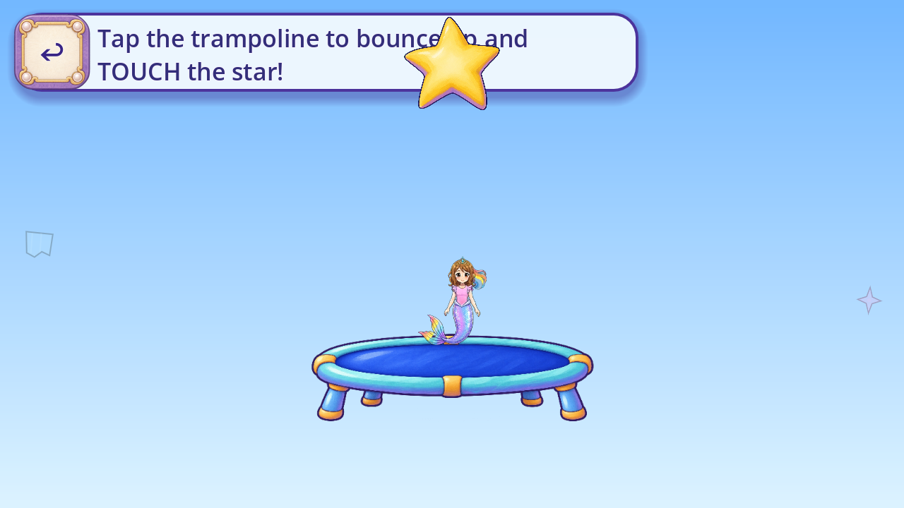

# R130 — painted trampoline pad and frame

Stable ID **FV-C6F64FAA2F32**. The actual current picture game used a flat blue capsule with an oversized detached highlight underneath. This candidate replaces that drawing with one whole painted trampoline cutout. Dev remains frozen.

One built-in ImageGen call produced the attached mat/rim/four-leg design, using the actual neighboring painted star as a style reference. The actual game capture was inspected and described in text; no protected originals or gameplay-capture pixels were exported to the generator. Exact native PNG, prompt, reference roles/hashes, editable Aseprite masters and exact RGBA crop proof are preserved. [Exact prompt](../../../../assets_src/imagegen/trampoline_pad_20261102/prompt_01.txt) · [Native source](../../../../assets_src/imagegen/trampoline_pad_20261102/native/trampoline_01.png) · [Derivation/masters](../../../../assets_src/imagegen/trampoline_pad_20261102/derivation_01.json) · [Generation accounting](GENERATION_ACCOUNTING.json).

Only the trampoline constructor changed;29other PictureGames methods are byte-identical after LF normalization. Roshan, the star, original400x140 invisible touch target, three bounce heights/timing, reward, sound, saves and close behavior remain unchanged. The painted object is one aspect-preserving403x129Canvas card; decorative feet extend below the unchanged target. [Scope](IMPLEMENTATION_SCOPE.json) · [Exact function preservation](FUNCTION_PRESERVATION.json).

Actual Godot4.7.2-stable Mobile/Speedy context passes144source and165candidate configured checks across three aspects and nine sampled states: rest, wrong/passive, three apices/landings including payoff, then immediate reentry. These are309configured checks, not unique requirements or formalQA11. All27candidate native frames,15source native frames and54whole-HUD phone previews were inspected. [Ten-axis provisional review](FRAME_REVIEW.json) · [Phone review](PHONE_SQUINT_REVIEW.json) · [Source frame hashes](SOURCE_FRAME_INDEX.json) · [Candidate frame hashes](CANDIDATE_FRAME_INDEX.json).

The Aseprite crop round-trips RGBA exactly. Its lockRatio command floors the runtime export to512x163 rather than the requested512x164; that initial dimension assertion failure is preserved, and the actual output was retained without reexport. No alpha mask, pixel repaint, procedural substitute or extra generation was used. Built-in backend only; no model version was exposed.

All82existing local programs, fresh complete static gates, exact4.7.2analyzer and2Dno-regression checks pass. The headless human-art diagnostic skips; this is not82assertive requirements or formalQA11. [Actual local result](LOCAL_82_RESULT.json) · [Fresh static result](STATIC_RESULT.json). Exact published-head CI remains separately pending. [Separate evidence lanes](VALIDATION_STATUS.json). FormalQA11, devices, child/owner acceptance, natural route and whole-game coverage remain open. The unchanged header/star overlap and the preexisting global reward card on immediate reentry remain visible in both builds and are not accepted by this prop review. This is one bounded candidate for one existing role, with no Dev, accepted-removal or closure credit.

[Actual source delivery manifest](MANIFEST.json). The canonical envelope supplies the immutable every-file verification receipt after publication.
