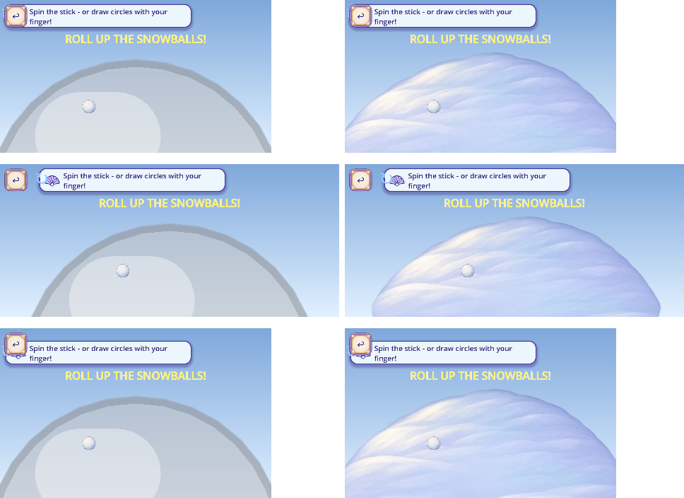

# Painted snowfield candidate and recent update integration — R133

The painted Snowman ground is published at [fe0660ad](https://github.com/Ebonyks/mermaid-roshan-reef/blob/fe0660adced29fac3ae50737c0f829f400c856ab/docs/handoffs/codex_recent_updates_dev_2026-11-03/README.md), alongside the composed recent updates. All 1,343 required files were anonymously byte-verified. All 82 local game checks, current static gates, five analysis checks and the shrinking 2D gate pass. Exact-head GitHub CI is running; Dev remains unchanged with20 partial artifacts.

One native 2048-square painted design supplies four 1024 runtime cards. Existing painted body/coal, functional invisible geometry, original one-finger behavior and save keys retain their scopes. Generation used5of8 item calls; the exposed backend supplies no model selector/version. [Production delta](PRODUCTION_DELTA.json), [source manifest](https://raw.githubusercontent.com/Ebonyks/mermaid-roshan-reef/fe0660adced29fac3ae50737c0f829f400c856ab/docs/handoffs/codex_recent_updates_dev_2026-11-03/MANIFEST.json), [anonymous receipt](SOURCE_DELIVERY_VERIFICATION.json), [every-file journal](SOURCE_VERIFIED_FILES.jsonl), [CI status](SOURCE_CI_STATUS.json).

Current canonical source artifacts36, partial Dev artifacts20. Native capture totals7561bounded +4286excluded =11847retained events; phone views/boards/technicalexports are separate. Lower263known roles/35families and unknown whole-game denominators remain. Accepted artwork removals0. FormalQA11, physical-device, child, owner, complete action/contact and global coverage remain open. R93handfit history and every prior rejection remain unchanged.

The current registry, coverage and tally resolve through [CURRENT](../CURRENT.json). Unchanged historical archives remain at their original immutable revisions. The actual production payload is the immutable source above; this thin canonical record does not copy its archive. [CHG-139](../../../../audit/MASTER_AUDIT_CHANGELOG_ROLLBACK_2026-08-10.md#chg-139--r133-painted-snowfield-and-recent-source-composition) names implementation, risk, dependencies and bounded rollback planning.
