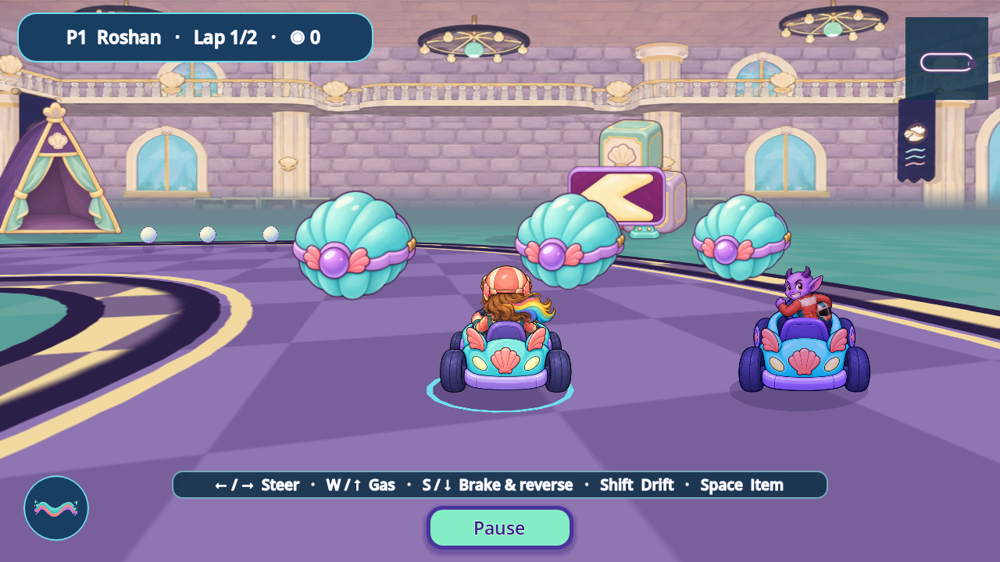
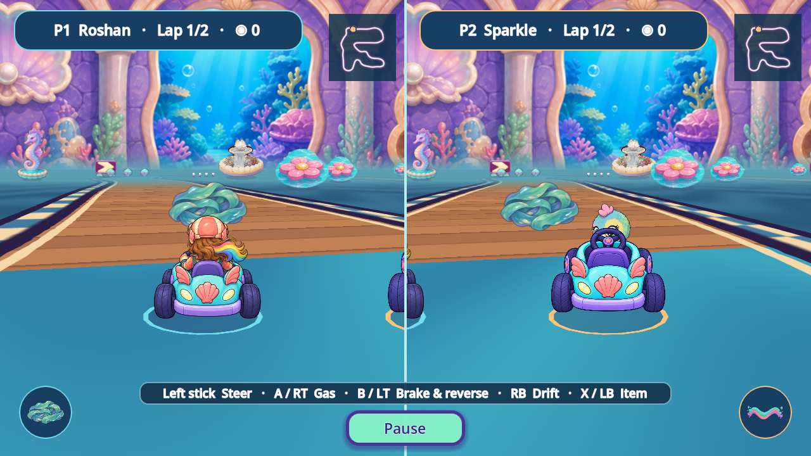

# R143 Painted Racer resources

The published Racer engine, four PC courses and seven painted object candidates are reconciled with current Dev `bc02217f` and its owner-authorized MCP development bridge. The shell capsule (`FVR-D147419B7EE0`) and kelp trap/icon (`FVR-59E3B726D2F1`) now use required painted resources. Three superseded optional file bindings and two procedural missing-art drawing paths are retired. Draw regions, size, placement, timing, collision, items and controls stay the same. This iteration regenerates **no artwork pixels** and makes **zero generation calls**.

The seven native masters, exports and provisional reviews retain their [exact producer provenance](https://github.com/Ebonyks/mermaid-roshan-reef/tree/96511087fcdbc572b090028db201a3f422d652fa/assets_src/imagegen/reef_kart_context_20261105). R143 continues the existing R141 artifact; it adds no design, family or accepted-removal credit.

All 54 before/after native pairs are pixel-identical. Another 54 views verify the actual combined source at `8b8829ba3c114bb57a31e9da58a31b91a4c2ed5c` plus Dev `80975b0051f6a5be29b0680e8b84e15f30d3c316`. The task retains **162 capture events / 54 unique image hashes**. The historical 54 KEEP/no-Speedy source events stay excluded. Coverage includes four PC courses in solo/split, grid/finish/bend, individual props, capsule/kelp states, menus/results, 1600x900, 1280x800 and the original touch Canal.

The configured native profile is official Godot **4.7.2-stable `ed1daf0bf`, Mobile, Speedy, Canvas Items/Expand, normal time**. The fixture applies `ReefMain._apply_quality("speedy")` on an unattached profile owner, plus root 0.8 scaling and a 30 fps ceiling. The standalone Canvas Racer has no quality-tier branches. This is posed profile evidence; it does not establish natural Main travel, measured phone performance, whole motion or formal QA11.

The earlier C0+Dev809 combination passed the original static commands, all three focused Racer/PC/handling suites, **27 changed-script analyzers and all 82 original command exits** (81 assertion probes plus one headless capture SKIP), followed by the current 2D no-regression guard. The frozen 5,510 runtime inputs and all 11 normal-save hashes remain unchanged. This is segmented evidence with retained failed attempts and actual successful continuations.

| Evidence lane | Scope |
|---|---|
| Candidate / local integration | Actual painted outputs and source changes present |
| Configured runtime / machine | Bounded views and latest 82 checks pass on the declared source |
| Exact-head remote CI / Dev integration | Pending in this source record; the live registry records later verified outcomes |
| Formal QA11 / device / child / owner | Open; no acceptance or removal credit |

Required preloading moves these two existing textures into earlier script-parse residency. Target-device startup, memory and frame pacing remain unmeasured. Original runtime PNG files are preserved pending safe reference/export cleanup under `DL-PERF-06`. Other Racer HUD/effects/fallbacks, actor poses, background native coverage and whole-game inventory remain open.

The earlier R141 tent observation is withdrawn: the large translucent foreground shape in `prop-play_blocks` is the finish arch. Its intentional near-camera fade is unchanged. No tent defect or repair is claimed.

[Candidate outputs and provenance](CANDIDATE_RECORDS.json) · [Ten-axis comparison](TEN_AXIS_COMPARISON.json) · [Capture events](FRAME_EVENTS.json) · [Reproduction instructions](CAPTURE_INSTRUCTIONS.json) · [Current machine result](current_dev_80975b0051/evidence/FINAL_RESULT.json) · [Retained failures and recovery](RECOVERY_HISTORY.json) · [Manifest](MANIFEST.json)

The [standing registry route](../CANONICAL_REGISTRY.md) connects Dev readers to the owner-established per-piece registry and its revision-specific integration receipts. Later reconciliations must declare their exact scope. No master promotion or creative acceptance is asserted here.

The subsequent archive-only reconciliation retained Dev archive `169f6e90faff072affb40874f49566a97c2814ef`. Both license and ledger additions are preserved. [All 5,510 tested runtime inputs and the CI script remain byte-identical](FINAL_RECONCILIATION.json); the existing bounded native and machine evidence remains applicable. No healthy engine suite or capture was repeated for this archive change.

Current MCP combination: the actual newer source passes the complete static/import pipeline, nine tooling-scope controls, standalone inactive-bridge check, 15 changed-script analyzers, three focused Racer suites and **81 assertion probes plus one headless capture SKIP**, with strict actual-zero exits and the original flags, order, classifiers and deadlines. All 5551 frozen runtime inputs, including addon/configuration dependencies, and the 11 normal-save hashes remain unchanged. [Exact current machine result](current_dev_bc02217f/evidence/FINAL_RESULT.json) and [reconciliation scope](MCP_RECONCILIATION_SCOPE.json) retain the source pin. Earlier failed attempts and completed809/169 records keep their original scope.

The configured native images above remain bound to the actual809 source. Racer code, textures, fixture and rendered scene dependencies are unchanged; the new bridge removes itself in a standalone launch. No newMCP GUI capture, formalQA11, device, child or owner acceptance is claimed.
