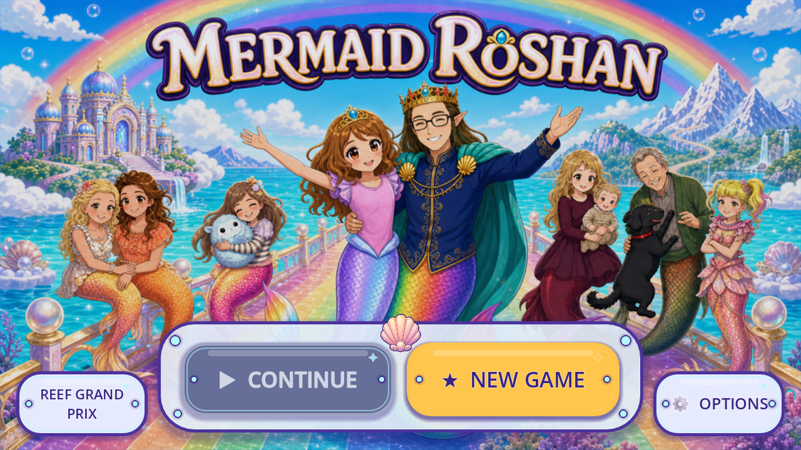

# R144 — painted shared shell on Dev

**FV-AB474EF3699E** is integrated on Dev at [`f1cced56d299695580509b0d3c96e75f7f5e75ce`](https://github.com/Ebonyks/mermaid-roshan-reef/commit/f1cced56d299695580509b0d3c96e75f7f5e75ce). The shared UI crest uses the byte-unchanged project-owned painted castle motif in place of its procedural fan, ribs and dots. Control bounds, names, input settings, draw order and resize behavior are preserved. The warmer cream pearl and narrower painted silhouette remain candidate differences awaiting owner review.

[Integration receipt](dev_integration_20261106/DEV_INTEGRATED.json) · [immutable source tree](https://github.com/Ebonyks/mermaid-roshan-reef/tree/f1cced56d299695580509b0d3c96e75f7f5e75ce/docs/handoffs/codex_flat_vector_art_2026-10-07/r144_shared_painted_shell) · [source delivery manifest](https://github.com/Ebonyks/mermaid-roshan-reef/blob/f1cced56d299695580509b0d3c96e75f7f5e75ce/docs/handoffs/codex_flat_vector_art_2026-10-07/r144_shared_painted_shell/dev_reconcile_bc058d3b/MANIFEST.json) · [all33 source files anonymously verified](dev_integration_20261106/SOURCE_REMOTE_VERIFICATION.json)

The normal fast-forward preserves the owner-approved Android build fix and the source-only original Sky Lagoon flower study, including its newer rejection history. All5,557 runtime inputs match the validated source10256. [Exact F1 source CI](dev_integration_20261106/SOURCE_F1_CI.json) passed both required jobs; the separate automatic Dev event42202164628 was running at intake. No matching F1 APK is verified here, and no competing retry or master promotion is started.

The original same-scene comparison retains15 before/15 candidate native frames:26 bounded events and4 excluded diagnostics. The compatibility intro and occluded Garden crest earn no visible-removal credit; hidden touch-hint metadata and two presentation boards are not native frame events. [Ten-axis comparison](TEN_AXIS_COMPARISON.json), [provenance](PROVENANCE.json) and [original local machine results](SOURCE_MACHINE_RESULT.json) remain separate. Source4.7.2 Mobile/Speedy checks include static/import, real analyzers and82 strict command exits:81 assertion probes plus1 expected headless-capture SKIP. Normal child-save hashes and the review-resource exclusion guard passed.

The current registry has45 published bounded source artifacts and44 partial Dev artifacts. Roles280/families36 remain lower bounds; retained per-piece events8056 bounded/4398 excluded/12454 total are unchanged. This revision adds only one partial Dev integration. It creates no image, generation, named role, family, source artifact or retained native frame. Accepted removals and complete scene coverage remain0; whole-game totals remain unknown.

Formal fresh-runtime QA11, complete natural routes, physical device performance, child and owner acceptance remain open. Machine and diagnostic evidence do not grant creative acceptance or an owner score. The [current registry delta manifest](dev_integration_20261106/MANIFEST.json) binds this metadata publication; each older manifest retains its own immutable scope. [Prior source-publication history](https://github.com/Ebonyks/mermaid-roshan-reef/blob/3ec5c9c3beb0d6422dc9816e0cf2eab4ab9f4353/docs/handoffs/codex_flat_vector_art_2026-10-07/r144_shared_painted_shell/README.md) preserves the original pending states, canonical scanner correction and earlier automatic APK failure; they are not rewritten as successes.
