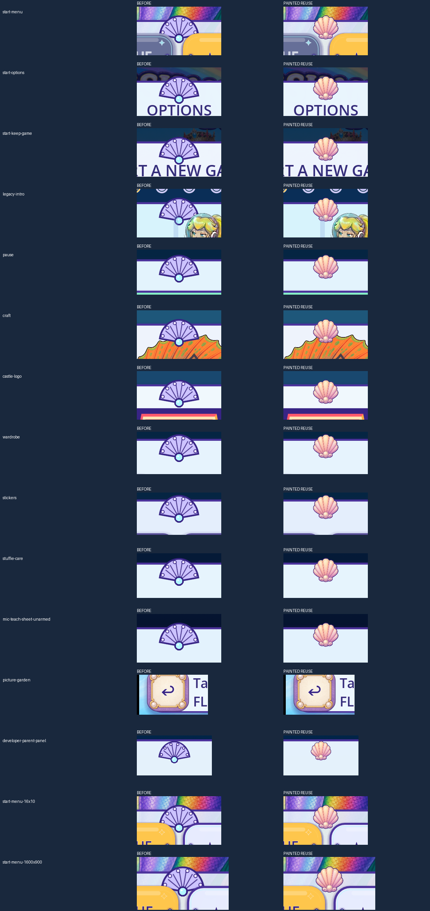

# R144 — shared painted shell crest

Candidate stable ID: **FV-AB474EF3699E**, shared UI family. Baseline game source: `a7e1faefc09b3303494a5499cce5fe120cb2dcb2`.

The shared ornament now draws the existing painted castle fan-shell motif instead of the flat polygon, radial lines, circles and arcs. The 256×256 project-owned PNG is reused byte-for-byte, with its painted shading, authored aspect and transparent edge. No generation, protected-source change, tint, new art family or animation was added. The warmer cream pearl and narrower painted silhouette are explicit candidate differences awaiting owner review.

[Provenance](PROVENANCE.json), [ten-axis comparison](TEN_AXIS_COMPARISON.json) and [actual caller geometry](CALLER_GEOMETRY_COMPARISON.json) retain separate claims. The native fixture calls shipped menu builders under exact Godot 4.7.2-stable, Mobile, Speedy and canvas-items/expand. Fifteen before and fifteen candidate frames cover the launch menu/options/save-protection sheet, legacy intro builder, pause, craft, castle logo, wardrobe, stickers, care, unarmed microphone sheet, Garden header, developer panel and two additional launch size/aspect cases. The hidden touch-pad compatibility ornament stays hidden. The Garden header ornament remains occluded by global Back; neither is counted as a visible removal.

Every captured name, Control rectangle, visibility, mouse filter and draw order matches. Button behavior, touch ownership, save keys, parent bounds and resize lifecycle are preserved. The fixture uses isolated user data and checks normal child-save hashes. It never presses New Game reset, records a microphone or changes saved clothing/drawings.

The actual changed candidate passes the complete current static/import prefix, changed-script parser/inference checks, two real analyzers, and all 82 trusted command exits (81 assertion probes plus 1 headless-capture SKIP), with strict actual-zero exits and unchanged normal save hashes. [Exact machine results](evidence/FINAL_RESULT.json) remain separate from these diagnostic pictures. At this source snapshot, publication/source CI and Dev integration await their actual post-source receipts on the canonical registry branch. Formal fresh-runtime QA11, natural-route coverage, target device, child and owner acceptance remain open. Accepted removals remain **0**; whole-game totals remain unknown. Existing unrelated flat menu panels and typography issues are not accepted by this bounded repair.

Delivery: work branch `codex/flat-vector-painted-shell-20261106`, normal green integration into `dev`, and canonical piece/coverage/tally reconciliation on `codex/flat-vector-r6-20261012`. No release/master promotion.

## Current Dev reconciliation

The [integration record](dev_reconcile_6dfd04ae/INTEGRATION_RECORD.json) reconciles this tested candidate with Dev `6dfd04aef441f30e0374e9ae9049cff845ce4ebd`. All 5,557 runtime Git inputs match the validated source revision `10256d79c971e1b39e7f422d63e014ae5183cc7c`; the existing Android build-capacity repair is preserved. Source and canonical publication CI both passed. The combined work branch still awaits its own CI and actual Dev integration.

The original [source manifest](https://raw.githubusercontent.com/Ebonyks/mermaid-roshan-reef/10256d79c971e1b39e7f422d63e014ae5183cc7c/docs/handoffs/codex_flat_vector_art_2026-10-07/r144_shared_painted_shell/MANIFEST.json) resolves `SELF` at that immutable source revision. The [current delta manifest](dev_reconcile_6dfd04ae/MANIFEST.json) binds the merged documents and selected immutable evidence without rebuilding the historical packet. Formal QA11, device, child and owner acceptance remain open.
