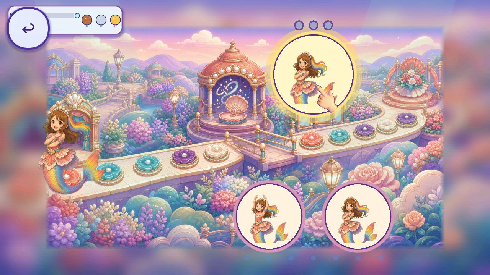
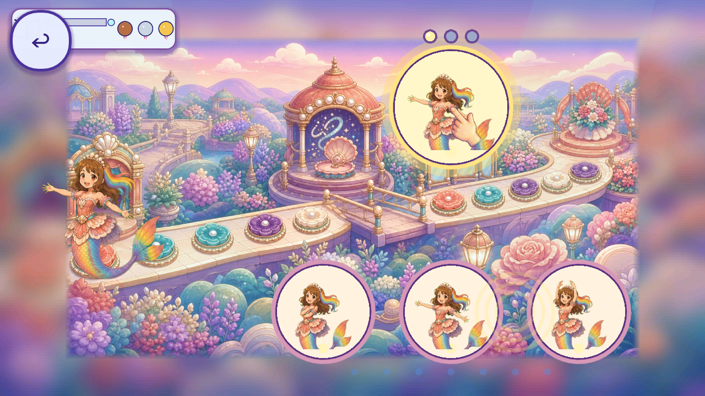

# R24 Ballet whole-hand reuse trial

The independent Ballet ghost finger `FV-D2EA0464919A` / `FVF-CEAD9700B93C` now has a nonruntime whole-source painted-hand trial across its three current modes. The already published [R23 context](../r23_ballet_pointer_context/README.md) and 20 required scene/state/source files were anonymously verified before this trial. The R16 hand remains unaccepted; no new generation,source pixels,production changes or art removal.

[Plan](PLAN.json), [prerequisite](CONTEXT_PREREQUISITE.json), [55 source bindings](SOURCES.json), [provenance](REUSE_PROVENANCE.json), [54 native files](CAPTURE_INDEX.json), [ten-axis inspection](REVIEW.json).18 views inspected at 1280x720 and 1600x720 under exact official Godot 4.7.2 Mobile/Speedy. A rigid 140-degree rotation and 98-pixel idle/88-pixel pressed uniform square keep the fingertip at the existing authoritative demo contact point. No crop, recolor, deformation or source pixel edit. Source-coordinate0-error and one declared texture command are not QA11/GPU/device evidence; the last callback can be stale while the caller hides the guide.

The articulated painted contour fits the cream/coral/lavender painted neighborhood more closely and leaves the inspected pose faces clearer than the R23 circle/stem. Palm overlap with costumes, arms or tail remains. Real partial ribbon/twirl inputs hide the guide, release restores it, and one pose choice starts the next demo. Full pose rounds, full trajectories, missing-package fallback retirement, natural routes/reload/reentry/focus, phone readability and exact human/device/child/owner acceptance remain open. Other flat frames, bands, rings and HUD stay unresolved. The isolated helper fallback and original production helper still exist.

[Registry](per_piece.json), [coverage](scene_coverage.json), [tally](tally.json), [backlog](CONGRUENCY_BACKLOG.json), [partial union](CURRENT_PARTIAL_CONTEXT_UNION.json).225 known records / 30 families;49 existing records / 10 families with partial context unchanged.2,564 bounded / 2,678 retained native files including 114 excluded.77 / 176 overlapping routes partial, zero complete, 99 without current slice; 351 source scopes unresolved. One unique hand sample supports two separate per-piece context review requests/consuming families. The existing CandyMaker stream draft still fails local QC. Zero art integration/runtime-verified replacements/accepted removal;whole-game pieces, screens and regressions remain unknown.

[Script/native gates](SCRIPT_GATES.json), [local gates](GATES.json), [receipt gates](RECEIPT_GATES.json), [manifest](MANIFEST.json), [remote verification](REMOTE_VERIFICATION.json). Inherited R16 exact 82 trusted native passes bind unchanged production bytes;new fixture checks are separate. No new source import needed. Prior audit findings stay open in their recorded lifecycles. Publication is not acceptance.

Inspect the actual pose guide and next-round overlap:

[Source/runtime parity](SOURCE_PARITY.json) preserves the inherited functional Geode correction separately from artwork acceptance.
