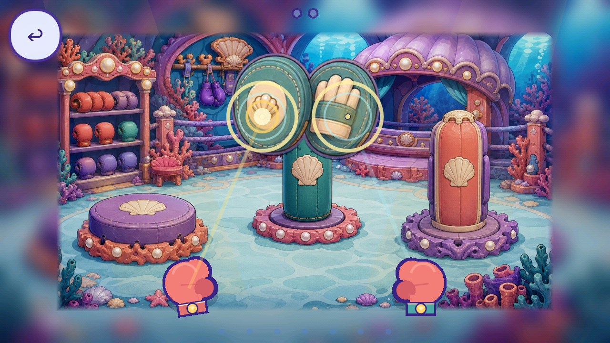
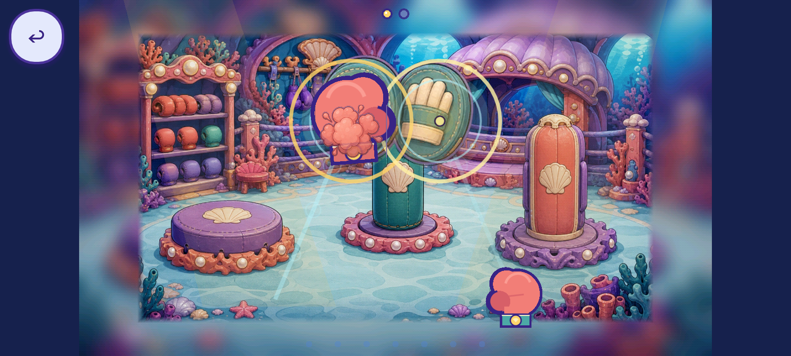

# R25 Boxing guide: current first-phase context

The independent Boxing demo guide `FV-DAA9072B905A` / scope `FVF-22152D4FD26C` now has current first-phase context at both native aspects. This is a partial context audit before repair. No source art, production code, new drawing or acceptance changed.

[Plan](PLAN.json), [57 source bindings](SOURCES.json), [five-mode caller audit](CALLER_CLOSURE.json), [capture index](CAPTURE_INDEX.json), [ten-axis inspection](REVIEW.json), [source/runtime parity](SOURCE_PARITY.json). Exact official Godot 4.7.2 Mobile/Speedy; private SaveState before Main; 30 corrected native event files, 12 inspected current views and 13 directly viewed source images. The first 30 PNGs remain preserved with aliased snapshot metadata, excluded from bounded coverage; [recovery](SETUP_RECOVERY.json) records the fixture-only correction. No runtime defect or historical state correction is fabricated.

Actual left/right demos and the five-second assist reset do not advance progress. A backward/sideways drag and a 45-percent forward drag earn zero. One real left-glove target drag earns one of two required units; release clears ownership and keeps that glove at the target. Wrong release restarts the demo; presses hide it. These isolated private playtest entries do not prove a natural route, second glove, full phase/award, save reload/reentry/focus or the four other modes.

The cream dot and gold rings cover details on the painted mitts near contact. Their uniform material differs from the live world tile family's painted leather, shells and pearl lighting. Large procedural gloves, target rings, lanes, feedback and back control remain separate unresolved artwork. The actual scene uses world tiles; alternate stage tiles and the full world reference are separate inventory. Roshan's approved atlas is an identity reference, with her actor hidden in this task. The loaded raster circle target is not the current primitive target's drawn texture. None of those observations grants extra artwork removal or per-piece coverage.

The existing R16 whole painted hand is a possible reuse trial, still unaccepted. Publish and anonymously verify this exact scene context before a bounded Boxing-only reuse override. Preserve both-hand timing, actual target geometry, assistance, input, ownership and release. No new generation is justified by this audit.

[Registry](per_piece.json), [coverage](scene_coverage.json), [tally](tally.json), [backlog](CONGRUENCY_BACKLOG.json), [partial union](CURRENT_PARTIAL_CONTEXT_UNION.json). 225 known records / 30 families; 50 existing records / 11 families now have partial context. 2,594 bounded + 144 excluded = 2,738 retained native files. Overlapping routes remain 77 partial / zero complete / 99 without a current slice; 351 source scopes remain unresolved. One unique hand sample and two existing per-piece context review requests remain unchanged; the prior stream draft still fails local QC. Zero art integration/runtime-verified replacements/accepted removals. Whole-game pieces, screens and regressions remain unknown.

[Script checks](SCRIPT_GATES.json), [local gates](GATES.json), [receipt gates](RECEIPT_GATES.json), [manifest](MANIFEST.json), [remote verification](REMOTE_VERIFICATION.json). Inherited R16 exact 82 trusted native passes bind unchanged production; new fixture checks are separate. QA11, device, child, owner, all missing route/state inventory and strict 2D satisfaction remain open. Finding lifecycles unchanged. Publication is not acceptance.

