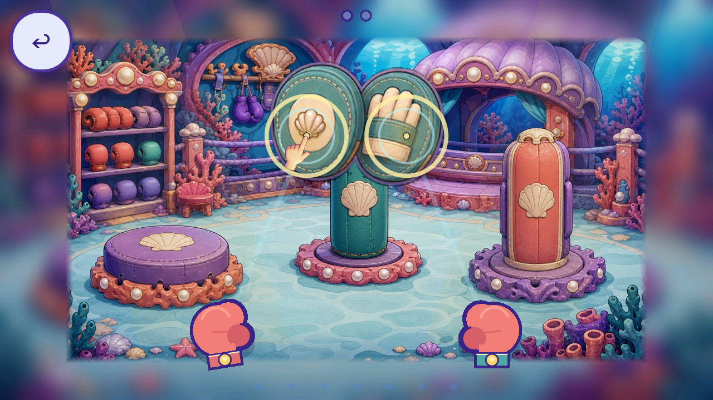
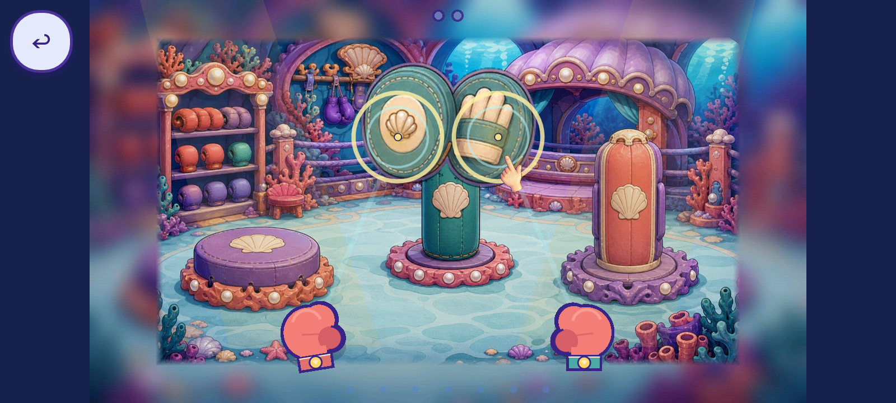

# R26 Boxing whole-hand reuse trial

The independent Boxing guide `FV-DAA9072B905A` / `FVF-22152D4FD26C` has a nonruntime first-phase whole-hand trial using the existing unaccepted R16 source. [R25 actual context](../r25_boxing_pointer_context/README.md) and 20 exact scene/state/source files were anonymously verified before prototype editing. No new art, source pixels, generation calls or production adoption.

[Plan](PLAN.json), [prerequisite](CONTEXT_PREREQUISITE.json), [61 bindings](SOURCES.json), [provenance](REUSE_PROVENANCE.json), [30 native files](CAPTURE_INDEX.json), [ten-axis inspection](REVIEW.json), [source parity](SOURCE_PARITY.json). Exact official Godot 4.7.2 Mobile/Speedy at 1280x720 and 1600x720; 14 native views inspected. Only the draw helper is overridden; derived script is assigned before arm/open in an isolated private playtest. Inherited input, demo, phase and save behavior remain.

A uniform 82-pixel square and rigid rotation along each glove-to-mitt ray keep the source fingertip at the original demo point. No crop, recolor, mirroring, deformation or parts. The hand reads more clearly as pointing in these views and covers less of the painted mitt than the old dot/ring guide. It still overlaps the glove at the start and some mitt detail near contact; phone readability and exact human review remain open. Removing the four visible guide primitives in this preview does not retire production or other target rings, lanes, gloves, feedback and HUD. Original invisible ray/contact calculations remain functional geometry, separately preserved.

Passive and backward/45-percent input earn zero; one left target drag earns one of two units; release clears ownership and keeps that glove at the target. Presses hide the guide; wrong release restarts it. Callback records show zero fingertip error but can be stale while hidden/between redraws; this is source geometry, not QA11 projection, GPU or device evidence. The isolated trial retains an original-helper missing-source fallback, not physically tested or retired. Second glove/full phase/award, four sibling modes, natural routes, reload/reentry/focus and full caller closure remain open.

[Registry](per_piece.json), [coverage](scene_coverage.json), [tally](tally.json), [backlog](CONGRUENCY_BACKLOG.json), [partial union](CURRENT_PARTIAL_CONTEXT_UNION.json). 225 known records / 30 families; 50 existing partial records / 11 families unchanged. 2,624 bounded + 144 excluded = 2,768 retained native files. 77/176 overlapping routes partial, zero complete, 99 without current slice; 351 source scopes unresolved. One unique hand source now supports three separate per-piece context review requests/consuming families. The existing stream draft still fails local QC. Zero art integration/runtime-verified replacements/accepted removals; whole-game pieces/screens/regressions unknown.

[Script checks](SCRIPT_GATES.json), [local gates](GATES.json), [receipt gates](RECEIPT_GATES.json), [manifest](MANIFEST.json), [remote verification](REMOTE_VERIFICATION.json). Inherited R16 exact 82 trusted native passes bind unchanged production; new prototype checks are separate. QA11/device/child/owner, strict 2D satisfaction and all inventory gaps remain open; finding lifecycles unchanged. Publication is not acceptance.

