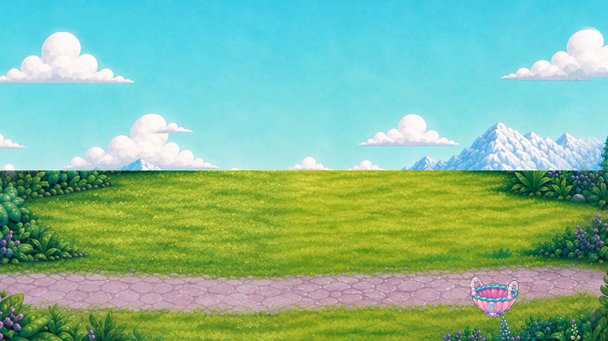
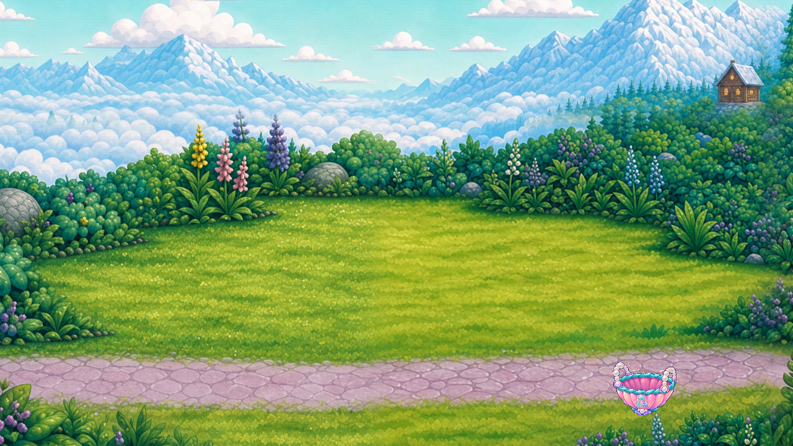

# Farmer panorama reuse fit — R52

One existing-source layout trial removes the artificial horizon cut while preserving all 460,800 pixels in the backdrop’s lower half. The centered alternative removes the path and is rejected. This is a **nonruntime reuse candidate**, with no production adoption or art acceptance.

The current [R51 scene/context failure](../r51_farmer_context/README.md) was published before this trial. Both new cases use unchanged source `5120b6d59885dd057937aaf284e73681d8eac9f5`, Godot 4.7.2-stable official `ed1daf0bf`, native Mobile/Speedy, original viewport controls and a private synthetic post-boss checkpoint. A separately archived ignored subclass changes only backdrop sampling, hides the original during comparison and restores it afterward. No gameplay phase, progress, clock, hit geometry, source artwork or production code is edited.

The original crops omit 448 native rows at the horizontal join. The retained continuous crop uses global source y=672…1824 at scale 0.625. The path and basket at canvas y≥360 are pixel-identical to the original component. The rejected y=448…1600 crop has adjacent rows too, but loses the path; a seam metric alone cannot accept it.

Both aspects, 1280×720 and 1600×720, complete gathering, filling and delivery. Forty paired checks preserve story, phase, progress and root/surface geometry across original, centered, lower-preserving and restored modes. Four initialized source tiles remain unchanged. Source-native coverage, upper-field readability, all callers, full motion/contact, device, child and owner acceptance remain open. Wide margins, basket occlusion/ownership, tiny oven contact, visible guides and R51’s cold-resume failure remain unresolved.

[Review](REVIEW.json) records exactly 12 viewed native images and two newly viewed source tiles. [Measurements](MAPPING_MEASUREMENTS.json), [native capture index](CAPTURE_INDEX.json), [reuse result](REUSE_RESULT.json), [source hashes](SOURCE_REFERENCES.json), [parity](SOURCE_PARITY.json), [plan](PLAN.json) and [reproduction](REPRODUCTION.json) retain each evidence lane.

81 native files = 30 unchanged-source controls + 44 nonruntime candidate captures + 7 diagnostics. The 74 bounded captures and seven excluded files bring the running total to **4,173 bounded + 1,758 excluded = 5,931 retained**. Stable totals remain **240 role records / 32 families**, catalogue coverage **83 partial / 93 without / 0 complete**, and accepted removals **zero**. The whole-game artwork/screen/regression denominators remain unknown. Two deterministic layout trials create no new drawing samples or generation calls; the three historical unaccepted drawing samples retain their original scope and caps.

[Registry](per_piece.json), [scene coverage](scene_coverage.json), [tally](tally.json), [backlog](CONGRUENCY_BACKLOG.json), [manifest](MANIFEST.json), [remote receipt](REMOTE_VERIFICATION.json) and [final byte proof](FINAL_BYTE_RECEIPT.json). This delta binds every new file and direct dependency; immutable R51/R50 manifests and receipts retain historical transitive verification. Machine checks and publication establish neither creative acceptance nor mission completion.

The [executed candidate source](EXECUTED_CANDIDATE_SOURCE.json) preserves exact UTF-8 bytes, including final blank lines. Readable `.gd` copies remove only those trailing blank lines to pass the publication whitespace gate. Native captures, reports and launch hashes retain the original execution; the validator reconstructs and verifies its exact source bytes separately.
