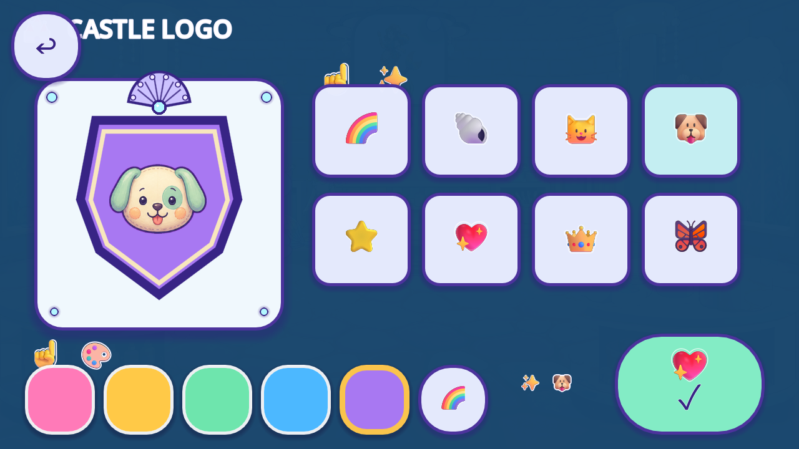
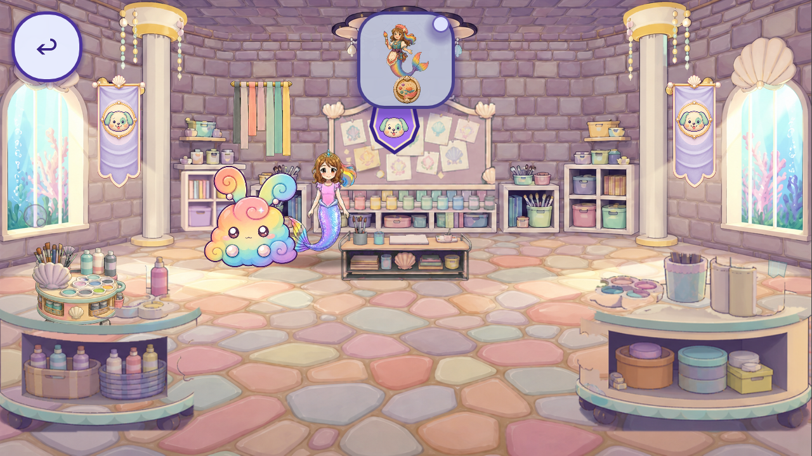

# Castle crest studio context — R53

The original Craft Room paint table opens the crest studio, and both native widths complete all 48 choices, Back cancellation, Keep, registered room displays and private-profile reload. The audit finds a concrete reuse opportunity: selector glyphs show different artwork from the painted motifs they select. The flat shield, color pills and surrounding UI still need material review.

These are unchanged source `5120b6d59885dd057937aaf284e73681d8eac9f5`, Godot 4.7.2-stable official `ed1daf0bf`, native Mobile/Speedy at 1280×720 and 1600×720. A new synthetic post-boss save and declared Castle/Craft Room startup API establish the checkpoint. Original viewport touch, walk, object animation and completion open the studio. No direct studio open, fabricated `logo_studio` game state, art override, production edit or actual child content is used. Full natural travel is still open.

Both corrected cases pass 68 checks each. Purple/dog survives Keep, two Craft Room banners plus badge, two Playroom banners, unregistered Library absence, Back after a gold/star draft and an application-background notification, and a fresh Main instance in the same engine. That background boundary had no pending/dirty save; it does not prove safety when another write is pending. This is not an Android process restart or device test. [Lifecycle evidence](LIFECYCLE_EVIDENCE.json) retains exact states and limitations.

Two initial runs falsely failed only the fixture’s nested integer/float equality: the saved JSON retained the same sentinel values. [Repair history](FIXTURE_REPAIR_HISTORY.json) preserves both failed runs, their 140 excluded images and a separate exact-engine adversarial check. Only the expected test structure is normalized into the JSON numeric domain; changed values still fail. No save behavior was repaired or weakened.

[Review](REVIEW.json) binds exactly 12 directly viewed native images and three source images, ten comparison axes and three open observations. The other captured choices are not claimed visually reviewed. Brown dog/flat butterfly menu glyphs differ from the cream/green puppy and painted pink/aqua butterfly previews. Existing motif textures and cloth banners are the first reuse sources; no failed-reuse gap or new generation is justified. Back overlaps the title at 1280; a transient room-door toast covers color controls at both widths in this declared startup seam. Their natural-route/lifecycle scope remains open.

Saved child color/symbol IDs and content must remain intact. Source-authored backing and selectors are separate repair candidates. Invisible functional controls/input geometry are separately preserved. [Source parity](SOURCE_PARITY.json) checks all 4,420 frozen runtime files, 4,041 initialized sidecars and eight normal-save hashes in all four runs. Provenance-only source notes grant no creative acceptance.

280 retained native files = 140 current-source bounded event/state captures + 140 excluded fixture diagnostics. Running totals become **4,313 bounded + 1,898 excluded = 6,211 retained**; these are not unique artwork or screen counts. One existing ID gains partial context: **74 existing IDs / 15 families**, plus 16 supplemental roles. Known role records stay **240 / 32 families**. The two crest catalogue aliases describe one overlay: **84 partial / 92 without a current slice / 0 complete** across the historical 176-entry catalogue. Whole-game artwork, screens and regression totals remain unknown; approved, integrated, runtime-verified replacements and accepted removals remain zero.

[Plan](PLAN.json), [capture index](CAPTURE_INDEX.json), [caller boundary](CALLER_SCOPE.json), [registry](per_piece.json), [coverage](scene_coverage.json), [tally](tally.json), [backlog](CONGRUENCY_BACKLOG.json), [reproduction](REPRODUCTION.json), [manifest](MANIFEST.json), [remote receipt](REMOTE_VERIFICATION.json) and [final byte proof](FINAL_BYTE_RECEIPT.json). Every new/direct dependency must be anonymously byte verified at the published revision; historical R52/R51 packets retain their own verification times. Machine checks/publication establish no artwork, full-game, device, child, owner or QA11 acceptance.
