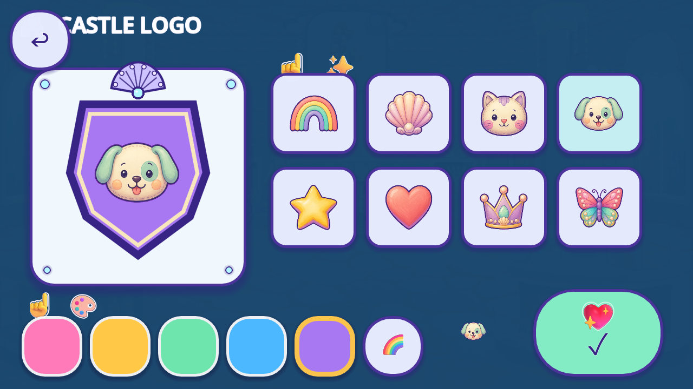

# Castle crest motif reuse — R54

The isolated candidate uses the exact painted preview motif for all eight choice buttons and the selected-symbol status. The brown emoji puppy and flat butterfly now match the painted identity selected by the child. **This is a nonruntime fit candidate; production remains unchanged.**

[R53 current context](../r53_castle_logo_context/README.md) was published and its selected scene/source dependencies were anonymously byte-verified before this trial. Original source `5120b6d59885dd057937aaf284e73681d8eac9f5` runs under Godot 4.7.2-stable official `ed1daf0bf`, native Mobile/Speedy at 1280×720 and 1600×720. The same declared synthetic post-boss checkpoint/startup Castle API leads to the original paint-table touch/walk/action launcher. Original selection, Keep and Back controls run throughout.

The eight existing `SYMBOL_TEXTURES` are reused proportionally at 100×100 inside the original 158×150 targets. The selected-symbol status uses the same 52×52 source motif instead of its decorative sparkle/emoji pair. Color and Keep feedback remain original. Mouse-IGNORE images preserve touch ownership; source callbacks execute first, followed by an ignored visual-only synchronization callback. Tooltips/parent hints remain source-owned. No new source pixels, tint, crop, drawing, generation or production code is added.

Both native cases pass **252 checks**, including **116 original/candidate/restored state and local-layout comparisons**. Every one of the 48 color/symbol combinations at each aspect preserves the saved choice, reward counters, source targets and local preview layout. Original animation transforms continue to evolve naturally; parity does not freeze time or claim pixel identity across timestamps. Passive, pressed/released, Keep, Back, registered room copies, background cancellation and same-engine private-profile reload remain bound. [Comparisons](MODE_COMPARISONS.json) and [source guards](SOURCE_PARITY.json) retain exact evidence. The original pending-write/Android lifecycle and complete natural route remain unproved.

[Review](REVIEW.json) records exactly 15 directly viewed native images and eight source images with ten comparison axes. It supports the isolated identity fit, not whole-role or owner acceptance. Flat shield, pills and panels; other title/color/pointer/confirmation glyphs; the door-toast/title overlap and wide room margins remain open. No failed-reuse gap is established, so no new art is justified. Saved child content and approved identities remain protected; invisible control geometry is separately preserved.

372 retained native files = **118 bounded nonruntime candidate frames + 254 excluded original/restored/lifecycle comparison frames**. Running totals become **4,431 bounded + 2,152 excluded = 6,583 retained**. These are event/state files, not unique artwork/screens. Known roles remain 240 /32 families; partial existing IDs 74 /15 families plus16 supplemental roles; catalogue coverage 84 partial /92 without /0 complete. No new drawing samples or review requests. Approved, integrated, runtime-verified replacements and accepted removals remain zero; whole-game denominators remain unknown.

A runner path typo was caught before native launch and corrected; [preflight history](LAUNCH_PREFLIGHT_HISTORY.json) records zero failed native attempts. All executed source bytes, native outputs and raw logs remain exact. The packet does not modify frozen root arrays, historical readers or their caps.

[Plan](PLAN.json) · [capture index](CAPTURE_INDEX.json) · [reuse result](REUSE_RESULT.json) · [reproduction](REPRODUCTION.json) · [registry](per_piece.json) · [coverage](scene_coverage.json) · [tally](tally.json) · [backlog](CONGRUENCY_BACKLOG.json) · [manifest](MANIFEST.json) · [remote receipt](REMOTE_VERIFICATION.json) · [final byte proof](FINAL_BYTE_RECEIPT.json). Historical R53/R51 dependencies retain their separate verification times; publication and machine checks grant no artwork, device, child, owner, QA11 or mission completion.
