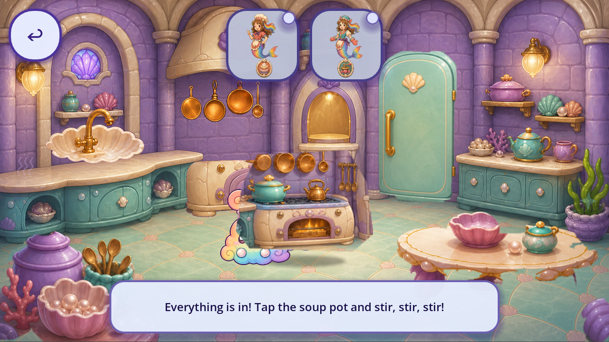
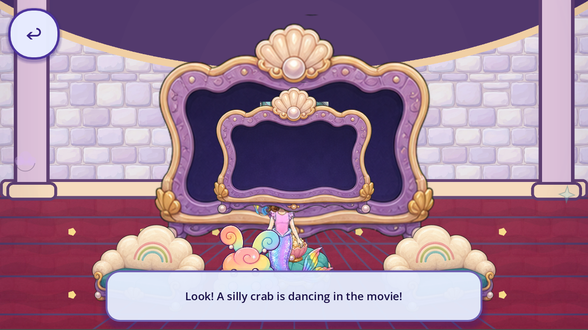

# Original Comfy room context — R55

The original optional Castle journey now has current source/input/save evidence at two viewport sizes. It also exposes a **whole-stove pot target**, a **duplicate blank movie screen**, duplicate character staging and remaining flat room/UI shapes. These are open audit observations, not accepted fixes.

Source `5120b6d59885dd057937aaf284e73681d8eac9f5` runs with exact Godot4.7.2-stable official `ed1daf0bf`, native Mobile/Speedy at1280×720 and1600×720. A declared synthetic private postboss checkpoint and original Main Continue lead to startup `game=level2`, `g[t]=0` and the original Castle mount. Subsequent navigation uses original viewport floor walking, hall doors, global Back and Gallery item doors. Actual runtime remains **level2**; `game.comfy_games` is a retained catalogue alias, not a forced game or newly proven unique screen.

Both current cases pass **88 checks**: passive state, Rumi/Eagle/Daddy finds and original Super Seeker sticker; three ingredients and stir; three movie counters; four bedtime targets; repeat visit and private mid/final save/reload/background boundaries. Three Main instances run per aspect. The future evening reward stays **unlocked=true, verified=false, introduced=false**. Same-engine reload is not cold OS/Android lifecycle acceptance.

Two fixture failures remain exact and excluded: an offscreen door visibility assumption (1 frame), then a blanket pearl invariant (61 frames). At1280, original hall walking popped `runner_bunny` before the first Comfy action and legitimately earned pearl23→24. At1600, the viewport-driven floor route missed that bunny and retained23. Current route events bind both outcomes; all15 Comfy target actions per aspect preserve their immediate story counters. The earned pearl was never reset. An initial integrity assertion incorrectly demanded the1280 hall-pop outcome at1600; [correction](INTEGRITY_REVIEW_HISTORY.json) retains that validator failure without changing native evidence. [History](FIXTURE_REPAIR_HISTORY.json), [route/lifecycle](LIFECYCLE_AND_ROUTE.json) and raw executed sources/logs preserve both corrections.

[Review](REVIEW.json) records **15 directly viewed native frames and9 source images**, ten comparison axes and five bounded observations. The named pot source is an entire stove/wall/pans scene, duplicating room scenery and obscuring Roshan. Movie messages describe a crab/clouds/hug while the same blank screen frame remains; no footage acceptance follows from counter progression. Sleepover targets disappear rather than showing sampled tucked contact, with live and target Roshan both present. Preserve approved character identities while resolving caller/staging ownership. Ingredient paint/edge density differs beside the kitchen; no new-generation gap is established.

[Consumer bindings](CONSUMER_BINDINGS.json) distinguish **12 draw-context occurrences /9 resolved source textures** from artwork design records. Daddy resolves the declared protected portrait through the existing FashionSkinEngine catalogue to `daddy_original.png`; six resolver/provenance dependencies were anonymously verified after native discovery. The original149-file prefixture prerequisite stays intact. All155 source/context dependencies total89,298,498B. Provenance and painted PNGs do not establish owner or style acceptance. Flat room architecture and Back/toast backing remain under existing open family scopes.

**184 retained files =118 bounded current contexts +66 excluded fixture/boot diagnostics.** Running totals are **4,549 bounded +2,218 excluded =6,767 retained** event/state files, not unique artwork/screens. Catalogue aliases become **85 partial /91 without current slice /0 complete**. Known art roles remain240 /32 families;74 existing partial IDs /15 families plus16 supplemental roles. No new drawings/samples/requests. Approved, integrated, runtime-verified replacements and accepted removals stay zero; whole-game artwork/screen/regression totals remain unknown.

All4420 tracked runtime bytes,4041 initialized sidecars and normal eight save suffix hashes remain exact. No production source/art, protected originals, real child save content or frozen root arrays/readers changed. Next source-reuse trial is the named pot isolation/fit against this exact kitchen; full inventory/caller/fallback closure and all device/child/owner/QA11/strict2D evidence remain open.

[Plan](PLAN.json) · [capture index](CAPTURE_INDEX.json) · [source guards](SOURCE_PARITY.json) · [reproduction](REPRODUCTION.json) · [registry](per_piece.json) · [coverage](scene_coverage.json) · [tally](tally.json) · [backlog](CONGRUENCY_BACKLOG.json) · [manifest](MANIFEST.json) · [remote receipt](REMOTE_VERIFICATION.json) · [final byte proof](FINAL_BYTE_RECEIPT.json). Historical parent verification retains its original time and scope. Publication and machine passes grant no creative or mission acceptance.
