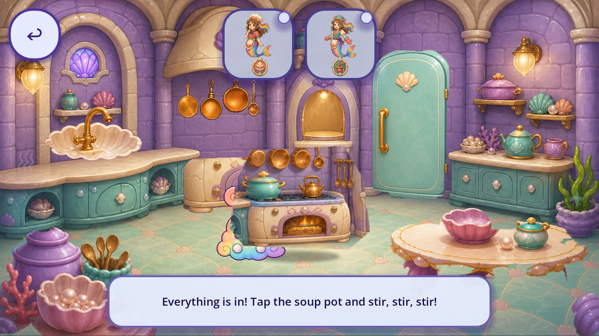
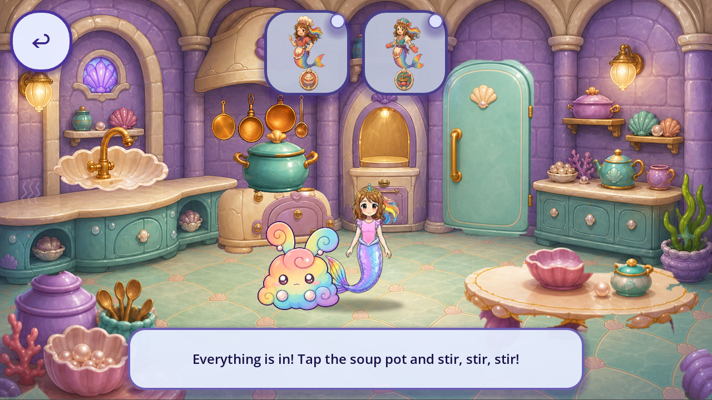

# Current pot ownership and scoped reuse fit — R56

The isolated trial replaces the miniature whole-stove Comfy target with **one retained painted pot on the current oven**, leaving Roshan visible. **Production is unchanged, the old source rejection remains, and this is not an accepted replacement.**

The ownership audit changes the repair decision. Today's original Kitchen renders twelve healed V4 tiles plus a separate V2 oven card at frame0; no stove-pot body is drawn beneath the Comfy layer in inspected current underlays. The old full-pot generation was rejected for duplicating a body in its historical room/consumer. That rejection is preserved. Reusing its first closed-pot cell for a different, isolated current target is a separately reviewed fit, not permission to revive the old animation or ship rejected art.

[Bindings](OWNERSHIP_AND_REUSE_RESULT.json) retain actual native texture/frame/transform/metadata. The oven still reports `source_ownership_verified=false`; this audit does not accept that debt. Native inventories list nodes whose visibility flag is true, including transparent input geometry and containers. They are not draw-call/art-piece counts or full effective-alpha/hidden/native closure. [R55 context](../r55_comfy_room_context/README.md) and its completed-underlay images were already public and byte-verified before the fit.

Godot4.7.2-stable official `ed1daf0bf` runs native Mobile/Speedy at1280×720 and1600×720. Original Main Continue, declared startup `game=level2`,`g[t]=0`, original hall door and Comfy stir control run from a new synthetic private pot-ready checkpoint. **24 original ownership checks and32 refined-fit checks pass.** Two refined original/candidate/restored signatures preserve source state, disk, same control instance, callback, tooltip and input owner. Geometry intentionally changes to180×180. Passive/background/mid same-engine reload/original stir/return/save checks pass; natural full journey, cold OS lifecycle and actual stirring are unproved.

The retained1774×887 RGBA sheet is loaded only in the ignored fixture; `AtlasTexture(0,0,443,443)` uses its first static cell without edited source pixels. The existing pulse continues; fixture-only position compensation pins a declared bbox point to the live oven support point. The initial fit hovered despite a small declared-anchor error: **all38 first-fit files remain visual rejects/excluded diagnostics**. The refinement moves the oven support point11 source pixels down to frame(134,17). Native views support the improved static placement; bbox alignment is not physical-contact/QA11 acceptance. Roshan still performs no approach/hand/tool stir and original completion removes the pot.

An explicit Boolean type was missing from the candidate fixture. The shell also launched it despite the failed analyzer; that unnecessary launch produced **zero frames**, and its exact source/log/result remain. [Fixture history](FIXTURE_REPAIR_HISTORY.json) and [contact history](CONTACT_FIT_HISTORY.json) preserve both mistakes. Corrected prechecks were required before later launches; no production source was patched.

[Review](REVIEW.json) records exactly **12 native views and5 source images**, with ten axes for contour/material/palette/light/perspective/scale/contact/occlusion/readability/action-state. No new art call or drawing sample. The whole sheet costs6,294,152 decoded RGBA bytes and is NPOT over1024; this nonruntime trial is not a compliant shipping export, memory/overdraw budget or phone-size/device acceptance. The other seven acting cells and rejected lid masks are unused.

**104 retained native files =34 bounded contexts +70 excluded diagnostics/comparisons.** The34 are24 source ownership contexts plus10 refined static-fit files. Running totals: **4,583 bounded +2,288 excluded =6,871 retained** ordered event/state files, not unique art/screens. Known roles240 /32 families,74 existing partial IDs /15 families plus16 supplemental roles, catalogue85partial /91without /0complete. Approved/integrated/runtime-verified replacements/accepted removals remain0; whole-game art/screen/regression totals stay unknown.

All4420 tracked runtime bytes,4041 initialized sidecars and normal eight save suffix hashes remain exact. No protected original, child identity/save key, production artwork/code, frozen root arrays/readers, source rejection or acceptance lane changed. Keep the static fit pending its exact owner/export/action reviews, and return to remaining game-wide route/state/caller inventory rather than treating one improved target as completion.

[Plan](PLAN.json) · [capture index](CAPTURE_INDEX.json) · [comparisons](MODE_COMPARISONS.json) · [source guards](SOURCE_PARITY.json) · [reproduction](REPRODUCTION.json) · [registry](per_piece.json) · [coverage](scene_coverage.json) · [tally](tally.json) · [backlog](CONGRUENCY_BACKLOG.json) · [manifest](MANIFEST.json) · [remote receipt](REMOTE_VERIFICATION.json) · [final byte proof](FINAL_BYTE_RECEIPT.json). Machine gates and publication grant no artwork, device, child, owner or mission acceptance.
