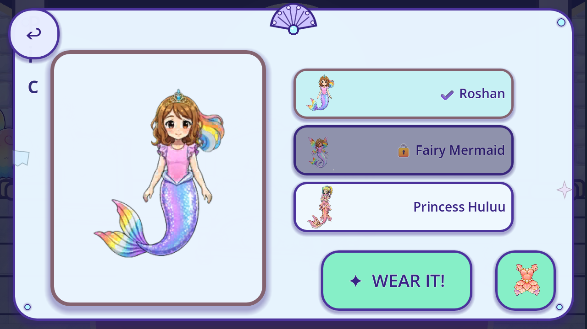
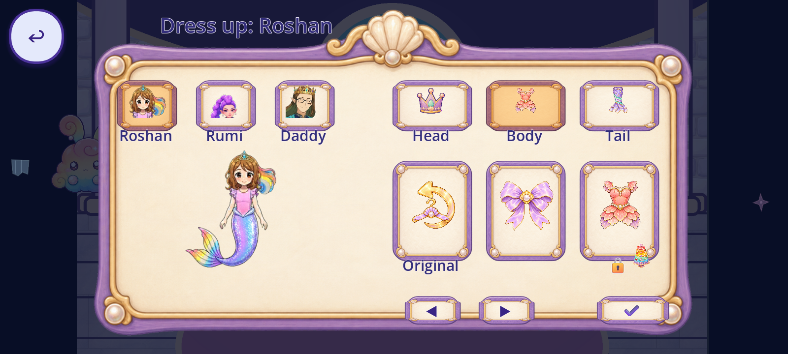

# R63 — original Royal Bedroom wardrobe context

Exact current game source `5120b6d59885dd057937aaf284e73681d8eac9f5`; prior canonical `db43af9e46f0b7f718225ffc03dd40206b8cc2de`. This packet audits the existing full-skin picker. No production code, assets, normal child saves or creative acceptance changed.

[Registry](per_piece.json), [coverage](scene_coverage.json), [tally](tally.json), [backlog](CONGRUENCY_BACKLOG.json), [capture index](CAPTURE_INDEX.json), [review](REVIEW.json), [source consumers](SOURCE_CALLER_BINDINGS.json), [catalogue bindings](CATALOGUE_BINDINGS.json), [manifest](MANIFEST.json), [remote receipt](REMOTE_VERIFICATION.json), [final metadata proof](FINAL_BYTE_RECEIPT.json).

Five passing native cases have147checks: four locked/unlocked1280/1600 full cases132checks and one live-feedback close adjunct15checks. Original touch callbacks reached the wardrobe through MainHall, Dream House Wing and Royal Bedroom after a declared private postboss Castle bootstrap. Two private profiles start Classic with Fairy locked/unlocked before Main; this is not ordinary acquisition or unforced project entry. Actual source look buttons, rapid-repeat feedback, Done/Back/reopen, application notifications, same-engine Main reload and Fashion child entry/Back were observed. Live Back/Done cancels and disposes the original14-star burst and releases world controls. No fresh OS, real phone, audio/performance, QA11, child or owner proof.

The first54-frame run is wholly excluded: its copied read-only Comfy disk reader omitted skin/fairyskin, producing3failed observations. The two missing fields were added without changing original inputs/rendering or the33checks; the corrected case passed. Original failed fixture, captures and logs remain intact. All runs preserve4420runtime raw hashes,4041initialized sidecars and8normal-save name/hash observations.

294new native events comprise231bounded contexts and63excluded diagnostics. Cumulative5328bounded +2657excluded =7985native events. Fourteen passing images were directly viewed; five excluded images informed fixture diagnosis. These counts are events, not distinct artwork/screens. Exact origin/current source consumers justify partial `game.wardrobe` and interior-only `game.pearl_castle` bindings. Existing `ui.wardrobe`/`overlay.wardrobe` remain separate overlapping IDs:88partial,88without a current slice,0complete; all176incomplete. `standalone.main` ordinary entry is not credited.

Current weaknesses are the collapsed narrow title, caption over Done, clipped lock toast, flat parent material versus painted room/Fashion frame, enlarged256px Classic preview, protected Huluu current-use/identity review, geometric stars/glyphs and very flat raster room forms. Existing source choices are observed as-is, not newly approved. All ten style axes and exact same-scene source hashes are in the review.14repeated feedback instances are not14designs. Hidden hit geometry remains functional geometry. No new art, drawing sample, candidate, integration or accepted removal;240known named roles/32families unchanged and whole-game totals unknown.

Reproduction and limits: [REPRODUCTION.md](REPRODUCTION.md), [source parity](SOURCE_PARITY.json), [lifecycle](LIFECYCLE.json), [reuse inventory](REUSE_INVENTORY.json), [failed fixture history](NATIVE_FIXTURE_REPAIR_HISTORY.json). Initial45published dependencies were verified before fixture; [delivery references](DELIVERY_SOURCE_REFERENCES.json) additionally verify current texture/caller/authority dependencies. Historical parent transitive evidence retains its prior receipt/time. Current payload and metadata require their own exact anonymous verification before delivery.
