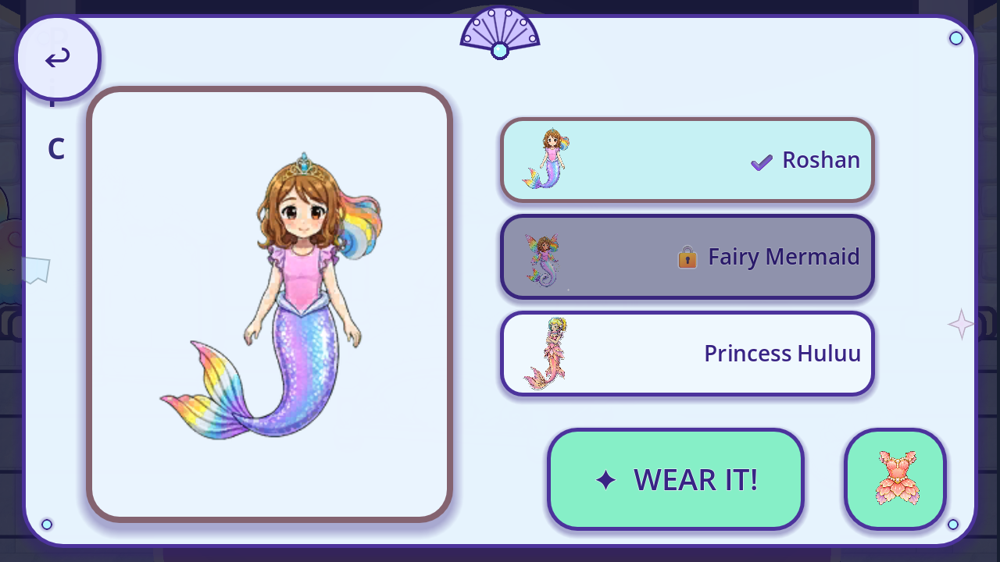
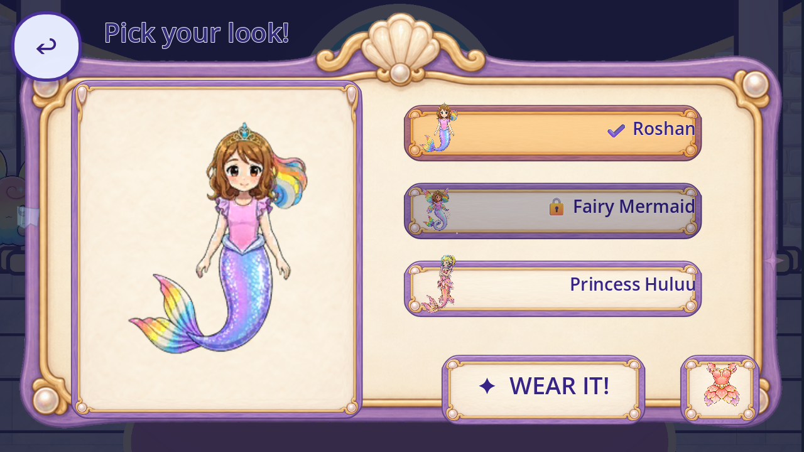

# R64 — painted wardrobe material and heading reuse candidate

Exact current source `5120b6d59885dd057937aaf284e73681d8eac9f5`; prior canonical `d7703fef32f32c4e2727f43eaecef5ff73d8cdce`. This is an ignored candidate trial. Production game files, source PNGs, character identities and normal child saves remain unchanged.

[Registry](per_piece.json), [coverage](scene_coverage.json), [tally](tally.json), [backlog](CONGRUENCY_BACKLOG.json), [capture index](CAPTURE_INDEX.json), [review](REVIEW.json), [lineage](FIXTURE_LINEAGE.json), [reuse provenance](REUSE_PROVENANCE.json), [manifest](MANIFEST.json), [remote receipt](REMOTE_VERIFICATION.json), [final metadata proof](FINAL_BYTE_RECEIPT.json).

The candidate inherits current WardrobeUI behavior and changes only material/title/decorative ownership: existing painted Fashion panel/card textures on the two parent/preview panels and five buttons; all six button style resources; exact five duplicate procedural shell/pearl ornament nodes detached/disposed; one source-text heading recreated using the existing Fashion label recipe. No new drawing/generation, portrait/source-pixel/save-key/choice/callback/progress/clock/camera change. All original33full-flow behavior checks remain.

Four candidate locked/unlocked1280/1600cases pass196checks; candidate live Back/Done closes a source14-star burst and passes23checks. Original source control passes49checks:219candidate+49control=268. The control uses the original owner; its loaded but unused v1candidate dependency is preserved honestly, not called matched v2bytes. Both failed54-frame runs are retained/excluded: a material-versus-pearl observer grouping error and a v1candidate cached201px title/thin-card fit failure. No floors/checks were lowered.

V2samples the card's complete nonzero-alpha region9,8,223,224 with36pxnine-slice; every alpha-positive source pixel/shadow/antialiasing remains. Source files are not edited. Original titleLabel201pxminimum is avoided with a fresh one-line430x64/font42 source-textLabel. Painted styles persist through131sampled candidate picker states; the source control has30flat picker states. This resource sampling is not independent live alpha-projection/occlusion or QA11 proof.

The material matches the existing painted room/Fashion family more closely in inspected frames, but the candidate remains unaccepted. Right-aligned text sits close to ornate corner beads and thumbnail figures overlap card edges; padding/readability requires further fit review. Original caption covers Done early and locked toast bottom-clips; soft Classic preview/protected Huluu current-use/identity, static acting,14procedural stars/glyphs, Back/roomraster/callers/resources/fullroutes/Fashionvariants and font authority remain open. New reuse eligibility grants no creative acceptance.

402new native events=231bounded candidate contexts+171excluded diagnostics (failed108,passingcontrol54,bootstrap9). Cumulative5559bounded+2828excluded=8387native events. These are events, not unique designs/screens/removals. Known240roles/32families,74existingpartialroles/15families,88partialcatalogueIDs/88withoutcurrentcontext/0complete and all176incomplete are unchanged. Whole-game denominators remain unknown; approved/integrated/runtimeverifiedreplacement/acceptedremoved remain0.

[Reproduction and limits](REPRODUCTION.md), [lifecycle](LIFECYCLE.json), [sampled material state identity](MATERIAL_STATE_IDENTITY.json), [observer repair](FIXTURE_SCOPE_REPAIR_HISTORY.json), [failed v1/v2 repair](CANDIDATE_V1_FAILURE_V2_REPAIR.json), [before-fixture source context](CONTEXT_PREREQUISITE.json), [direct delivery dependencies](DELIVERY_SOURCE_REFERENCES.json). All six passing cases are exact official4.7.2WindowsMobile/Speedy/Dummy audio with4420runtime/4041initializedsidecar/8normal-hash guards. Private source profiles, declared Castle bootstrap and same-engine Main reload/handler notifications do not prove ordinary acquisition/unforced entry, freshOS, device performance/audio, QA11, child or owner acceptance. Historical transitive references retain original receipts/times. Publish/verify current payload and metadata before delivery.

Candidate allocation/overdraw gap: the five-button painter constructs30StyleBoxTexture resources per complete refresh and paints again on open after inherited source styling. Texture files are shared and ornament nodes removed; resource reuse, actual Speedy allocation/overdraw cost and physical performance still require verification before adoption. No performance improvement is claimed.
