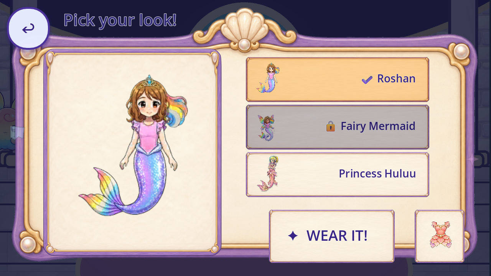

# R65 — Wardrobe cached frame and fit refinement

Ignored candidate only, from exact source 5120b6d59885dd057937aaf284e73681d8eac9f5 and prior canonical 6647c56cb0c05f0130557f022abf5d421b4cc871. Production, original PNGs/targets/portraits/choices/save keys and protected originals are unchanged.

[Registry](per_piece.json), [coverage](scene_coverage.json), [tally](tally.json), [backlog](CONGRUENCY_BACKLOG.json), [capture index](CAPTURE_INDEX.json), [review](REVIEW.json), [lineage](FIXTURE_LINEAGE.json), [provenance](REUSE_PROVENANCE.json), [manifest](MANIFEST.json), [remote receipt](REMOTE_VERIFICATION.json), [final metadata proof](FINAL_BYTE_RECEIPT.json).

The current painted Fashion card draws at one-third uniform scale on one input-ignoring child behind each original button. Thinner/taller paper improves inspected portrait and label clearance; original targets/portraits stay fixed and text gains36pxright inset. Three immutable frame styles, one empty input style and one parent material are constructed once per Main owner. The original six Button style keys share the empty input style; actual visible art is the painted child. Source refresh preview/selected/locked/text/grey cues and helper typography/metadata effects are preserved mechanically. Inherited baseopen still allocates initial styles/ornaments before replacement; total CPU/GPU/overdraw/FPS is unmeasured.

Four candidate profiles/aspects pass200checks, live Back/Done passes25checks and exact published R64candidate control passes50checks. Original33full-flow behavior assertions remain. Native mouse reaches Fairy hover, but Tab produced no focused picker; focus and disabled visuals remain unexercised. Five resources stay stable in9sampled Main epochs, all9weak owner observations retire, and both live closes dispose all5ownedframes. These are bounded observations, not global leak/performance/device acceptance.

Inspected portraits/text fit better. The much finer frame contour differs from thick parent/preview neighbors; style/phone readability remain open. Original caption obscures Done early, locked toast clips, Classic preview is soft, legacy Huluu source-use/identity and proceduralstars/glyphs/callers/Fashionvariants/roomraster remain open. No new drawing, production adoption, approval, runtime-verified replacement or accepted removal is credited.

304native events=239bounded+65excluded(R64control56,bootstrap9). Cumulative5798bounded+2893excluded=8691native events. Events are not designs/screens/removals. Known240roles/32families,74partialroles/15families,88partialcatalogue/88withoutcurrentcontext/0complete and all176incomplete are unchanged. Whole-game art/screen/regression totals remain unknown; accepted removals0.

[Reproduction](REPRODUCTION.md), [lifecycle](LIFECYCLE.json), [sampled state/cache identity](MATERIAL_STATE_IDENTITY.json), [before-fixture context](CONTEXT_PREREQUISITE.json), [direct source references](DELIVERY_SOURCE_REFERENCES.json). Exact official4.7.2WindowsMobile/actualSpeedy/time1/Dummy/maxfps30;4420runtime bytes/4041initializedsidecars/8normal-save hashes preserved. Private profiles, declared Castle bootstrap and same-engine reload/handler notifications do not prove normal acquisition/unforced entry, freshOS, QA11, phone audio/performance, child or owner acceptance. Historical transitive references retain original receipts/times.
