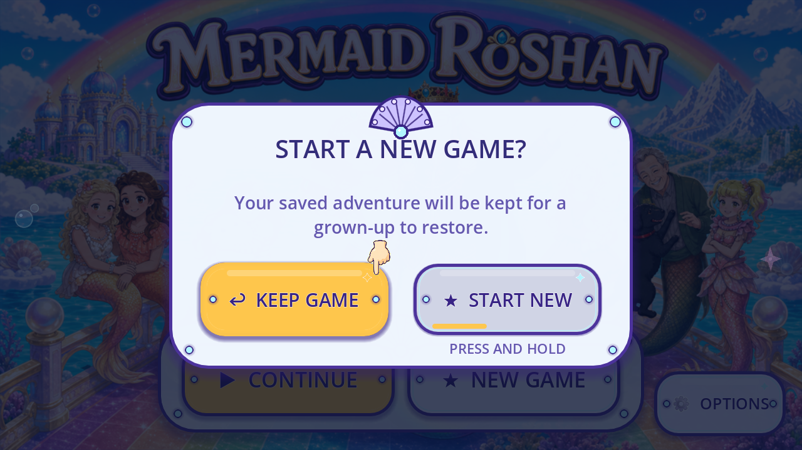
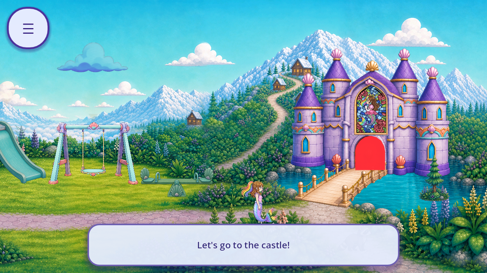

# R66 — display entry and castle gate mask audit

This revision audits the original display entry, adds one visible flat-art role, and retains a reproduced legacy Continue failure. Production files and source images are unchanged. No artwork has been approved, integrated or accepted as removed.

Source: `5120b6d59885dd057937aaf284e73681d8eac9f5`. Prior canonical revision: `0ff29db519e81bb98c69669fffe79de1d68db065`.

[Registry](per_piece.json) · [Coverage](scene_coverage.json) · [Tally](tally.json) · [Backlog](CONGRUENCY_BACKLOG.json) · [Captures](CAPTURE_INDEX.json) · [Review](REVIEW.json) · [Manifest](MANIFEST.json) · [Remote verification](REMOTE_VERIFICATION.json) · [Final metadata proof](FINAL_BYTE_RECEIPT.json).

Six missing-save, active-Day-One and New Game cases at 1280×720 and 1600×720 pass 60 checks. A separate three-check preflight verifies private save injection before Main's `_ready()` across an actual engine reload. Both original New Game holds then archive synthetic data and reload through the source code. Arm delay, disarmed taps, short lifts and cancellation retain their original behavior. The opening clip finishes naturally. The observer does not force a world route, game phase, quality flag, progress, camera or clock.

Both legacy profiles **fail** the unchanged check that saves predating the Day One namespace take the direct route. Loading adds `day_one_active=true` and repairs the private primary before the menu appears; Continue then plays the Day One opening. Current StartMenu and Main comments promise direct entry for those older saves. Both exit codes of 1, 24 checks, two failed assertions and 42 excluded captures remain recorded. Passing evidence checks do not turn that failure into a product pass. The dated DO-10 record retains its policy limits; no earlier runtime comparison proves a newly introduced regression. [Exact trace](LEGACY_POLICY_MISMATCH.json).

The additional role is **FVR-42846B2A5A82: Castle gate flat focus mask**, in family `sky_lagoon_affordances`. The white alpha PNG is tinted nearly opaque red on the original visible Sprite2D, covering painted gate detail. It is visible artwork even though it also signals a target. The invisible Node2D anchor and 128-pixel touch radius remain separately classified as functional geometry. Original flat panels, button states, insets, sheens, sparkles, hold fill and glyphs also remain. The New Game onset records the original boot splash fading over an active opening clip; clip pixels were not edited and transition acceptance remains open.

| Count unit | Current evidence |
|---|---:|
| Known named roles / families | 241 / 33 |
| Existing roles with partial context / their families | 75 / 15 |
| Supplemental roles with partial context | 17 |
| Catalogue entries: partial / without current context / complete | 89 / 87 / 0 |
| New native events: bounded / excluded | 70 / 56 |
| Cumulative native events: bounded / excluded | 5,868 / 2,949 |
| Accepted removals | 0 |

The 126 new events include 42 failed legacy captures, two dependency-preflight captures and 12 desktop Sparkly captures, all excluded from the bounded count. Missing-save desktop startup defaults to Sparkly; the real Options control then selects Speedy and creates a private save. Events and named roles are not the unknown whole-game artwork or distinct-screen totals. `standalone.main` gains one partial binding; `ui.start` remains separate. All 176 catalogue entries remain incomplete. Prior namespace totals are historical; `display_entry_context` and [SUMMARY](SUMMARY.json) hold this revision's metrics.

[Reproduction](REPRODUCTION.md) · [Lifecycle](LIFECYCLE.json) · [Entry states](ENTRY_STATE_IDENTITY.json) · [Mask identity](MASK_SOURCE_IDENTITY.json) · [Caller binding](SOURCE_CALLER_BINDINGS.json) · [Known-role union](CURRENT_KNOWN_ROLE_UNION.json) · [Before-fixture prerequisites](CONTEXT_PREREQUISITE.json) · [Direct source dependencies](DELIVERY_SOURCE_REFERENCES.json).

The trials use exact official Godot 4.7.2 on Windows, Mobile rendering, time scale 1, Dummy audio and a 30-fps cap. Speedy evidence is separated from the Sparkly diagnostics. All 4,420 runtime files, 4,041 initialized sidecars and 11 normal save/archive hashes are preserved. Actual child documents were never parsed, copied or seeded. The observer loads the configured PackedScene; it does not prove a fresh OS launch. Full QA11, zero 3D debt, phone audio/performance, child and owner acceptance, all callers/fallbacks, and the whole-game inventory remain open.
