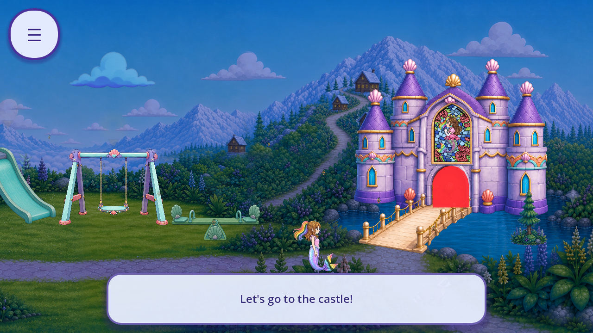
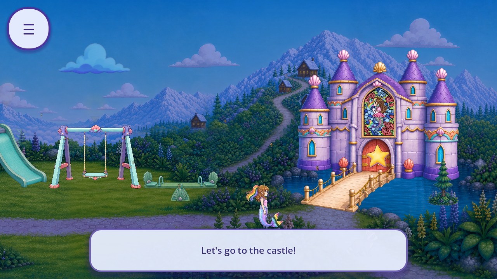

# R67: painted castle-gate cue reuse trial

The castle gate's red focus mask hides the painted wood and hardware. This bounded candidate uses the existing gold star artwork at the original door anchor and retains its authored colours. The original flat mask is never constructed for this role in the candidate. Production files are unchanged.

Four native trials at 1280×720 and 1600×720 passed **54 checks**, with 20 raw frames. Original Continue and the unskipped opening reach the scene; original pause clears focus, resume leaves it clear, the first door touch selects, and the second enters the main hall. Original teardown frees the cue. The invisible Node2D anchor, target ID, payload, radius, geometry, camera and all other targets retain their source owners. Candidate alpha uses the source pulse; its RGB stays white so the artwork keeps its own colour.

This is a reuse candidate with open visual acceptance. The gold/violet palette fits the castle trim, but the simpler star may read as a collectible rather than an entrance. Its smoother material also needs comparison against the carved fixtures at actual phone size. See the [ten-axis review](REVIEW.json). No style score or owner approval is inferred from the machine checks.

No art was generated, no new runtime asset was added, and no source PNG or protected original was edited. The existing 128×128 star is a licensed uniform whole-star derivative of `assets/mg/star.png`. [Provenance and current-scene reference hashes](DELIVERY_SOURCE_REFERENCES.json) retain exact source commit `5120b6d59885dd057937aaf284e73681d8eac9f5`. [Published R66 context was anonymously verified before construction](CONTEXT_PREREQUISITE.json).

The tally remains **241 known roles in 33 families**, with **89 catalogue entries partially covered, 87 without current context and none complete**. Accepted removals remain **0**. This trial adds 20 bounded observations, bringing the retained total to 5,888 bounded plus 2,949 excluded native events. Unknown whole-game artwork, screen and regression totals remain unknown. The R66 legacy-save routing failure remains open and unchanged.

Missing-texture negative behavior, return/reentry and remaining callers/fallbacks are still open. The candidate returns an error before registering the target if the painted texture is absent; that untested path could remove access to the gate and blocks adoption. The candidate's missing-art behavior must preserve a functional entry while failing its artwork audit. Full QA11, fresh OS, actual device performance/audio, child and owner evidence and strict zero 3D debt remain outstanding.

[Summary](SUMMARY.json) · [Raw capture index](CAPTURE_INDEX.json) · [Source lineage](SOURCE_LINEAGE.json) · [Lifecycle guards](LIFECYCLE.json) · [Per-piece registry](per_piece.json) · [Scene coverage](scene_coverage.json) · [Tally](tally.json) · [Reproduction](REPRODUCTION.md) · [Manifest](MANIFEST.json) · [Remote verification](REMOTE_VERIFICATION.json)
