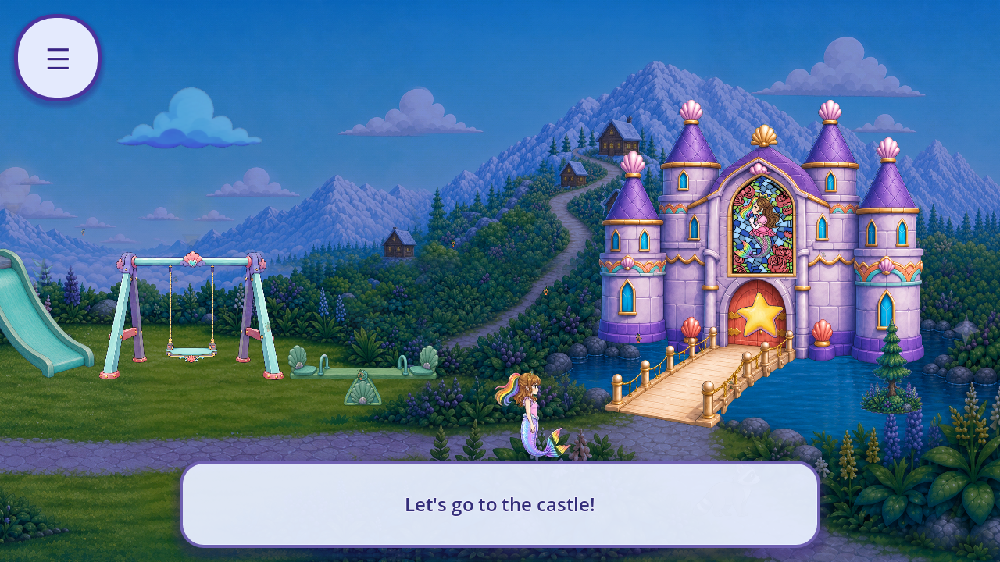
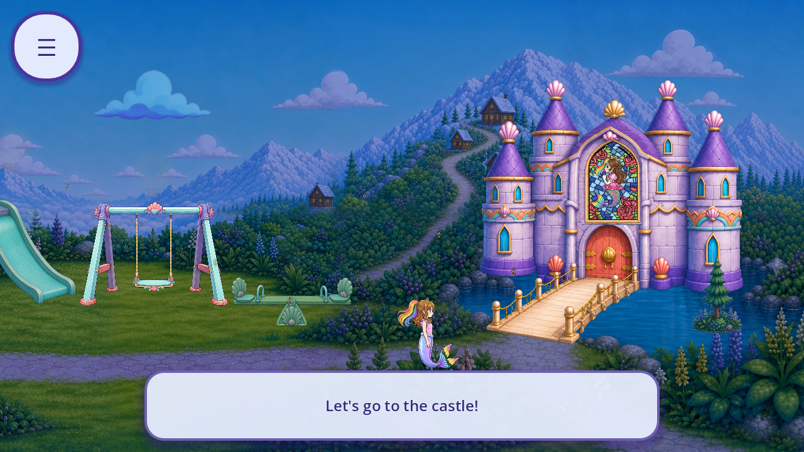

# R68: preserve direct gate interaction when cue art is missing

The candidate now registers the castle gate's original target even when its painted cue cannot be loaded. It keeps the source anchor, generous touch radius, focus and castle-entry behavior without drawing a flat substitute. Production files are unchanged.

R68 also corrects the R67 review: **missing cue artwork did not block every route to the castle**. The original walking/proximity trigger still enters it. The defect was loss of the dedicated target and direct focus. See the [scope correction and exact source branch](SCOPE_CORRECTION.json).

Four repaired trials at 1280×720 and 1600×720 passed **88 checks**: original Continue, source movie wait, pause/clear/resume, target selection, castle entry, neutral Back, rebuilt courtyard target, re-entry and teardown. Both missing-cue trials keep the artwork lane explicitly failed. Functional access is separate from artwork acceptance.

Two corrected R67 baseline trials preserve the two direct-interaction failures each while confirming that the source walking route reaches the main hall after the castle clip finishes. Two earlier baseline trials used an 8-second wait and wrongly called the still-playing clip an access failure. Those raw failures and their two black clip frames remain excluded diagnostics; they are not evidence of blocked access or visible artwork. [Fixture versions](FIXTURE_VERSIONS.json) bind the exact observer used by every case. No trial was overwritten or relabelled as a pass.

The packet has **52 raw native frames: 32 bounded and 20 excluded**. Eleven named frames were inspected, including the diagnostic correction. Existing five false friend/save flags and the synthetic unknown field survive the repaired route. The source legitimately updates its launch counters; no claim of zero source progress is made. All 4,420 tracked runtime bytes, 4,041 initialized sidecars and 11 normal save/archive hashes are unchanged. Actual child save documents were never parsed, copied or seeded.

The [direct-reference census](DIRECT_CALLER_CENSUS.json) checks 312 current scripts and records 103 helper references: 33 production and 70 probe references. The separate [castle-entry census](CASTLE_ENTRY_CALLERS.json) identifies seven production calls, one definition and ten probe calls, including the independent doorstep trigger missed by the narrower identifier search. These are exact lexical inventories, not complete dynamic or runtime caller closure. [Immediate null-highlight consumers](NULL_HIGHLIGHT_CONSUMERS.json) are dispositioned separately.

The normal cue reuses the unchanged licensed 128×128 whole-star derivative of `assets/mg/star.png`; no drawing, generation, new runtime asset or protected-source edit occurred. Its gold/violet material and collectible-versus-entrance readability still need review. Missing cue artwork remains failed, even though the target works. [Ten-axis current-scene review](REVIEW.json) and [source/constructor lineage](SOURCE_LINEAGE.json) preserve those limits.

The tally remains **241 known roles/33 families; 89 catalogue entries partially covered,87 without current context and 0 complete; 0 accepted removals**. Retained native evidence is 5,920 bounded plus 2,969 excluded events. Whole-game artwork/screen/regression totals remain unknown. Alternate inputs, sibling targets, other route/profile callers, full QA11, fresh OS, actual device performance/audio, child and owner evidence, strict zero 3D debt and the comprehensive inventory remain open. The R66 legacy-save routing failure is unchanged.

[Summary](SUMMARY.json) · [Capture index](CAPTURE_INDEX.json) · [Lifecycle guards](LIFECYCLE.json) · [Per-piece registry](per_piece.json) · [Scene coverage](scene_coverage.json) · [Tally](tally.json) · [Reproduction](REPRODUCTION.md) · [Manifest](MANIFEST.json) · [Remote verification](REMOTE_VERIFICATION.json)
