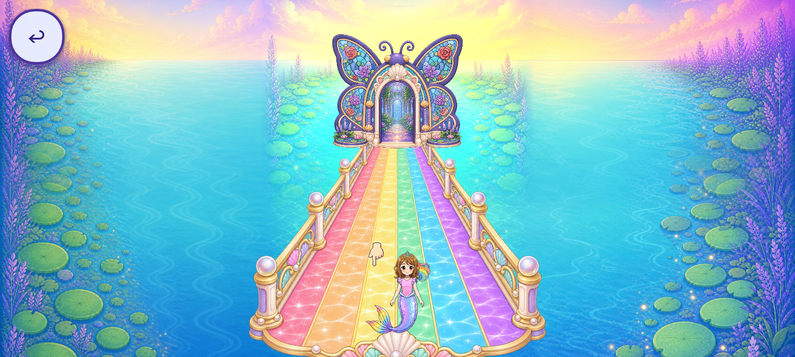
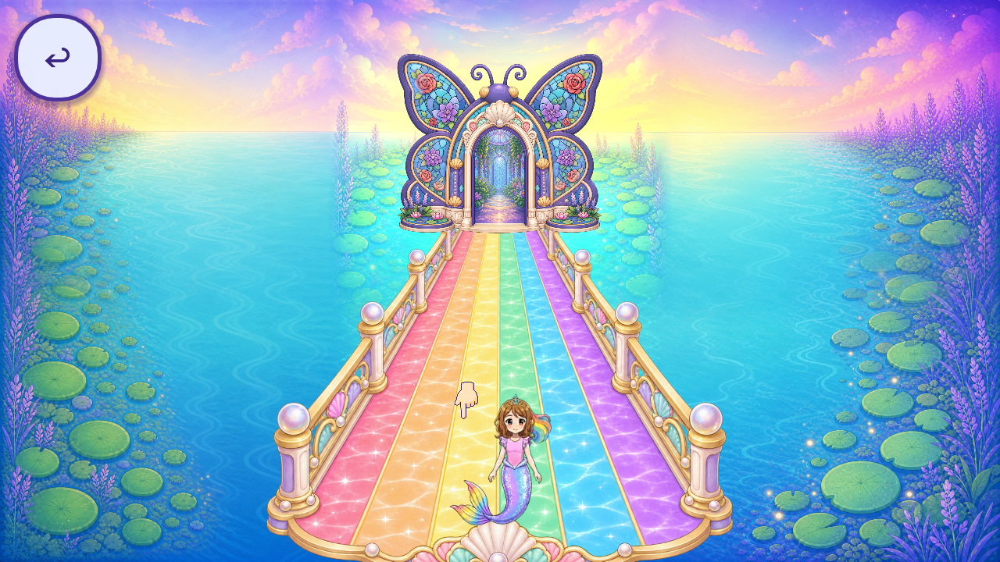

# R70 — existing-art Skyway reuse candidate

The nonproduction candidate restores the loaded painted Skyway by lowering its opaque backdrop. A second background-only layout uses the same eight tiles to cover the wide viewport, removing the purple side strips without changing the source house, path, Roshan, controls, world transform, progress or callbacks. **No game runtime or source pixels changed; this is not an adopted replacement.**

Current source at1600×720:

Existing-art candidate at1600×720:

Candidate at1280×720:

Two final cover cases pass52 observer assertions, including four immediate before/after source-state/control/foreground identity comparisons, ordinary directSkywayBack to the same settled hall, teardown and original door re-entry. Original waypoint and House inputs still reach the existing garden, whose Back/HUD defect remains failed. [Raw pixel evidence](PIXEL_EVIDENCE.json), [lineage and declared writes](SOURCE_LINEAGE.json), [lifecycle](LIFECYCLE.json), [ten-axis review](REVIEW.json), and [background coverage](BACKGROUND_COVERAGE.json) keep these lanes separate.

The packet retains89 native PNGs:36 bounded final-candidate frames and53 excluded diagnostics. An initial17-frame observer run froze the hall view before its source camera finished easing. The correction waits for measured natural convergence; it does not move the camera or relax candidate identity comparisons. The two corrected z-only trials reveal wide purple margins, motivating the cover variant. Their raw states remain preserved.

Open acceptance: the wide crop changes the background horizon while keeping foreground geometry fixed; effective visible source height is about1638pixels, so native coverage, composition/perspective and phone quality remain unaccepted. The flat raster hand, source foreground/contact/acting and shared UI remain open. The fallback node still exists; missing-resource retirement/recovery is unproven. DirectBack's transient Skyway caption and source garden Back/HUD state need caller/voice cleanup evidence. Other profiles, live orientation, all callers, full QA11/freshOS, phone performance/audio, child and owner reviews remain open. The prototype grants no creative acceptance.

[Registry](per_piece.json), [coverage](scene_coverage.json), [tally](tally.json), [backlog](CONGRUENCY_BACKLOG.json), and [reference resolution](REFERENCE_RESOLUTION.json) preserve all historical IDs/counts.243 named roles/34 families;75 existing partial roles/15 families plus19 supplemental partial roles.92 partial catalogue entries/84 without current context/0 complete of176 overlapping aliases.5996 bounded+3044 excluded=9040 retained native images. **0 generated drawings,0 new runtime assets,0 approved/integrated/runtime-verified replacements and0 accepted removals. Whole-game artwork/screen/regression totals remain unknown.**

The current source remains `5120b6d59885dd057937aaf284e73681d8eac9f5`; R69 current context was anonymously verified before the candidate.4420 source file hashes,4041 initialized sidecars and11 normal save/archive hashes remain exact. Only own synthetic private profiles were parsed, with the unknown marker retained; no actual child documents or drawings were copied/parsed. Protected originals and release branches remain untouched.

[Reproduction](REPRODUCTION.md), [manifest](MANIFEST.json), [remote verification](REMOTE_VERIFICATION.json), and [final byte receipt](FINAL_BYTE_RECEIPT.json) bind exact immutable GitHub revisions and public anonymous access. Publication is not acceptance. The mission remains open.
