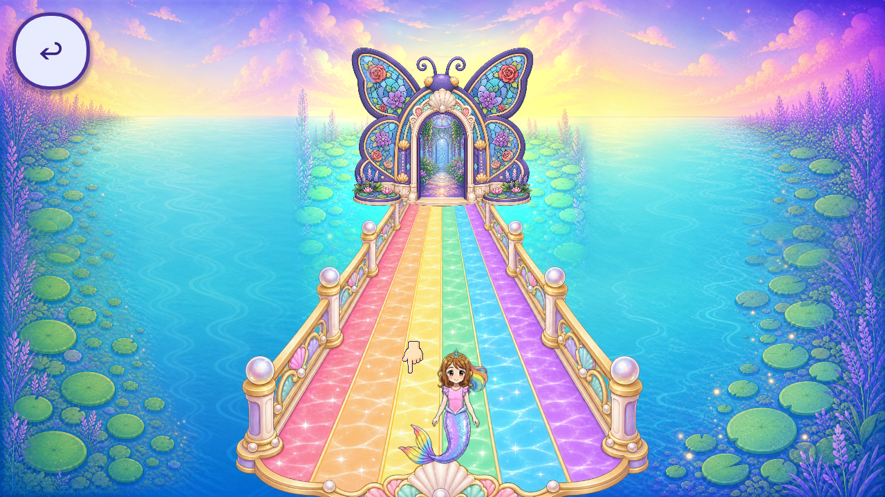
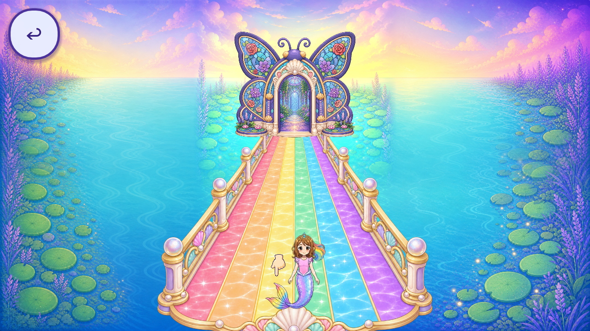

# R71 Skyway hand: registration and blocked painted-art request

The original instructional hand `FVR-47ADC102790E` misses the next waypoint when its downward fingertip is tapped during much of the natural bob. Both widths reproduce misses at all three waypoints; target-centre taps still advance. [Hero-clearance source-alpha analysis](HERO_CLEARANCE.json) accompanies direct image review. An offset-only local preview keeps the fingertip within the original touch regions. Its first centred trial passed input checks but covered Roshan, so it is visually rejected. The revised tip sits40 logical pixels left of the waypoint centre, with16px horizontal and49px vertical minimum margin. All existing hand pixels remain flat artwork. No production change or accepted removal.

## Evidence and limits

- Source `5120b6d59885dd057937aaf284e73681d8eac9f5`; dedicated topic baseline `872b45515e27df6b833ea4b697755186563ed904`. [Reproduction](REPRODUCTION.md), [geometry](GEOMETRY.json), [measurements](HINT_MEASUREMENTS.json), [review](REVIEW.json), [source bindings](SOURCE_BINDINGS.json).
- 4 final cases/178 checks; 163 raw native frames, 86 bounded and 77 excluded. Cumulative 6082 bounded/3121 excluded/9203 retained. Frames are capture events, not distinct screens or art pieces.
- Exact4.7.2 Mobile/Windows/Speedy; own synthetic beforeReady profile, source controls and natural clock/camera.4420 source files,4041 sidecars and11 normal save/archive name hashes unchanged. No actual child drawings/save data seeded/copied. Dummy audio and desktop capture do not prove audible guidance or phone performance.
- Attempt1 used seconds as radians in an observer assertion; raw failure retained. Attempt2 unexpectedly returned to the hall during sampling; last2raw captures unexpectedly2560x1369 instead of1280x720. Window/input interference is possible but unproven; its inherited raw return label grants no credit. Completed witnessed runs did not reproduce that exit. Centred trial is excluded for hero occlusion despite machine success.
- Source opaque fallback and gardenBack/HUD failure remain. R70 background preview is inherited, with wide crop/native2K-quality gaps. Hand/sharedUI/material/style, missing-resource retirement, voice, reverse route/allcallers, QA11/freshOS/device/child/owner and strict2D remain open.
-243 known roles/34 families;92 partial/84 without current context/0 complete catalogue aliases. Whole-game piece/screen/regression totals stay unknown; accepted removed0. [Registry](per_piece.json), [coverage](scene_coverage.json), [tally](tally.json), [backlog](CONGRUENCY_BACKLOG.json). Stable IDs/history and frozen root registries retained.

[Exact source remote probe suite](EXACT_SOURCE_REMOTE_CI.json) completed successfully. A redundant isolated local full-suite attempt was stopped after that exact source success was verified; [its partial log/status](SOURCE_FULL_CI.json) grants no local full-suite PASS or source-defect claim. R71 native/evidence/document/2D gates retain their own scope.

## Deferred painted hand request and reuse follow-up

[Exact two-image request](NEW_ART_REVIEW_REQUEST.json), [prompt](PROMPT.txt), [bounded reuse inventory](REUSE_INVENTORY.json), [automatic rejection](GENERATION_BLOCKED.json). The original/native hand remains flat; character extracts have wrong gestures/tiny resolution/rules-off derivative scope.26 filename candidates are finite triage, not exhaustive all-image acceptance review. The original hand has a painted-material gap, but [additional approved gesture review](REUSE_FOLLOWUP.json) found a painted left-pointing pose in Roshan’s combined atlas. Its non-destructive region/rotation/isolation, resolution and in-context suitability must be tested before deciding that new art is required.123 gesture-family filename hits include variants/copies and do not count as reviews or new pieces. No full scene redraw is proposed.

Automatic approval review rejected sending the original hand and current scene capture to built-in ImageGen because destination-specific export authorization was not established. No generation call, new sample or provider cost exists. The published request binds immutable public source images and exact prompt; intended1 take, maximum2 after documented failure. The request is now deferred: test the existing approved pointing gesture first. If that reuse materially fails, explicit owner approval for this external image export is required before generation. No immediate owner action is needed for the next safe step. Publication itself is authorized and does not grant creative acceptance.

## Delivery

[Manifest](MANIFEST.json), [anonymous required-file receipt](REMOTE_VERIFICATION.json), [final metadata receipt](FINAL_BYTE_RECEIPT.json). Immutable revision/hash/access/time are recorded there after publication. Public project image access is separate from permission to send them to an image-processing destination.
