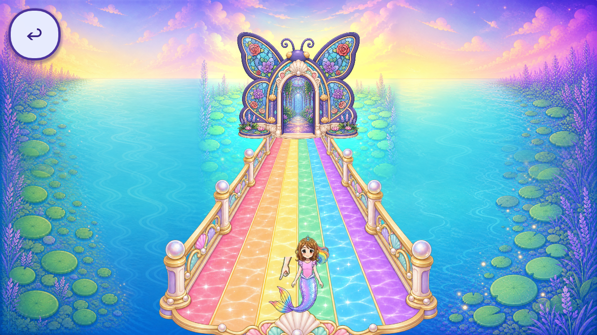

# R72 Skyway pointing-hand reuse audit

Two literal crops from the approved painted pointing atlas were tested in the current Skyway scene. Both retain source-controlled touch reach but fail as standalone instructional hands: the wider crop leaves a long forearm; the tighter crop retains a cut wrist and limited native detail. Lossless original-PNG rendering improves compression loss but does not resolve those defects. Both new uses are rejected. Original character identity acceptance is unchanged.

[Rejection evidence](REUSE_REJECTION.json), [source inventory/provenance](REUSE_INVENTORY.json), [source-region inspection](SOURCE_INSPECTION.json), [decode comparison](decode_comparison.json), [import settings](IMPORT_DECODE_FINDING.json), [ten-axis review](REVIEW.json), [reproduction](REPRODUCTION.md), [raw pixels](PIXEL_EVIDENCE.json), [measurements](HINT_MEASUREMENTS.json).

## Evidence scope

- Exact game source `5120b6d59885dd057937aaf284e73681d8eac9f5`; topic baseline `63b842887eb14d6b51bedb0b676afbe17b6453a7`. Twenty-two immutable scene/source files were anonymously reverified before prototyping. Seven native runtime cases pass 322 observer checks over 28 natural bob cycles; the original gardenBack/HUD return contract still fails in every case.
- There are 142 raw frames: 40 bounded original-flat controls and 102 excluded rejected-trial/source-inspection frames. Cumulative: 6122 bounded, 3223 excluded, 9345 retained. Capture events are not distinct screens or artwork counts.
- Exact Godot 4.7.2 Mobile/Windows/Speedy, original configured Main and private synthetic dependency beforeReady. The 4420 source files, 4041 initialized sidecars and 11 normal save-name hashes remain unchanged. No actual child drawing/save JSON was copied, read or seeded. Desktop/Dummy audio provides no device, audible-guidance or child acceptance.
- The crops use only Sprite2D region, rotation, uniform scale, texture binding and offset on the original node. Other foreground, controller, input targets, state and clock retain exact signatures. Frame14's recorded repack is an integer 12px shift with no erased pixels; the native RGBA Aseprite is the same 1024-square resolution, with no higher-resolution hand established.
- The tracked import sidecar uses VRAM mode2, high_quality=false, lossy_quality=0.7. Tracked LF and initialized CRLF differ in bytes but normalized content/settings are exact. Original-PNG sourceRGBA, created ImageTextureRGBA and independently decoded PillowRGBA agree. The direct PNG loader warns it will not work on export; a future proper lossless delivery/import/license/memory/device path would need separate evidence. No source artwork or import setting was edited.
- [Observer correction](OBSERVER_PREBINDING_CORRECTION.json) flags four invalid pre-attachment tip readings in each of three early painted runs. Pixels and post-binding cycles remain valid within their rejected-trial scope. Raw history is preserved; actual-texture/region binding was verified on rerun. [Source-alpha diagnostic](HERO_ALPHA_ANALYSIS.json) retains only its finite five-case/twenty-cycle projection scope, with no exact GPU/QA11 claim.
- [Finite caller census](POINTER_CALLER_RECONCILIATION.json): 316 text paths, 20 literal resource rows in 19 files, including 18 ghost-hand rows. Dynamic-resource, per-instance and route/caller closure remain open.
- Known roles/families remain 243/34. Catalogue aliases: 92 partial, 84 without current slices, zero complete. Whole-game piece/screen/regression totals remain unknown. No new generation, drawings, production assets, approvals, integrations, runtime-verified replacements or accepted removals. [Registry](per_piece.json), [coverage](scene_coverage.json), [tally](tally.json), [backlog](CONGRUENCY_BACKLOG.json). Frozen root registries and prior namespaces retain exact bytes/history.
- The original flat hand/shared UI, opaque fallback, R70 background crop/native-quality issue, voice, remaining callers, QA11/freshOS/device/child/owner and strict 2D evidence remain open. Numeric reach does not accept an art use.

## Concrete new-art request

[Two-image export request](NEW_ART_REVIEW_REQUEST.json), [exact prompt](PROMPT.txt), [actual R71 automatic rejection](GENERATION_BLOCKED.json). IMAGE_1 is the project-original flat hand shape. IMAGE_2 is the fresh original-flat-control Skyway screenshot from this packet's private synthetic run, used only for style/palette context. The final receipt binds IMAGE_2 to the exact anonymously verified payload revision.

The specific gap is one clean standalone downward-index hand with painted contours/material, adequate native detail, matching scene palette/light and a readable silhouette. One intended built-in ImageGen take, maximum two after a documented failed take. No full-scene or character redesign, protected-original edit, CLI/API-key workaround or runtime adoption. No call, output or sample exists. Export remains blocked until explicit owner authorization for these two inputs and this destination; authorization would not accept the resulting artwork.

## Delivery

[Manifest](MANIFEST.json), [anonymous all-required-file receipt](REMOTE_VERIFICATION.json), [payload verification summary](FINAL_BYTE_RECEIPT.json). R72 uses one payload and one final receipt commit, each earning actual staged and committed 2D no-regression gates. The receipt proves its declared payload; its own immutable bytes/head are checked after push without recursive self-hash commits. No gate is waived. Publication is separate from creative acceptance and mission completion.
