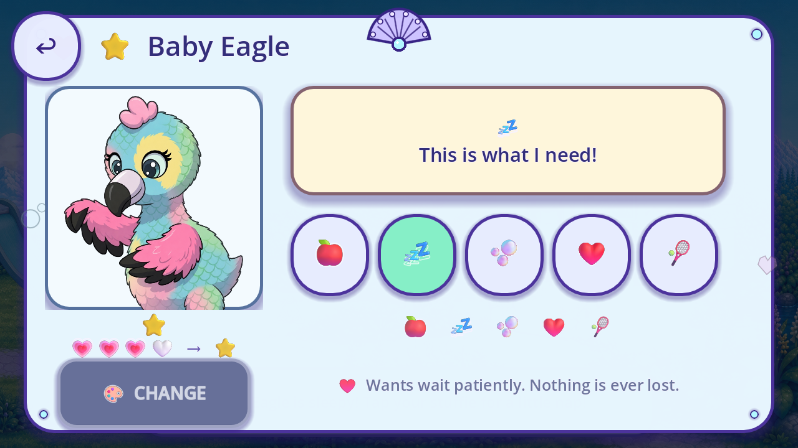
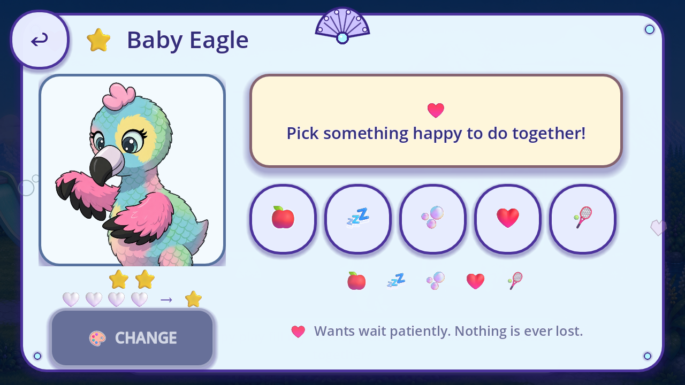
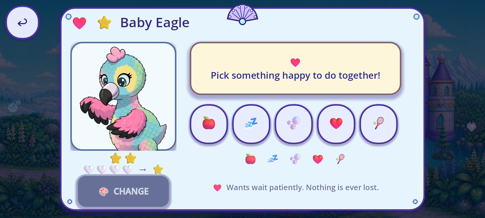

# R76 Stuffie care: current context and missing roles

Seven care pictogram/progress roles now have bounded current-source evidence: five action pictograms, growth-star pips and the four-slot heart-progress strip. These glossy rasterized glyphs differ from the painted Baby Eagle beside them. They are style-review candidates; presence of an emoji or a successful input is not artwork-removal acceptance.

The canonical running inventory is **261 known roles / 35 families; zero accepted removals**. Repeated footer, title and need uses do not become extra pieces. Existing shared panels, buttons, shell ornament and Eagle retain their IDs. Whole-game artwork, distinct screens and regression totals remain unknown. The catalogue stays92partial/84without-current-slice/0complete of176overlapping aliases; no new alias is credited.

[Per piece](per_piece.json) · [Scene coverage](scene_coverage.json) · [Tally](tally.json) · [Known role union](CURRENT_KNOWN_ROLE_UNION.json) · [Repair backlog](CONGRUENCY_BACKLOG.json) · [Manifest](MANIFEST.json) · [Remote receipt](REMOTE_VERIFICATION.json)

Source: `dd799b2d43871b29d1d6e0503646308a194dad1e`, Godot4.7.2-stable official `ed1daf0bf`, Mobile/Speedy at1280×720 and1600×720. Original Main receives an owned synthetic SaveState before Ready; original Continue precedes a declared production-API promenade bootstrap. Original Menu→Stuffie→care/Back inputs, natural first-want clocks and source-owned redraw/save behavior follow. This is not an earned whole-game journey or a fresh OS launch.

Both healthy cases pass43observer checks: one requested care changes3→4points, all four unasked choices and a repeat add0, and original Back/reopen/newMain reload preserves progress, identity and synthetic custom/unknown data. All4425runtime raw-file hashes,4088sidecars and11normal save-name hashes remain exact. No production code/art/import or normal child-save content was changed or parsed.

## Current observations

| Point | Evidence and next action |
|---|---|
| Material and contour | Glossy red apple/heart, beveled sleep marks/gold stars, iridescent bubbles and fine tennis glyph contrast with broad painted feather bands and dark authored contours. Review existing sources in actual slots before commissioning any gap. |
| Feedback | Source creates `StuffieCurrentNeed` under a need panel, while `_choose_canvas_menu_care` searches the stage directly. The intended short icon+heart acknowledgement/pulse does not reach the live label; the requested label stays visible after unasked care. This is an open source-bound repair, with no runtime fix in Phase1. |
| Layout | At1280 the fixed Back covers the decorative title heart; at1600 it does not. The footer duplicates the five icons at a smaller size. Readability and child comprehension remain open. |
| Provenance | Observed theme font reports `FontFile`, empty resource path and Open Sans SemiBold. This does not identify the color-glyph provider or approve OS fallback font pixels. |
| Remaining states | Healthy first-request feed/bath/play variants, heart counts1and2, growth beyond stages1and2, postbattle queue, bruised/resting, during-care, other companion identities, full natural entry, actual audio, finalQA11/device/child/owner evidence remain open. |

[Ten-dimension review](REVIEW.json), [exact source bindings](SOURCE_BINDINGS.json), [seven stable IDs](NEW_ROLE_RECORDS.json), [six reuse candidates](REUSE_INVENTORY.json) and [feedback observations](FEEDBACK_OBSERVATIONS.json) keep these claims separate.

|1280 natural request|1280 newMain reload|1600 requested care fulfilled|
|---|---|---|
||||

## Evidence and boundaries

All88native frames are retained:32bounded source care checkpoints,20entry/lifecycle diagnostics and36failed-observer diagnostics. The first fixture lost button names after source redraw(10frames); the next used strict nested int/float equality on parsed JSON(26frames). Both failures and exact fixtures/logs remain, with no bounded credit. Callback-bound control identity plus normalized JSON value equality correct only the observer. Two new healthy runs pass86checks; native source behavior is unchanged.

Cumulative retention is6310bounded+3476excluded=9786native frames/events. These are evidence units, not distinct screens or artwork removed. [Capture index](CAPTURE_INDEX.json), [deterministic derivation reproduction](REPRODUCTION_CHECK.json), [source guards](SOURCE_GUARDS.json) and [gates](GATES.json) bind exact files/checks. Historical R75 data, IDs and frozen root registries remain unchanged.

Zero new drawings, generation calls, replacement approvals, integrations, runtime-verified replacements or accepted removals. Reuse fit and actual glyph-provider provenance are unresolved. The R72 external ImageGen request remains unapproved; no export/retry occurred. Full audit, zero-art and acceptance mission stays open.
