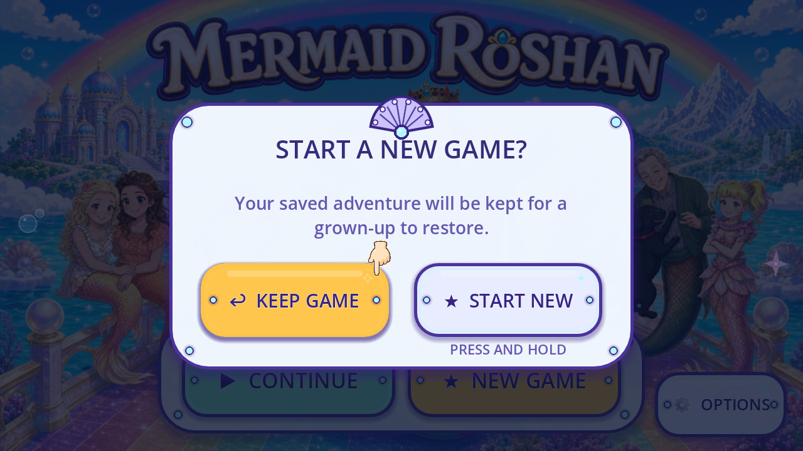
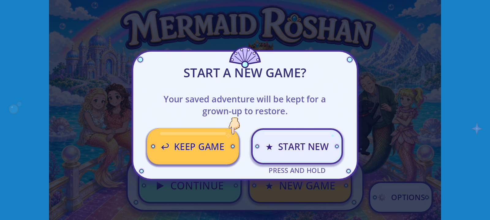

# R77 — current intro entry ownership and Keep Game hand

One newly named visible role is registered: **FVR-67E362D1DE53, Keep Game instructional hand**, in the existing shared UI family. The running inventory is **262 known roles / 35 families; zero accepted removals**. The original hand targets Keep Game correctly in these tests; its flat material still differs from the painted launch artwork.

[Per piece](per_piece.json) · [Coverage](scene_coverage.json) · [Tally](tally.json) · [Known role union](CURRENT_KNOWN_ROLE_UNION.json) · [Backlog](CONGRUENCY_BACKLOG.json) · [Manifest](MANIFEST.json) · [Remote receipt](REMOTE_VERIFICATION.json)

## What the intro name actually owns

The exact current `dd799b2d43871b29d1d6e0503646308a194dad1e` source parses313GDScripts. The named `_ready()` call to the retained four-page `IntroOverlay` sits under `DisplayServer.get_name() == "headless"` and `first_session`. The display branch builds `StartMenu`. Twelve non-test-filename target calls are source candidates, including debug-export calls; that classification does not establish normal reachability.

On the actual displayed menu, `intro_active=true` and LivingWorld reports `intro.storybook`, while no IntroOverlay instance/layer exists. Original New Game reloads Main and enters Day One with its existing opening clip. Original Continue preserves this newly created Day One profile. We do not force the retained book pages or manufacture `ui.intro` coverage. Dynamic/native/debug/resource closure remains open. The catalogue stays92partial/84without-current-slice/0complete of176overlapping aliases; whole-game artwork, distinct-screen and regression totals remain unknown.

[Named caller/guard graph](SOURCE_ENTRY_GRAPH.json) · [Live owner observations](ENTRY_OWNER_OBSERVATIONS.json) · [Exact functions](SOURCE_BINDINGS.json) · [Ten adversarial extraction tests](SOURCE_TESTS.json).

## Current original-control evidence

Two healthy1280×720/1600×720 runs under exact official Godot4.7.2-stable `ed1daf0bf`, Mobile, pass50observer checks. Original Options selects/persists Speedy and mutes the isolated run. The initial desktop-default Sparkly views are retained as excluded diagnostics. No game, camera, progress, intro, clock, geometry or visual resource is forced.

Across64natural bob samples, the unchanged centered512×512 hand at0.14scale keeps its source fingertip inside the original300×118 Keep Game button. Actual input at that tip cancels without resetting. A short Start New hold preserves the private hashes; an intentional hold archives the private options save, reloads the original Main and plays the existing opening. The clip is gone about32.19seconds after the first new-Main checkpoint, before its38second timeout. Only checkpoints are observed: no complete movie, audio, motion or cinematic delivery acceptance is claimed.

This refreshes [R66](../r66_display_entry_context/README.md), which already tested original holds/reload/opening. R77 adds the current named-owner crosswalk and separate hand role. Relevant modules and the source hand are exact-equal to R66's source. Its **legacy Continue-policy mismatch remains open**; these fresh Day One profiles do not retest or repair that failure. The bright castle gate focus mask is the existing **FVR-42846B2A5A82**, seen again after the opening; it is not a newly discovered piece.

[Pointer measurements](POINTER_MEASUREMENTS.json) · [Six actual native views and ten-dimension neighbor comparison](REVIEW.json) · [Prior scope/source comparison](PRIOR_R66_SCOPE.json).

|1280 Keep Game cue|1600 Keep Game cue|
|---|---|
|||

## Save and evidence boundaries

Before loading Main, the observer remaps `user://` to a fresh owned namespace and checks the actual engine path. Original default SaveState remains isolated through the real scene reload. Normal saves are hash-only: no normal JSON parsing, content backup/restore or writes. All11normal save-name hashes,4425runtime raw-file hashes and4088sidecars remain exact; the source worktree is clean. Temporary ProjectSettings values are restored after source teardown.

The first run passes25observer checks but logs39shader-cache write errors after the user-directory remap. All18frames are excluded and retained. A later Python cache-preparation containment check stops before native launch,0frames; that stop is preserved under [prelaunch](prelaunch/attempt2_entry_source_1280/PRELAUNCH_FAILURE.json). Packaged Python APPDATA aliases differ from the engine-declared paths. The healthy cases create only shader-cache directory names through Godot's verified private namespace, with depth/count/name/containment guards; no normal cache or save file contents are copied. No shader/renderer setting is weakened to hide errors.

[Capture index](CAPTURE_INDEX.json):54raw =32bounded +22excluded, plus0prelaunch frames. Cumulative retention is6342bounded +3498excluded =9840native frames/events. These are evidence units, not art or distinct screens. [Five-output fresh-scratch reproduction](REPRODUCTION_CHECK.json) · [Source/save/import guards](SOURCE_GUARDS.json) · [Fixture gates](FIXTURE_SYNTAX_GATES.json) · [Document/evidence gates](GATES.json).

The hand remains a flat source bitmap. Reuse fit, painted style, readability, independent liveAlpha/fullQA11, actual device, child and owner evidence remain open. Invisible hit geometry and hold timers stay functional and separately dispositioned. Zero new drawings, generation calls, runtime assets, approvals, integrations, runtime-verified replacements or accepted removals. The R72 external ImageGen request remains unapproved; no retry/export occurred. The full mission remains open.

Published payload: [`d2eaff753986d8dcf25fc4f15a7ef5fff50f5929`](https://github.com/Ebonyks/mermaid-roshan-reef/tree/d2eaff753986d8dcf25fc4f15a7ef5fff50f5929/docs/handoffs/codex_flat_vector_art_2026-10-07/r77_intro_entry_ownership). Anonymous exact-byte/SHA-256 verification covers all470required files/90878887bytes at 2026-10-16T09:52:06.423322+00:00. Manifest SHA-256 `3e16ae058417f024743ca3e81213a55894790dd3d0060b955fc23b5f395d4b8f`. [Remote verification receipt](REMOTE_VERIFICATION.json) records each path/hash/access result. Final receipt metadata is separately checked after its push; publication grants no artwork or game acceptance.
