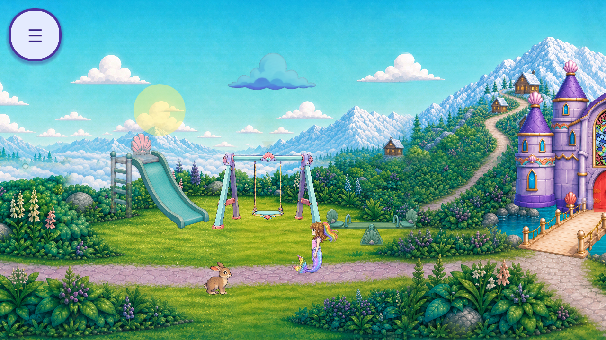
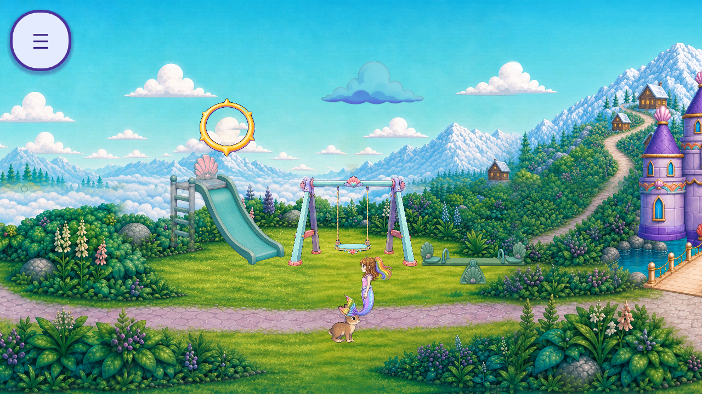

# R82 — local painted-ring reuse for touch feedback

Source `dd799b2d43871b29d1d6e0503646308a194dad1e`; topic baseline `2acd2c969faeb3fb61d3ff5bcf1540aadba6735b`. [Plan](PLAN.json), [impact](../../../../design/audit_impacts/flat-vector-touch-flash-reuse-20261016.json), [summary](SUMMARY.json).

One bounded nonruntime sample **FV-CAND-R82-RING-01** reuses the whole existing `assets/opera/worlds/props/fx_telegraph_ring.png` for the source-bound TouchUI flash subpart **FV-7976FC8C2881 / FVS-38151AC2830B**. [Eleven inspected source options](REUSE_INVENTORY.json) retain exact hashes/provenance and fit dispositions. Star reward shapes, uniform shine/rings, wipe/bop/dust/bubble event vocabulary do not automatically meet neutral touch feedback. The chosen brush-shaded gold/lavender ring has a transparent center. Its existing ground-telegraph acceptance does not accept this new touch use.

The observer first records original source flashes, then explicitly changes only the source-created flash Panel material: `StyleBoxEmpty` replaces the filled style and a whole-bitmap `TextureRect` child fills the same110×110rectangle. Source bitmap/RGB/aspect are preserved, with white child modulation and no crop, warp, relight, new input owner or tween. Original Panel, touch/controller, alpha tween and queue-free remain authoritative. The candidate uses authored image alpha up to1.0, while the source fill peak was0.5; this is a declared visual change, not opacity equivalence. [Sample](CANDIDATE_SAMPLE.json), [job/derivation card](REUSE_JOB_CARD.json).

Two official Godot4.7.2-stable / Mobile / Speedy native cases pass84 observer checks using original private NewGame/options/reload/opening/travel and actual original touch input. Four original and four separate candidate lifecycles record construction blueprint, exact full-image geometry, declining original Panel alpha and natural parent teardown. No game/phase/actor/timer override or source artwork/code edit occurs. [Lifecycle evidence](FLASH_LIFECYCLE.json) qualifies instrumented wall time and remaining child-instance/ancestor-RGB telemetry; no device-performance or exact0.35s wall-time acceptance is claimed. The retained R81 313-script graph remains exact current-source reference evidence; no new full AST scan is claimed.

[39 raw frames](CAPTURE_INDEX.json) contain19 bounded original-source views,16 excluded local-prototype views and four excluded bootstrap controls. The images below are different natural time/camera states, not registered pixel-matched before/after pairs.

Original source flash at1280:

Local painted-ring prototype at1280:

[Ten-axis partial review](REVIEW.json) compares contour/material/palette/light/perspective/scale/contact/occlusion/readability/action-state against the actual painted scene and [exact source hashes](SOURCE_BINDINGS.json). The open center keeps scene detail visible in these samples. The bright rim/connected alarm ticks, new peak opacity, all-scene meaning/readability and full touch states remain unaccepted. Child-instance/ancestor RGB, QA11, device, child and owner evidence remain open. Production still contains the original flat flash; it is not exempt as invisible geometry.

[Registry](per_piece.json), [coverage](scene_coverage.json), [tally](tally.json), [backlog](CONGRUENCY_BACKLOG.json) and current unions preserve all inherited bodies and stable IDs. Known263 roles /35 families,76 existing partial roles /15 families plus39 supplemental partial roles, and92 partial /84 without a current slice /zero complete among176 overlapping aliases are unchanged. One sample awaits review for this role; global sample and whole-game artwork/screen/regression totals remain unknown. Cumulative6,489 bounded +3,552 excluded =10,041 retained frames/events are evidence counts, not removed artwork. New generation/runtime assets/approved/integrated/runtime-verified replacements/accepted removals remain zero. R80's star sample remains awaiting new-use review.

All4,425 runtime files,4,088 import/UID sidecars and11 normal save-name hashes remain unchanged; normal child contents are never parsed/copied/restored. [Source guards](SOURCE_GUARDS.json), [capture provenance](CAPTURE_PROVENANCE.json) and39 appended nonruntime [license rows](../../../../ASSET_LICENSES.md) bind each unedited framebuffer. Source inputs/originals remain untouched. No hosted generation/export or alternate backend is used; the [R72 rejected export](../r72_skyway_hand_reuse/NEW_ART_REVIEW_REQUEST.json) remains unapproved.

Reproduce with `python -B derive_evidence.py`, optionally setting `R82_ANALYSIS_OUTPUT` to a fresh owned directory. Run `python -B test_reuse_evidence.py` and `python -B validate.py`. [Reproduction receipt](REPRODUCTION_CHECK.json), [syntax/analyzer gate](FIXTURE_SYNTAX_GATES.json), [document/evidence gates](GATES.json) and actual staged/committed2D publication companions keep verification separate from acceptance. [Work remaining](WORK_IN_PROGRESS.json). Whole-game inventory/caller/state closure and every required acceptance lane remain open; the mission is not complete.
