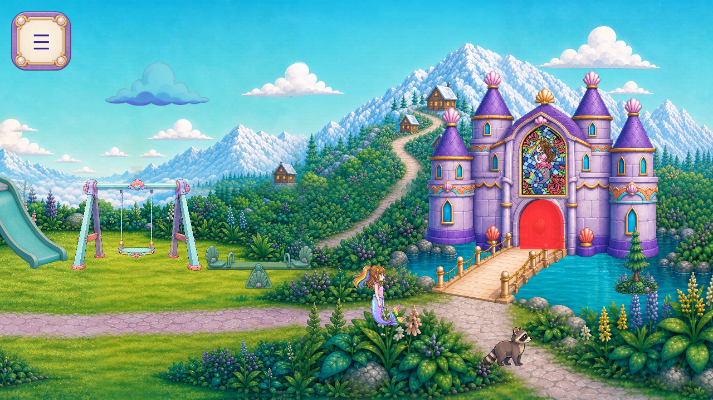
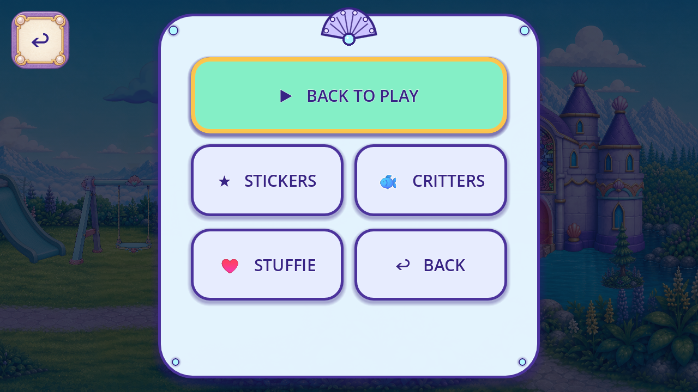

# R86 painted global navigation runtime trial

The existing painted wardrobe card now supplies all six material states of the actual global Menu/Back button. The original constructor and mode-sync call apply the surfaces synchronously. The same112x112 target at(18,18), Button ownership/layer29, glyphs/fonts and original input/route/pause/save flow are retained. No diagnostic tick or forced toggle enters production. Source artwork and protected originals are unchanged; no new art is generated.

The [publishedR85 sample](https://github.com/Ebonyks/mermaid-roshan-reef/tree/05fdd9c35622a06abda3be8aa72e519de13f5768/docs/handoffs/codex_flat_vector_art_2026-10-07/r85_navigation_reuse) retains the current scene comparison, reuse inventory, state colors and prior timing rejects. The [context prerequisite](CONTEXT_PREREQUISITE.json), [plan](PLAN.json), [source preservation](SOURCE_PRESERVATION.json), [raw source pin](SOURCE_PIN.json) and [impact](../../../../design/audit_impacts/flat-vector-navigation-runtime-20261017.json) bind this repair to baseline dd799b2d43871b29d1d6e0503646308a194dad1e.

Exact official Godot4.7.2 import and changed-script analyzer pass. All1102 sidecar normalizations equal baseline Git blobs; no source image changes. Two ordinary displayed Mobile/Speedy cases at1280x720 and1600x720 each pass32 checks, three original touch Menu/Back round trips and13 material-presence timing guards. The capture observer is read-only; it supplies no material overrides or forced visual states. [Native capture index](CAPTURE_INDEX.json) binds30 raw frames, all excluded from current-dev coverage. [Partial direct agent review](REVIEW.json) records nine inspected frames and all ten comparison axes. Metadata and pixel guards are machine evidence, not creative acceptance.

Unmodified full trusted82-probe CI passes with82 unique zero-exit probes; source/sidecar/actual-normal-save hashes and stock CI bytes remain unchanged. [Full result](full_ci_attempt2/FULL_CI_RESULT.json) and [gate summary](GATES.json) retain the exact raw log hash. Initial DOC080 navigation and zero-probe Windows handle failures are preserved; only the local task-index route and owned launch wrapper were repaired. Payload publication and anonymous exact-byte verification now pass; exact published-head remoteCI/integration and all acceptance lanes remain pending. [Role evidence](ROLE_EVIDENCE.json) records implementation separately from dev integration and formalQA11/device/child/owner acceptance. Critical glyph/fallback semantics, other routes/callers, neighboring flat pause UI and the unknown whole-game denominator remain open. No new role/family/sample credit or accepted removal is claimed. The canonical registry stays on its durable audit branch; five root representations absent in this baseline remain absent. No release or dev integration is authorized by this packet.

The [source caller matrix](NAVIGATION_CALLER_MATRIX.json) inventories26 registered route labels across57 call sites in171 searched script files. These are source labels, not distinct screens or reviewed artworks. Only the Sky Lagoon root pause/resume lane has currentR86 native context; progress-gated castle/boss modes, every registered caller variant, lock/focus/cancel and dynamic legacy returns remain open.

Actual source Menu before input:

Actual source first paused Back frame:

[Manifest attempt1](MANIFEST_ATTEMPT1_FAILURE.json) retains the corrected tracked-import dependency mistake. [Generated import snapshot](GENERATED_CARD_IMPORT_BINDING.json) records the existing ignored mode0 settings without changing runtime metadata or source pixels.

Published review payload: [immutable tree](https://github.com/Ebonyks/mermaid-roshan-reef/tree/9f6ae4fd0782d8f3333715725a8e96e83443cc3f/docs/handoffs/codex_flat_vector_art_2026-10-07/r86_navigation_runtime), [direct manifest](https://raw.githubusercontent.com/Ebonyks/mermaid-roshan-reef/9f6ae4fd0782d8f3333715725a8e96e83443cc3f/docs/handoffs/codex_flat_vector_art_2026-10-07/r86_navigation_runtime/MANIFEST.json), [anonymous verification receipt](REMOTE_VERIFICATION.json). The receipt binds the manifest to that payload commit; later receipt metadata is separately byte-verified.
