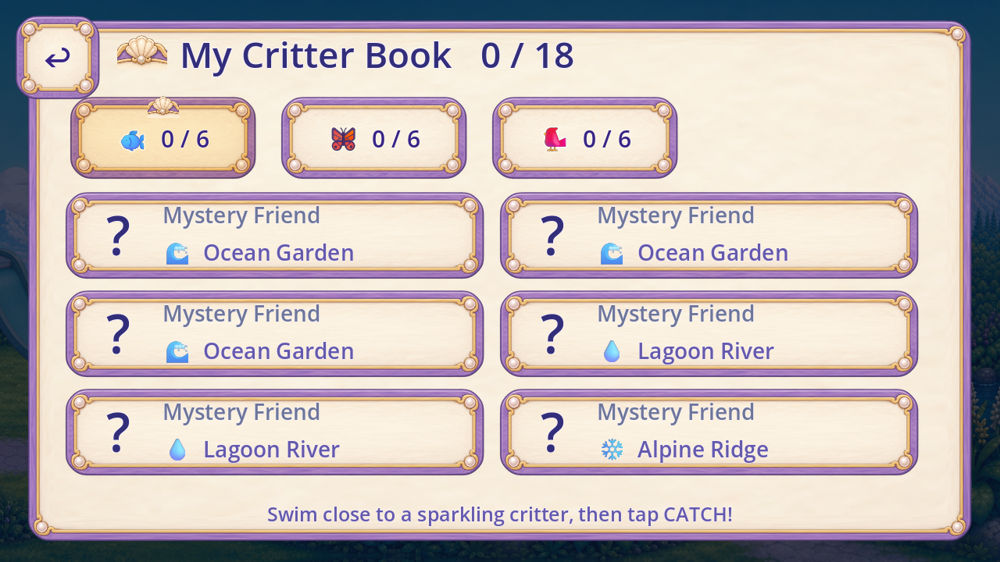
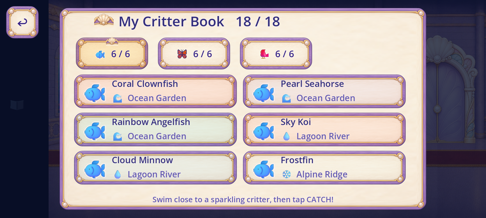

# R88 painted Critter Book runtime candidate

This source-bound work branch replaces the book's flat board/card/tab treatment with the existing painted card frame. It replaces the procedural fan/pearls and decorative title glyph with the existing painted shell crop. The title and help now have usable bounds; category buttons remain 242x110, six cards use two wider columns and three rows with 388px text slots, and unknown-card names rise to the 28px child-state floor. Semantic category/habitat glyphs remain an open art and packaged-font lane.

[Published current context](https://github.com/Ebonyks/mermaid-roshan-reef/tree/bb30d505500a7b737115f694e69e02b35efddb85/docs/handoffs/codex_flat_vector_art_2026-10-07/r87_critter_navigation_context) documents the failing title/help widths and same-scene neighbors before implementation. [Source prerequisite verification](CONTEXT_PREREQUISITE.json), [reuse plan](REUSE_PLAN.json), [code protection](CODE_PROTECTION.json), [per-piece overlay](per_piece.json), [coverage](scene_coverage.json) and [tally](tally.json) preserve stable IDs and evidence lanes. Full-panel fit and earlier compact-card trials retain their historical limits; no source artwork is generated or edited.

Exact Godot 4.7.2 import and changed-script analysis pass. Eight current combined-source cases pass 606 native checks and retain 100 frames at both widths. They cover actual fresh controls, synthetic 6/18 and18/18 saved consumers, measured text expansion/restoration, notifications/reload and native focus/pressed/hover/disabled state review. The unmodified full local82-probe CI passes with82 unique zero exits and exact source/sidecar/normal11 guards. [Full result](full_ci/FULL_CI_RESULT.json), [gates](GATES.json) and [partial review](REVIEW.json) separate machine evidence from acceptance. Final document/source-binding checks and anonymous immutable payload verification pass. Exact published-head remoteCI, integration and all acceptance lanes remain pending. Logical collection, save and input bodies remain unchanged; only book construction and its layer ordering change. The book is above captions and below global Back. Source/new-use, remaining glyph/caller coverage, formal QA11, device, child and owner acceptance remain separate. Accepted removals and dev integration remain zero; whole-game artwork/screen totals remain unknown.

The retained [attempt history](ATTEMPT_HISTORY.json) records the first shell-size bug, observer corrections, passing superseded 3-column views, and the expected 130% habitat expansion failure. The current reflow keeps the 28px habitat/unknown-name and 29px caught-name sizes; source category meanings, DEFS order and all collection/save/input functions remain unchanged.

The [navigation dependency](NAVIGATION_DEPENDENCY.json) copies only the exact three published runtime source files from PR35. Its earlier verification remains historical; the current eight-case evidence tests the combined four-script candidate. [Capture index](CAPTURE_INDEX.json) retains all249 raw frame events, including149 superseded/failed/earlier candidate events. Every new frame is excluded from current-dev coverage and accepted-removal counts. The trusted full local82 suite passed on this exact combined source pin.

The [navigation dependency](NAVIGATION_DEPENDENCY.json) copies only the exact three published runtime source files from PR35. Its earlier verification remains historical; the current eight-case evidence tests the combined four-script candidate. [Capture index](CAPTURE_INDEX.json) retains all349 raw frame events, including249 superseded/failed/earlier candidate events. Every new frame is excluded from current-dev coverage and accepted-removal counts. The trusted full local82 suite passed on this exact combined source pin.

Actual combined-source1280book:

Actual full saved consumer at1600:

The source category/habitat emoji are visibly incongruent with the painted frame; they remain explicit follow-up artwork/font/recognition work. This frame/layout implementation does not claim zero art in the whole book, all shared-role consumers or the game.

[Same-scene ambient follow-up](AMBIENCE_SOURCE_FOLLOWUP.json): a faint procedural book remains at the outer margin; existing catalogue book/bubble/idlefish roles require their own exact ownership/state closure. No shared-ambience or whole-book removal is claimed.

The [first unchanged full CI](full_ci_attempt1/FULL_CI_RESULT.json) retained81zero exits and one failed UI crest-hook assertion. The actual painted TextureRect now preserves CritterBookShellCrest; the trusted probe is unchanged. [Focused UI evidence](crest_ui_target/RESULT.json) passes, and the renewed full CI is the separate current source result. [Prior source/fixture mapping](ATTEMPT5_SOURCE_AND_FIXTURES.json) and pre-engine execution-copy failure remain retained.

[Existing catalogue alias](CATALOGUE_ALIAS_BINDING.json): R62 already resolves game.critters as a reference-catalogue subsystem ID and partially binds its saved-book consumer. [Selected immutable prerequisites](R62_ALIAS_PREREQUISITE.json) were reverified anonymously. It remains separately overlapping with ui.collection and overlay.critter_book. Acquisition/dynamic/full-route scope remains open; this correction adds no coverage or artwork credit.

[Individual card consumers](CONSUMER_BINDINGS.json) trace all18existing saved-species keys to observed painted card material at both widths. These36native bindings reuse one material role; they add no artwork, role, family, frame or acceptance credit. Generic category pictures still lack individual species/child-meaning acceptance.

[Explicit catalogue membership](CURRENT_CATALOGUE_CONTEXT_UNION.json) carries the unchanged176overlapping labels:92with existing partial evidence,84without a slice,0complete. [Immutable prerequisites](CATALOGUE_UNION_PREREQUISITE.json) were byte-verified anonymously. Member evidence retains its original source/date; no all92current-dev refresh or distinct-screen denominator is implied.

[Stock visual advisory](VISUAL_ADVISORY_SCOPE.json) retains its separate UNSATISFIED state. Its scanner counts are not artwork or screen totals; local82-probe success never establishes game-wide visual or acceptance satisfaction.

[Remaining book source audit](NEXT_BOOK_REUSE_AUDIT.json) records5directly inspected existing images and their unresolved isolation/pose/approval/scale limits. No new sample, drawing, runtime change or acceptance is claimed. The old atlas page-fan sequence is unsuitable as a painted replacement.

Published review payload: [immutable tree](https://github.com/Ebonyks/mermaid-roshan-reef/tree/c524e0855559bf14e3f1c502b290baf90458a171/docs/handoffs/codex_flat_vector_art_2026-10-07/r88_critter_book_runtime), [direct manifest](https://raw.githubusercontent.com/Ebonyks/mermaid-roshan-reef/c524e0855559bf14e3f1c502b290baf90458a171/docs/handoffs/codex_flat_vector_art_2026-10-07/r88_critter_book_runtime/MANIFEST.json), [anonymous verification receipt](REMOTE_VERIFICATION.json). Every required manifest file was fetched and byte-verified anonymously. This receipt is final metadata, verified separately at its own immutable commit. Publication grants no art, integration or device/child/owner acceptance.
