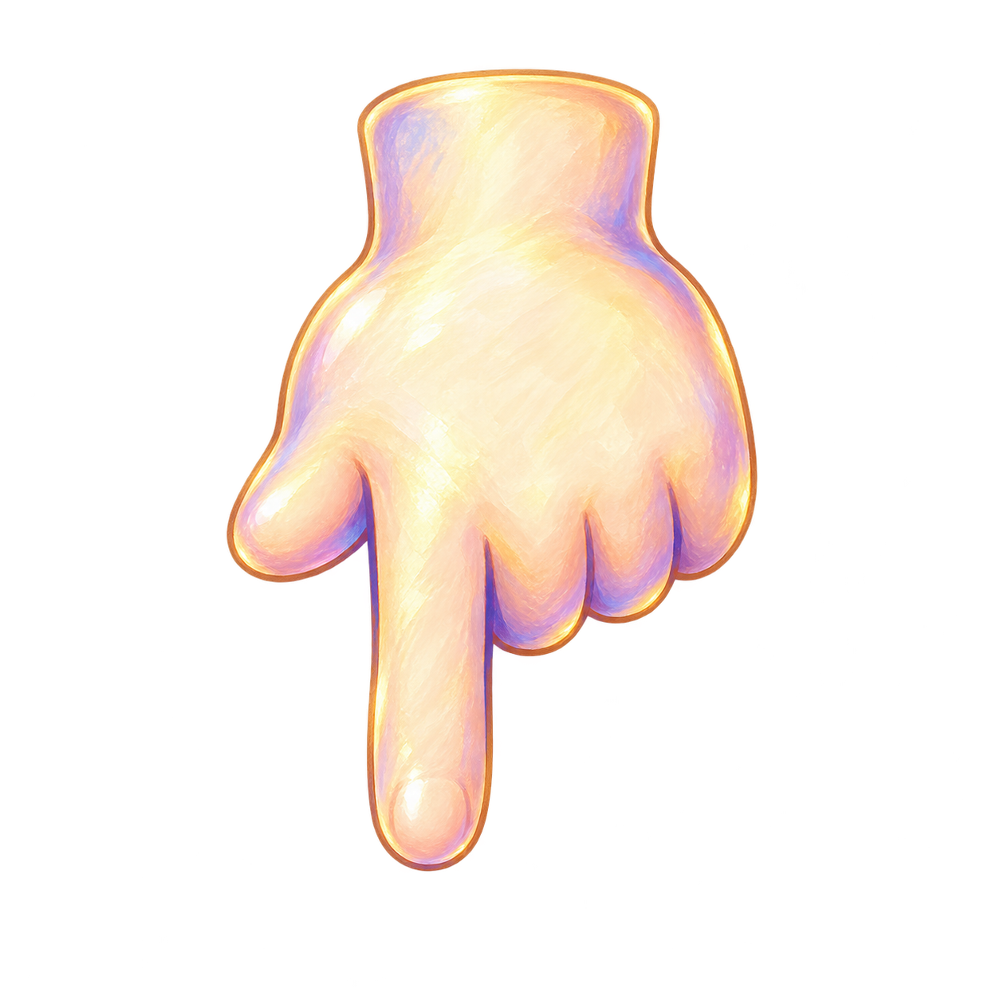

# R93 — first painted Skyway hand candidate

The owner authorized the two exact public inputs for the bounded hand job. Built-in ImageGen produced this first actual replacement candidate in one call. Approved-region reuse had already failed the standalone-hand quality requirement; the originals remain untouched.

This is an unmodified 1254×1254 RGBA source candidate. Its painted ivory/gold and lavender material is a closer preliminary fit to the exact [Skyway reference](https://raw.githubusercontent.com/Ebonyks/mermaid-roshan-reef/1b771fafcc68506eed8212a1cc9b5981bc25b0a2/docs/handoffs/codex_flat_vector_art_2026-10-07/r72_skyway_hand_reuse/native/attempt2_flat_1280/06_reentry_hint_registered.png). It retains the left thumb, three curled fingers and uniquely lowest down index. The gold rim, faint low-alpha speckles, native-size readability and fingertip registration require review. A compliant ≤1024 or power-of-two runtime copy is still needed; the original generated master is preserved.

[Authorization](OWNER_AUTHORIZATION.json), [exact prompt](PROMPT.txt), [provenance](GENERATION.json), [technical inspection](TECHNICAL_REVIEW.json), [ten-axis comparison](CONGRUENCY_REVIEW.json), [per-piece](per_piece.json), [scene coverage](scene_coverage.json), [tally](tally.json), [summary](SUMMARY.json). One of at most two takes used; no second take for novelty.

No game files or protected originals changed. One new unaccepted candidate for existing stable role `FVR-47ADC102790E`; zero new roles, families, current runtime captures, integrations or accepted removals. The source-bound R72 capture remains a style reference, not newly current gameplay evidence. Formal QA11, runtime, device, child, owner, other callers/fallbacks and unknown whole-game inventory remain open.

Delivery: [immutable candidate payload](https://github.com/Ebonyks/mermaid-roshan-reef/tree/88ff2a795a5796a44b1b2857874808534fcf0391/docs/handoffs/codex_flat_vector_art_2026-10-07/r93_painted_hand_candidate), [direct manifest](https://raw.githubusercontent.com/Ebonyks/mermaid-roshan-reef/88ff2a795a5796a44b1b2857874808534fcf0391/docs/handoffs/codex_flat_vector_art_2026-10-07/r93_painted_hand_candidate/MANIFEST.json), [anonymous byte-verification receipt](REMOTE_VERIFICATION.json). Every declared required file was checked at this exact payload; final own receipt metadata is checked separately.

The separate [painted insect-tab source candidate](https://github.com/Ebonyks/mermaid-roshan-reef/tree/92822aaf5f381e623dacf1a9dff0e20f82306c4a/docs/handoffs/codex_flat_vector_art_2026-10-07/r91_critter_insect_tab_runtime) is also now published:750native checks/100current frames and82local trusted probes pass; all306direct required files are anonymously byte-verified. Its28historical trial frames remain excluded. This is one additional bounded source artifact, with remote exact-head CI and all acceptance pending. [Evidence](R91_PRODUCTION_EVIDENCE.json). The earlier [DevF retry](DEV_CI_FINAL.json) completed successfully on attempt2; the original55minute cancellation remains historical. No exactFAPK claim or visual acceptance follows.
