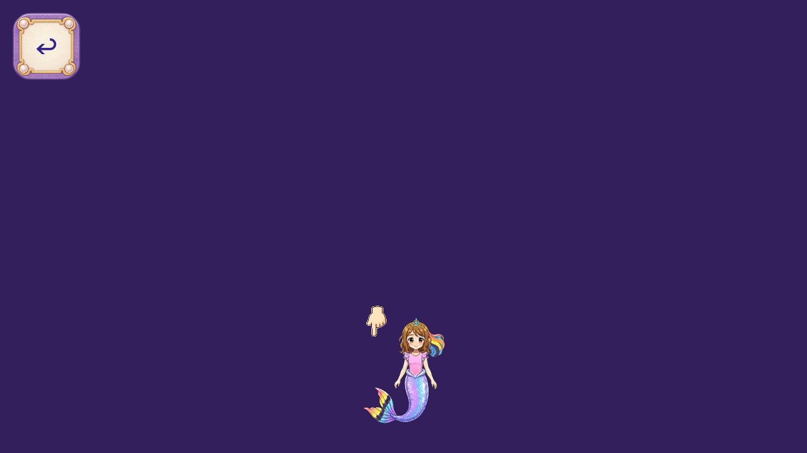
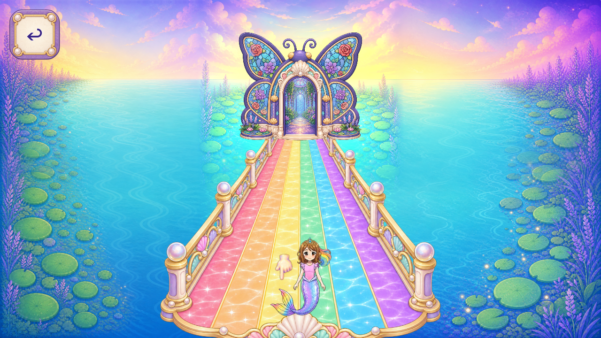
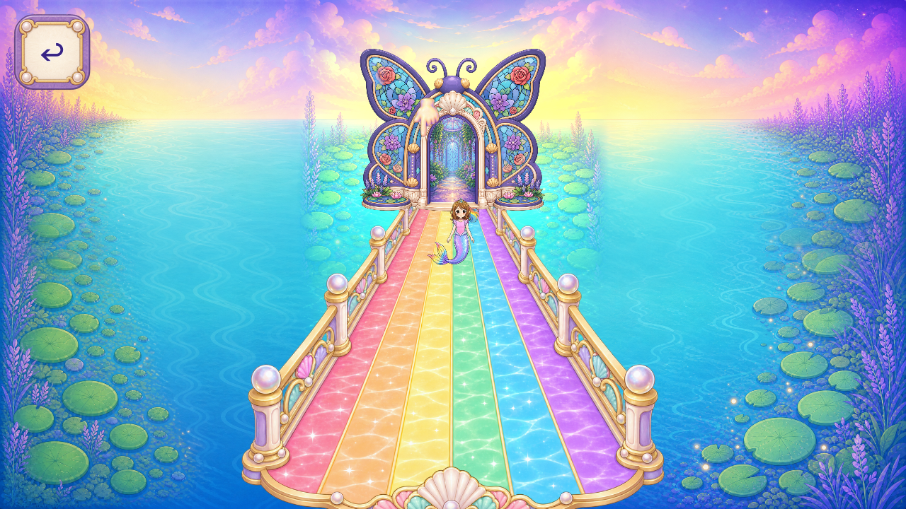

# R94 — painted hand native fit and Dev insect-tab integration

The existing first painted hand now has a source-bound native fit. Six actual Godot 4.7.2 Mobile/Speedy cases pass 138 checks at 1280×720 and 1600×720. No new art was generated: the same R93PNG is rendered byte-for-byte, with mipmaps and Sprite2D scale/offset only. The preferred 36px fit is close to the original 32px cue; the bulky 49px trial is retained as an unselected diagnostic. This is a review candidate, not a shipped hand replacement.

Actual sourceF still has the known R70backdrop occlusion: the scene artwork is hidden. The painted-neighbor images below deliberately reuse the existing R70layout proposal so the hand can be judged beside its intended pearl/gold/rainbow neighbors. That background fix is not integrated or accepted by this hand preview.

[Raw frames and measured natural bob cycles](CAPTURE_INDEX.json), [ten-axis/direct-view review](CONGRUENCY_REVIEW.json), [exact scene/reference hashes](SCENE_REFERENCE_BINDINGS.json), [source binding](SOURCE_BINDINGS.json), [first-fit disposition](FIT_REVIEW_A1.json), [per-piece](per_piece.json), [coverage](scene_coverage.json), [tally](tally.json), [summary](SUMMARY.json).

The hand fingertip stays inside original touch regions throughout full natural bob cycles and advances all three original waypoint actions. Original hero, targets, controller, state/clock, source pixels and normal-save hashes remain unchanged. House activation/return/reentry, all callers/fallbacks, runtime-size export, formalQA11, phone performance/touch, child and owner review remain open. The raw 1254-square master is still not a compliant runtime texture; direct PNG lab loading is not Android export proof.

The separate [insect-tab PR37](https://github.com/Ebonyks/mermaid-roshan-reef/pull/37) is merged on Dev at `39b0e158db7de3d0c178c4444f97c04fda75bec5`. Exact-head source-push CI succeeded; the redundant PR run hit the confirmed 55-minute ceiling after mandatory steps succeeded and is retained as cancelled, never relabeled green. Normal integration uses the green exact workbranch head. [Integration](r91_integration/DEV_INTEGRATION.json), [CI reconciliation](r91_integration/CI_RECONCILIATION.json), [anonymous Dev/source verification](r91_integration/DEV_REMOTE_VERIFICATION.json), [new Dev CI observation](r91_integration/DEV_CI_OBSERVATION.json). The new Dev APK is not verified yet.

There are now three integrated partial code artifacts and four published bounded source artifacts; zero complete artwork roles/families or accepted removals. The hand remains one existing unaccepted drawing candidate, one total generation call. 36 raw frame events are not36screens or artworks:16 current-source controls and10 selected nonproduction candidate-context frames are bounded;10 unselected 49px diagnostics are excluded. Global inventory and all acceptance gaps remain open.

Reproduce from immutable sourceF using the six included GDScript files copied to ignored`export/flat_vector_r94/` in an isolated clone. Run the supplied `capture_hand.gd` or `capture_hand_context.gd` with exact engine, Mobile and a fresh `R94_OUT`, `R94_WIDTH`, `R94_VARIANT`, `R94_REV`, `R94_NORMAL_BASE` and `R94_CANDIDATE` as recorded in each actual LAUNCH.json. Use only an own synthetic profile; never copy real child saves/drawings. Included operation scripts/pins record the actual host paths and guards; the GitHub packet is the delivery, not those staging paths.
