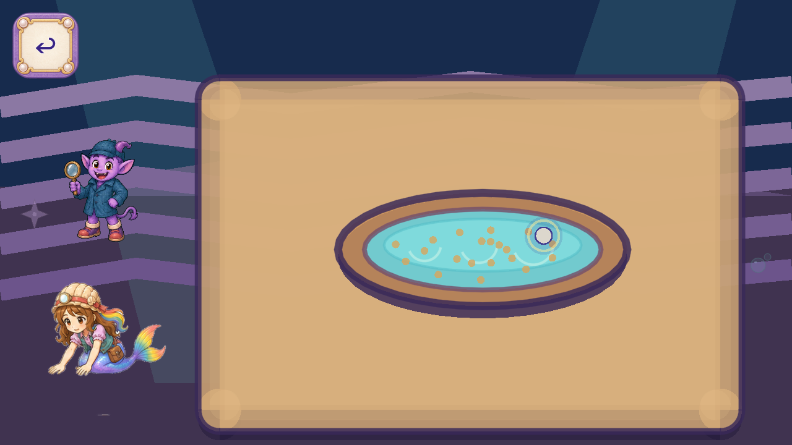
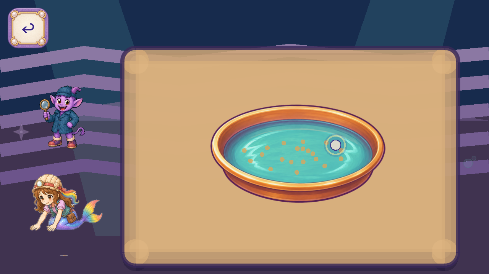
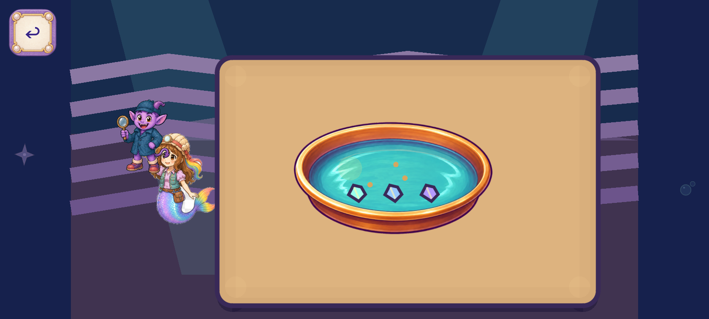

# Current runtime publication status

The painted pan is implemented on the actual source branch. Exact Godot4.7.2 import and all82 trusted probes pass through the repository probe-by-probe route on reconciled `1a4e8a1ceae29b401d63900a57a531b2f4442ba8`; [result](validation_reconciled/FINAL_RESULT.json), [status](PRODUCTION_STATUS.json), [manifest](MANIFEST.json). The original scripts/ci.sh run remains FAIL and is preserved separately. The pan code/source PNG remain identical after declared Git LF/CRLF normalization; no new art was generated here. Exact-head remoteCI and Dev integration remain pending. FormalQA11/device/child/owner acceptance remains open.

# R95 — painted Geologist washing pan

A focused production replacement for `FV-F2DE53A80AA7`: the live pan's nested flat ellipses/arcs are replaced by one complete existing painted bronze/aqua pan. The raw source is preserved unchanged; Godot builds a lossless texture with a 1024 size limit and mipmaps. The runtime region and uniform fit preserve its complete painted contour. Original touch rectangle, one-finger washing, sediment/mineral progression, callbacks and save keys remain unchanged.

The owner now prioritizes polished painted artwork across every job game and removed the former generation-saving/failed-reuse prerequisite. [Direction and scoped coordination](OWNER_PRIORITY.json). This complete source meets the selected pan brief; no new ImageGen call or model-version claim is made.

Four actual source/candidate native cases at1280x720 and1600x720 pass106 checks, with16 valid frame events. The runtime texture is1024 square. [Raw captures and input/progression checks](CAPTURE_INDEX.json), [seven exact direct frame views and ten-axis comparison](CONGRUENCY_REVIEW.json). Full trustedCI and final publication remain in progress. This draft is not an integrated Dev change or artwork acceptance. The original Main library-room launcher and a declared own synthetic saved-PAN checkpoint supply context; this is not naturally earned whole-route proof or formal QA11. Wrong-stage and occluded preliminary setup frames are retained separately and excluded from artwork and coverage claims.

The surrounding flat cave/workspace, sediment, minerals and other weak job-game art remain repair targets. Phone, child, owner, formal QA11, all callers/variants and unknown whole-game inventory remain open. Green machine tests never establish accepted artwork removal.

