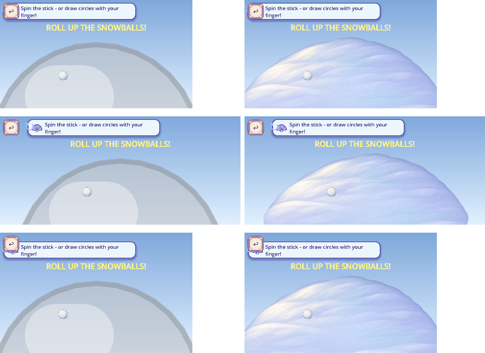
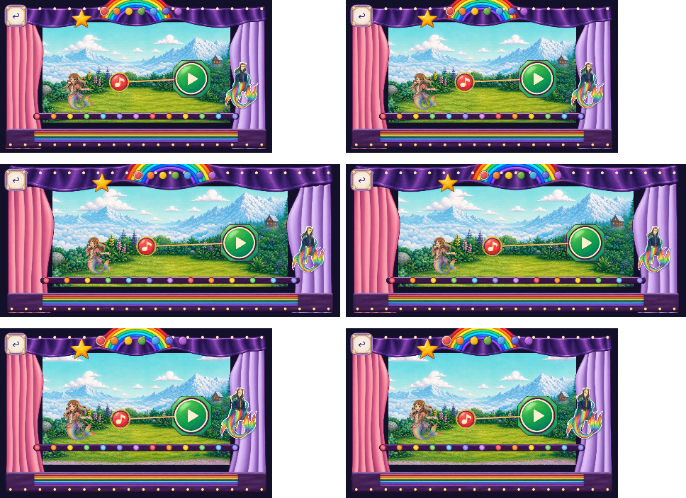

# Recent updates and painted snowfield — 2026-11-03

The owner directed all recent completed updates to Dev and continued art production. This combined candidate is locally validated; exact-head remote CI and Dev integration remain pending. Master promotion is outside this task.

The pending merge preserves27 immutable source heads:26 recent source updates and the other chat's published Dev-open policy correction. Original failed/cancelled runs, rejected studies, source-only prototypes, and scoped book/music/animation permissions remain unchanged. [Source selection](SOURCE_SELECTION.json), [merge parents](SOURCE_MERGE_PARENTS.json), [policy source](POLICY_SOURCE_COMPOSITION.json).

R133 (FV-55B5EF60A12C) replaces only the Snowman ground with one painted native2048-square master and four1024 cards. Its current neighbors include the recent painted body and coal. The original functional geometry, one-finger mechanics, save keys, voices and rewards remain. [R133 material and provenance](../codex_flat_vector_art_2026-10-07/r133_snowfield_runtime/PLAN.json), [composition](R133_COMPOSITION.json).

The ten independently authored Melody roles now coexist. Forty deterministic runtime exports keep the original23MiB decoded/12MiB declared-upload limits:23,673,956 and10,894,436 bytes measured by the actual closed scene census, including all21 preloaded pip states. The native2K background tiles remain exact. Painted-note alpha is centered on the unchanged84pxpicture/120pxhit target. [Exports](MELODY_RUNTIME_EXPORTS.json), [registration](MELODY_NOTE_REGISTRATION.json), [combined contract](MELODY_COMBINED_CONTRACT.json).

Actual Godot4.7.2 Mobile/Speedy paired captures pass all12 cases with2,184 configured checks:174 bounded native events and16 excluded fixture-failure events, retained separately.29 comparison boards expose174 phone views, all inspected by the agent, plus7 native views. These are source-bound configured scenes and squint derivatives, not physical-device or formalQA11 evidence. [Frame index](context/FRAME_INDEX.json), [visual review](COMBINED_VISUAL_REVIEW.json), [ten axes](TEN_AXIS_COMPARISON.json), [fixture histories](FIXTURE_VERSIONS.json).

Snowfield scene comparison, with the source and painted candidate shown across three aspect ratios:

The combined painted Melody stage in the same scene comparison:

The original R133 premerge54bounded/64excluded events retain their original scope. Neither screenshots, technical exports, machine passes nor publication establish accepted artwork removal. Unknown whole-game denominators and all required formalQA11/device/child/owner gates remain open. Existing floating/contact, chase clipping and shared HUD/reentry weaknesses remain visible and separately unresolved.

Import, focused combined Melody, original80-test2D-auditor suite and15-test development-audit suite pass. Full current static/all82/analyzer/2D validation passes on7748frozen runtime inputs with normal saves unchanged. Exact-head remote CI, anonymous delivery verification and Dev integration remain pending. [Actual validation](validation/FINAL_RESULT.json), [delivery manifest](MANIFEST.json). [Plan](PLAN.json), [telemetry-only capture applicability](TELEMETRY_CONTEXT_APPLICABILITY.json).

The initial full static run stopped at an inconsistent audio-ledger summary hash. Fresh regeneration matched all 862 current CSV rows exactly. Only the summary hash pointer was repaired; recordings, provisional grades and listening acceptance were unchanged. The passed prefix and failed attempt are retained, and validation resumes at that exact check. [Repair evidence](AUDIO_LEDGER_RECONCILIATION.json).

The broad game check initially retained obsolete full-size actor/curtain bindings and a four-child proscenium. Its exact failed source and diagnosis are preserved. The updated test pins the composed painted stage and runtime exports, compares the curtain RGBA crops exactly, retains transform/clip/ordering/identity requirements, and rejects seven deliberately broken fixtures. The full-game check passes; production pixels and behavior are unchanged. [Binding repair](BROAD_THEATER_RECONCILIATION.json).

The first final 2D inventory check correctly rejected the disposable diagnostic copy under the project export folder. That executable copy was moved outside the project after its exact bytes were preserved as evidence. No runtime input, ignore rule, ceiling or validator was changed. Only the failed inventory check is repeated; the passing static, 82 game and five analysis checks retain their original records. [Placement repair](DIAGNOSTIC_PLACEMENT_REPAIR.json).

## Later bounded provenance index

The original SourceA payload and this historical manifest are bound to immutable revision fe0660adced29fac3ae50737c0f829f400c856ab. Retrieve its manifest and payload files at that revision; the original anonymous verification receipt retains their exact bytes. On the later R134 work branch, SOURCE_ORIGINS.json is a smaller current-material index. Its exact1342 material row objects are retained, and its immutable link preserves the original10.8MB preview, all13142 rows and11800 historical paths without repeating that archive in each new delivery. The original preview remains labeled as a preview. This maintenance changes no runtime, detector limit, approval, Dev or accepted-artwork claim.
